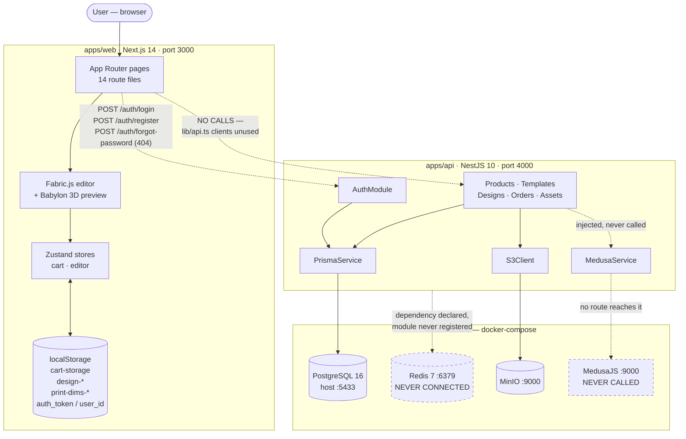
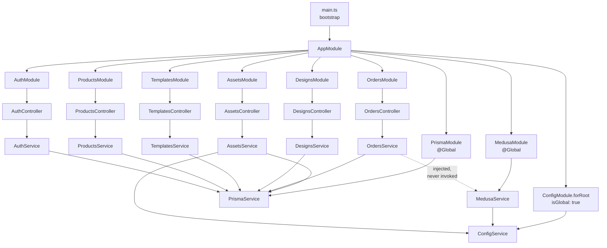
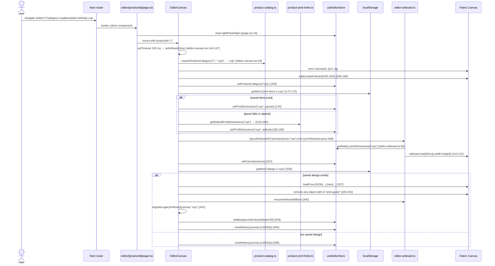
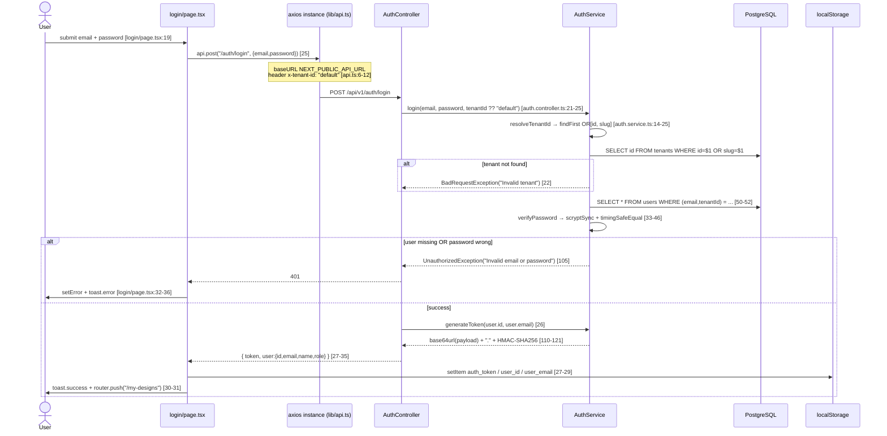
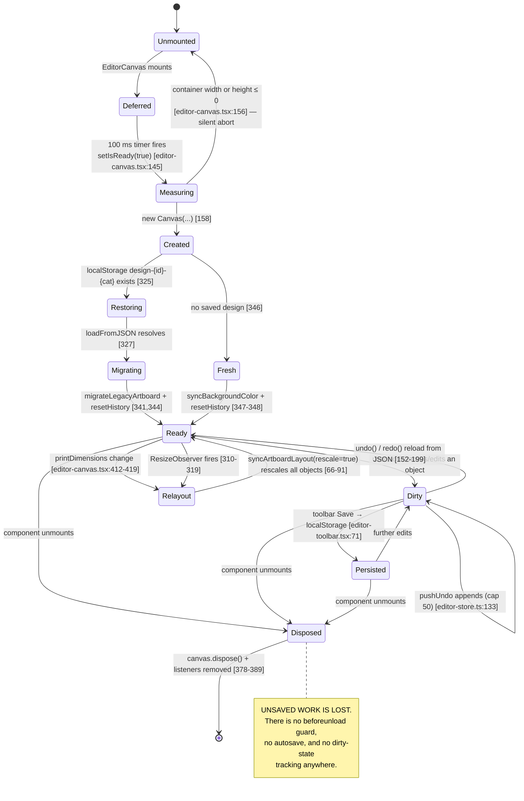
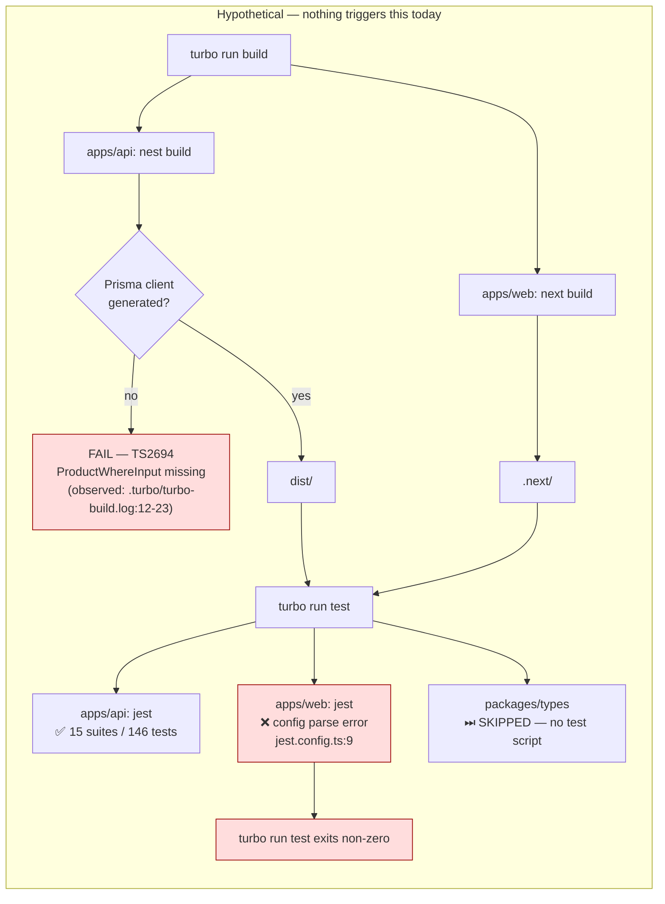

# 07 — Architecture Documentation

[← Index](./00-index.md)

## 7.1 The architectural style actually in evidence

There are **two different architectures** in this repository, and the boundary between them is not connected.

### Backend: layered / modular monolith, consistently applied

Every one of the six feature modules has exactly the same three-file shape:

| Module | Module file | Controller | Service |
|--------|------------|-----------|---------|
| Auth | `apps/api/src/modules/auth/auth.module.ts:5-10` | `auth.controller.ts` | `auth.service.ts` |
| Products | `products.module.ts:5-10` | `products.controller.ts` | `products.service.ts` |
| Templates | `templates.module.ts:5-10` | `templates.controller.ts` | `templates.service.ts` |
| Designs | `designs.module.ts:5-10` | `designs.controller.ts` | `designs.service.ts` |
| Orders | `orders.module.ts:5-10` | `orders.controller.ts` | `orders.service.ts` |
| Assets | `assets.module.ts:5-10` | `assets.controller.ts` | `assets.service.ts` |

The layers are: **HTTP (controller) → business logic (service) → data (PrismaService/S3Client/Medusa client)**. There is no repository layer, no domain-entity layer, and no DTO layer — services call Prisma directly (`apps/api/src/modules/products/products.service.ts:33`, `designs.service.ts:16`, `orders.service.ts:13`).

**Boundary enforcement: convention only.** Nothing prevents a controller from importing `PrismaService` directly; it simply never does. There is no lint rule, no dependency-cruiser config, and no architectural test.

**Where the layering is violated:** `apps/api/src/modules/products/products.service.ts:3,16,78,85` imports Prisma's generated `Prisma.ProductWhereInput` / `ProductCreateInput` / `ProductUpdateInput` types into the *service's public signature*. That means the ORM's type surface leaks into the layer above it, and — as `apps/api/.turbo/turbo-build.log:12-23` proves — a stale generated client breaks compilation of the business layer. No other service does this; the four others use hand-written inline parameter types (`designs.service.ts:25-30`, `orders.service.ts:35-46`, `templates.service.ts:53-60`, `assets.service.ts:50-57`).

### Frontend: by-type folders with an ad-hoc, store-centric editor core

There is no clean architecture, no MVVM, and no feature-first layout. The pattern that actually governs the editor is:

**A single Fabric `Canvas` instance is the source of truth, held in a Zustand store, and every component reaches into it imperatively.**

- The canvas is created once in `apps/web/src/components/editor/editor-canvas.tsx:158-164` and published globally via `useEditorStore.getState().setCanvas(canvas)` (`editor-canvas.tsx:322`).
- Every other editor component then pulls it back out: `editor-toolbar.tsx:32`, `editor-left-panel.tsx:97,165,240,316,421,488,589`, `editor-right-panel.tsx:205,611,789,903`, `editor-3d-preview.tsx:104`.
- Mutations are direct Fabric calls (`canvas.add(...)`, `object.set(...)`, `canvas.renderAll()`), followed by a manual `pushUndo(JSON.stringify(canvas.toJSON()))`.

This is a **shared-mutable-object architecture**, not a unidirectional data flow. React state is only used to *mirror* the canvas for display purposes, which is precisely why BUG-P01 happened (see [13](./13-historical-bug-report.md#bug-p01)) and why two components carry `const [, forceUpdate] = useState(0)` (`editor-right-panel.tsx:206`, `editor-left-panel.tsx:590`).

### What is explicitly **Not present**

Clean/hexagonal architecture, MVC, MVI, BLoC, Redux-style reducers, atomic design, microservices, event sourcing, CQRS, a domain layer, a repository layer, DTO classes, mappers, a service locator, a DI container beyond Nest's own, feature flags, and a plugin system.

---

## 7.2 System context diagram



**Reading the dashed edges:** the only live network path between the two applications is three auth endpoints. Everything else in the frontend reads hardcoded arrays or `localStorage`.

---

## 7.3 Module dependency graph — backend



**Cycles: none.** The graph is a strict DAG. Verified by reading every `import` statement in `apps/api/src`.

**Note on `@Global()`:** `PrismaModule` (`apps/api/src/common/prisma/prisma.module.ts:4`) and `MedusaModule` (`apps/api/src/common/medusa/medusa.module.ts:4`) are global, which is why `OrdersModule` can inject `MedusaService` without importing `MedusaModule` (`apps/api/src/modules/orders/orders.module.ts:5-10` lists no imports). This works, but it hides the dependency from the module declaration — a legitimate architectural criticism.

---

## 7.4 Module dependency graph — frontend

```mermaid
graph TD
    subgraph routes["app/ — routes"]
        Home["page.tsx"]
        Products["(shop)/products/page.tsx"]
        Detail["(shop)/products/[id]/page.tsx"]
        Templates["(shop)/templates/page.tsx"]
        Cart["(shop)/cart/page.tsx"]
        Checkout["(shop)/checkout/page.tsx"]
        MyDesigns["(shop)/my-designs/page.tsx"]
        Login["(auth)/auth/login/page.tsx"]
        Register["(auth)/auth/register/page.tsx"]
        Forgot["(auth)/auth/forgot-password/page.tsx"]
        EditorPage["(editor)/editor/[productId]/page.tsx"]
    end

    subgraph comps["components/"]
        Navbar["layout/navbar"]
        Footer["layout/footer"]
        Button["ui/button"]
        Input["ui/input"]
        Card["ui/card<br/>ZERO IMPORTS"]
        Toolbar["editor/editor-toolbar"]
        LeftPanel["editor/editor-left-panel"]
        Canvas["editor/editor-canvas"]
        RightPanel["editor/editor-right-panel"]
        Preview3D["editor/editor-3d-preview"]
        PrintPanel["editor/print-area-panel"]
    end

    subgraph libs["lib/"]
        ApiLib["api.ts"]
        Utils["utils.ts"]
        Artboard["editor-artboard.ts"]
        FabObj["fabric-objects.ts"]
        Viewport["canvas-viewport.ts"]
        Catalog["product-catalog.ts"]
        Limits["product-print-limits.ts"]
        Tmpl["editor-templates.ts"]
        P3D["product-3d.ts"]
    end

    subgraph stores["store/"]
        CartStore["cart-store"]
        EditorStore["editor-store"]
    end

    Home --> Navbar & Footer
    Products --> Navbar & Footer & Button
    Detail --> Navbar & Footer & Button
    Templates --> Navbar & Footer
    Cart --> Navbar & Footer & Button & CartStore
    Checkout --> Navbar & Button & Input & CartStore
    MyDesigns --> Navbar & Footer & Button
    Login --> Button & Input & ApiLib
    Register --> Button & Input & ApiLib
    Forgot --> Button & Input & ApiLib
    Navbar --> CartStore

    EditorPage --> Toolbar & LeftPanel & Canvas & RightPanel & Preview3D & EditorStore

    Toolbar --> EditorStore & CartStore & Artboard & Catalog & Viewport & Button
    LeftPanel --> EditorStore & Artboard & FabObj & Catalog & Tmpl & Utils
    Canvas --> EditorStore & Viewport & Artboard & FabObj & Catalog & Limits
    RightPanel --> EditorStore & Catalog & PrintPanel & Button & Input
    PrintPanel --> EditorStore & Limits & Catalog & Button & Input
    Preview3D --> EditorStore & Artboard & P3D & Catalog & Button

    Artboard --> Catalog
    Artboard ==>|"LAYERING<br/>VIOLATION"| EditorStore
    FabObj --> Artboard
    Tmpl --> Artboard & Catalog
    Limits --> Catalog
    P3D --> Catalog & Limits
    EditorStore --> Catalog & Limits
    Button --> Utils
    Input --> Utils
    Card --> Utils

    style Card stroke-dasharray: 5 5
```



### Cycles

**One import cycle exists:**

```
store/editor-store.ts
  → lib/product-print-limits.ts   (editor-store.ts:5-7)
      → lib/product-catalog.ts     (product-print-limits.ts:1-2)

lib/editor-artboard.ts
  → store/editor-store.ts          (editor-artboard.ts:4)
      → lib/product-print-limits.ts
          → lib/product-catalog.ts
```

`editor-artboard.ts → editor-store.ts → product-print-limits.ts → product-catalog.ts` is not itself circular, but `editor-artboard.ts` importing the store while `editor-templates.ts` and `fabric-objects.ts` import `editor-artboard.ts` means the store is transitively pulled into every editor utility. **`fabric-objects.ts` and `editor-templates.ts` therefore cannot be unit-tested without instantiating the Zustand store.** ES module hoisting keeps this from throwing at runtime, but it is a genuine coupling defect.

---

## 7.5 Architectural inconsistencies — named files

| # | Inconsistency | Offending file(s) | Detail |
|---|--------------|-------------------|--------|
| 1 | **A pure geometry module depends on global UI state** | `apps/web/src/lib/editor-artboard.ts:4,92-93,105` | `getActivePrintSize()` and `layoutArtboardInCanvas()` call `useEditorStore.getState()`. Consumers cannot inject a different print size. |
| 2 | **A function parameter is accepted and then explicitly discarded** | `apps/web/src/lib/editor-artboard.ts:28-32` | `getArtboardBounds(canvas, category?)` does `void category;` on line 32. All 9 call sites pass `category` believing it matters. This is a leftover from a refactor where bounds stopped being category-dependent. |
| 3 | **Business logic lives in a UI event handler** | `apps/web/src/app/(shop)/cart/page.tsx:140,146,154-156` | Tax (10 %) and free-shipping threshold ($50) are re-derived inline in JSX, duplicating `apps/api/src/modules/orders/orders.service.ts:51-53` and `apps/web/src/app/(shop)/checkout/page.tsx:62-64`. **Three independent copies of the same pricing rule.** |
| 4 | **The presentation layer sets prices** | `apps/web/src/components/editor/editor-toolbar.tsx:54` | `unitPrice: 24.99` is hardcoded for every product regardless of what the user is designing. The 3D mug costs $12.99 in the catalogue. |
| 5 | **The ORM's generated types leak into service signatures** | `apps/api/src/modules/products/products.service.ts:3,16,78,85` | Only this service does it; the other four use hand-written types. |
| 6 | **Two components hold the same responsibility with different implementations** | `apps/web/src/components/editor/editor-left-panel.tsx:588-671` (`LayersPanel`) vs `apps/web/src/store/editor-store.ts:9-16,21,36-41,84-107` (`EditorLayer[]` + 5 layer actions) | The store defines a complete layer-management API (`setLayers`, `addLayer`, `removeLayer`, `updateLayer`, `reorderLayers`) that **nothing calls**. `LayersPanel` bypasses it entirely and reads `canvas.getObjects()` directly. The store's layer subsystem is 100 % dead — and `apps/web/tests/unit/store/editor-store.spec.ts:119-247` contains 10 tests exercising this dead code. |
| 7 | **Route groups exist but provide no layout isolation** | `apps/web/src/app/(auth)/`, `(shop)/`, `(editor)/` | None of the three has a `layout.tsx`. Each page re-imports and re-renders `<Navbar/>`/`<Footer/>` (or forgets to — `checkout/page.tsx` has no `<Footer/>`). |
| 8 | **Ownership checks are enforced in the service but the identity is unauthenticated** | `apps/api/src/modules/designs/designs.service.ts:19`, `orders.service.ts:29` | The pattern is architecturally right (service-level authorization) and operationally worthless (identity comes from an unverified header). |
| 9 | **Global mutable static set at module load** | `apps/web/src/components/editor/editor-canvas.tsx:29` | `FabricObject.customProperties = [...]` mutates a library global as a side effect of importing a React component. Load order determines correctness. |
| 10 | **Presentational primitives buried inside a feature file** | `apps/web/src/components/editor/editor-right-panel.tsx:97-147` (`NumberInput`), `:156-202` (`ColorPickerWithSwatches`), `:38-80` (`OpacityControl`) | These are generic and belong in `components/ui/`; instead they are unexported locals in a 954-line feature file. |

---

## 7.6 Data-flow sequences

### (a) Read path — loading the editor for a product



**Note:** no HTTP request occurs anywhere in this path. The editor never fetches the product, its category template, or its print constraints from the API.

### (b) Write path — adding a shape and persisting

```mermaid
sequenceDiagram
    actor U as User
    participant SP as ShapesPanel
    participant AB as editor-artboard.ts
    participant FC as Fabric Canvas
    participant ES as useEditorStore
    participant RP as EditorRightPanel
    participant P3 as Editor3DPreview
    participant BJ as Babylon scene
    participant TB as EditorToolbar
    participant LS as localStorage

    U->>SP: click "Rectangle"  [editor-left-panel.tsx:407]
    SP->>AB: getArtboardBounds(canvas) → {centerX,centerY}  [330]
    SP->>FC: add(placeAtCenter(new Rect(...)))  [336-339,393]
    FC-->>ES: fires "object:added"
    Note over FC: editor-canvas.tsx:255-261 handler<br/>normalizeObjectOrigin + ensureArtboardAtBack
    SP->>FC: setActiveObject(obj); renderAll()  [394-395]
    SP->>ES: pushUndo(JSON.stringify(canvas.toJSON()))  [396]
    ES->>ES: undoStack = [...slice(-49), state]; redoStack = []  [editor-store.ts:130-138]
    FC-->>RP: "selection:created" → forceUpdate  [editor-right-panel.tsx:218]
    RP->>RP: activeObject = canvas.getActiveObject()  [236]
    RP->>U: render "rect Properties" panel
    FC-->>P3: "object:added" → scheduleCapture  [editor-3d-preview.tsx:160-162]
    P3->>P3: debounce 400 ms  [151-154]
    P3->>AB: exportArtboardDataUrl(canvas, {multiplier})  [136-139]
    P3->>BJ: setDesignDataUrl(pngDataUrl)  [78]
    BJ->>BJ: dispose old Texture; new Texture(...); applyTexture  [product-3d.ts:570-601]
    BJ->>BJ: requestRender() → pendingFrames = 3  [632-634]

    U->>TB: click "Save"
    TB->>FC: canvas.toJSON()  [editor-toolbar.tsx:66]
    TB->>LS: setItem(`design-${productId}-${category}`, json)  [71]
    TB->>U: toast.success("Design saved! 💾")  [72]
```

### (c) Cross-boundary path — login (the only real client→server round trip)



**Critical observation:** the returned token is never sent back for verification. `apps/web/src/lib/api.ts:15-24` attaches it as `Authorization: Bearer <token>` *and* copies `user_id` into an `x-user-id` header — and the server reads only the latter, unverified.

---

## 7.7 State-lifecycle diagram — the editor canvas



---

## 7.8 Multi-tenancy architecture

The schema is genuinely multi-tenant, but the runtime is not.

| Layer | Tenant handling | Evidence |
|-------|----------------|----------|
| Schema | `tenantId` FK on `users`, `products`, `category_templates`, `design_templates`, `orders`; nullable on `assets` | `apps/api/prisma/schema.prisma:35,65,131,154,213,268` |
| Uniqueness | `@@unique([email, tenantId])`, `@@unique([slug, tenantId])` on products and category templates | `schema.prisma:45,77,139` |
| Transport | `x-tenant-id` request header | `apps/api/src/modules/products/products.controller.ts:27`, `templates.controller.ts:12`, `orders.controller.ts:40`, `assets.controller.ts:14,31`, `auth.controller.ts:19,42` |
| Frontend | Sends a **build-time constant**: `NEXT_PUBLIC_TENANT_ID` or `"default"` | `apps/web/src/lib/api.ts:4,10`; `apps/web/.env.local:2` |
| Resolution | Only `AuthService.resolveTenantId` translates a slug to an id and validates existence | `apps/api/src/modules/auth/auth.service.ts:14-25` |

**Three gaps:**

1. **`Design` has no `tenantId`.** `apps/api/prisma/schema.prisma:186-201` scopes designs only by `userId`. A design is therefore not tenant-isolated at the data layer.
2. **No tenant validation outside auth.** `ProductsController.findAll` passes the raw header straight into a `where` clause (`products.controller.ts:33` → `products.service.ts:17`). An unknown tenant id simply returns an empty list; a *valid* tenant id belonging to someone else returns their catalogue.
3. **`OrdersController.create` writes `tenantId` from the header with no check** that the authenticated user belongs to that tenant (`orders.controller.ts:40,44`). Combined with the forged `x-user-id`, cross-tenant order injection is possible.

---

## 7.9 Database (Phase 2.13)

**Engine:** PostgreSQL 16 (`docker-compose.yml:4`), accessed exclusively through Prisma 5.17 (`apps/api/src/common/prisma/prisma.service.ts:2`).

### Entity-relationship diagram

```mermaid
erDiagram
    TENANTS ||--o{ USERS : "has"
    TENANTS ||--o{ PRODUCTS : "has"
    TENANTS ||--o{ CATEGORY_TEMPLATES : "has"
    TENANTS ||--o{ DESIGN_TEMPLATES : "has"
    TENANTS ||--o{ ORDERS : "has"

    CATEGORY_TEMPLATES ||--o{ PRODUCTS : "categorises"
    CATEGORY_TEMPLATES ||--o{ DESIGN_TEMPLATES : "categorises"

    PRODUCTS ||--o{ PRODUCT_VARIANTS : "has (cascade)"
    PRODUCTS ||--o{ PRODUCT_IMAGES : "has (cascade)"
    PRODUCTS ||--o{ PRODUCT_DESIGN_TEMPLATES : "junction (cascade)"
    DESIGN_TEMPLATES ||--o{ PRODUCT_DESIGN_TEMPLATES : "junction (cascade)"

    USERS ||--o{ DESIGNS : "owns"
    USERS ||--o{ ORDERS : "places"
    ORDERS ||--o{ ORDER_ITEMS : "contains (cascade)"
    DESIGNS ||--o{ ORDER_ITEMS : "referenced by (restrict)"

    TENANTS {
        string id PK "uuid"
        string name
        string slug UK
        string domain UK "nullable"
        json settings "default {}"
        datetime createdAt
        datetime updatedAt
    }

    USERS {
        string id PK "uuid"
        string email "unique per tenant"
        string name "nullable"
        string avatarUrl "nullable"
        enum role "ADMIN|MERCHANT|CUSTOMER, default CUSTOMER"
        string tenantId FK
        string medusaId UK "nullable, never written"
        string passwordHash "nullable, scrypt salt:hash"
        datetime createdAt
        datetime updatedAt
    }

    PRODUCTS {
        string id PK "uuid"
        string name
        string description "nullable"
        string slug "unique per tenant"
        decimal basePrice "10,2"
        string currency "default USD, never read"
        enum status "DRAFT|ACTIVE|ARCHIVED, default DRAFT"
        string medusaId UK "nullable, never written"
        string tenantId FK
        string categoryId FK
        json metadata "default {}"
        datetime createdAt
        datetime updatedAt
    }

    PRODUCT_VARIANTS {
        string id PK "uuid"
        string productId FK
        string name
        string sku UK "globally unique"
        decimal price "10,2"
        json options "default {}"
        int inventory "default 0"
        string medusaId UK "nullable"
    }

    PRODUCT_IMAGES {
        string id PK "uuid"
        string productId FK
        string url
        string alt "nullable"
        int position "default 0"
    }

    CATEGORY_TEMPLATES {
        string id PK "uuid"
        string name
        string slug "unique per tenant"
        string description "nullable"
        int canvasWidth
        int canvasHeight
        int printAreaX "default 0"
        int printAreaY "default 0"
        int printAreaWidth
        int printAreaHeight
        json supportedMaterials "default []"
        json availableColors "default []"
        json pricingRules "default {}, never read"
        json validationRules "default {}, never read"
        string thumbnailUrl "nullable"
        string tenantId FK
        datetime createdAt
        datetime updatedAt
    }

    DESIGN_TEMPLATES {
        string id PK "uuid"
        string name
        string categoryId FK
        string thumbnailUrl "nullable"
        json previewImages "default []"
        json canvasData "Fabric JSON"
        json lockedLayers "default [], never read"
        stringarray tags "default []"
        enum visibility "PUBLIC|PRIVATE|SHARED|MERCHANT"
        string createdBy "nullable, never written"
        string tenantId FK
        string version "default 1.0"
        json metadata "default {}"
        datetime createdAt
        datetime updatedAt
    }

    PRODUCT_DESIGN_TEMPLATES {
        string productId PK-FK
        string templateId PK-FK
    }

    DESIGNS {
        string id PK "uuid"
        string name
        string userId FK
        string productId "nullable, NO FK CONSTRAINT"
        json canvasData "Fabric JSON, unbounded"
        string thumbnailUrl "nullable"
        enum status "DRAFT|FINALIZED|ORDERED, default DRAFT"
        datetime createdAt
        datetime updatedAt
    }

    ORDERS {
        string id PK "uuid"
        string userId FK
        string tenantId FK
        enum status "PENDING|PAID|PROCESSING|PRINTING|SHIPPED|DELIVERED|CANCELLED|REFUNDED"
        decimal subtotal "10,2"
        decimal tax "10,2 default 0"
        decimal shippingCost "10,2 default 0"
        decimal total "10,2"
        string currency "default USD"
        string medusaOrderId UK "nullable, never written"
        json shippingAddress "nullable"
        json billingAddress "nullable"
        string paymentMethod "nullable, never written"
        datetime createdAt
        datetime updatedAt
    }

    ORDER_ITEMS {
        string id PK "uuid"
        string orderId FK
        string designId FK
        int quantity
        decimal unitPrice "10,2 CLIENT-SUPPLIED"
        json options "default {}"
    }

    ASSETS {
        string id PK "uuid"
        string filename
        string mimeType
        int size
        string url
        string s3Key
        string uploadedBy "nullable, NO FK CONSTRAINT"
        string tenantId "nullable, NO FK CONSTRAINT"
        enum type "IMAGE|FONT|SVG|MODEL_3D, default IMAGE"
        json metadata "default {}"
        datetime createdAt
    }
```

### Schema facts

**12 tables, 6 enums, 10 indexes, 14 foreign keys.** All defined in `apps/api/prisma/schema.prisma` (282 lines) and materialised by `apps/api/prisma/migrations/20260530232216_init/migration.sql` (284 lines).

| Enum | Values | Defined at |
|------|--------|-----------|
| `UserRole` | `ADMIN`, `MERCHANT`, `CUSTOMER` | `schema.prisma:49-53` |
| `ProductStatus` | `DRAFT`, `ACTIVE`, `ARCHIVED` | `:81-85` |
| `TemplateVisibility` | `PUBLIC`, `PRIVATE`, `SHARED`, `MERCHANT` | `:167-172` |
| `DesignStatus` | `DRAFT`, `FINALIZED`, `ORDERED` | `:203-207` |
| `OrderStatus` | `PENDING`, `PAID`, `PROCESSING`, `PRINTING`, `SHIPPED`, `DELIVERED`, `CANCELLED`, `REFUNDED` | `:234-243` |
| `AssetType` | `IMAGE`, `FONT`, `SVG`, `MODEL_3D` | `:276-281` |

### Indexes — the complete list

All 10 are unique constraints; **there is not one non-unique performance index.**

| Index | Table | Columns | Line |
|-------|-------|---------|-----:|
| `tenants_slug_key` | tenants | `slug` | `migration.sql:211` |
| `tenants_domain_key` | tenants | `domain` | `:214` |
| `users_medusaId_key` | users | `medusaId` | `:217` |
| `users_email_tenantId_key` | users | `email, tenantId` | `:220` |
| `products_medusaId_key` | products | `medusaId` | `:223` |
| `products_slug_tenantId_key` | products | `slug, tenantId` | `:226` |
| `product_variants_sku_key` | product_variants | `sku` | `:229` |
| `product_variants_medusaId_key` | product_variants | `medusaId` | `:232` |
| `category_templates_slug_tenantId_key` | category_templates | `slug, tenantId` | `:235` |
| `orders_medusaOrderId_key` | orders | `medusaOrderId` | `:238` |

**Missing indexes** (PostgreSQL does not auto-index foreign keys):

| Column | Queried at | Impact |
|--------|-----------|--------|
| `products.status` | Every list query — `products.service.ts:18` | Sequential scan on the hottest path |
| `products.categoryId` | FK join | |
| `designs.userId` | The primary access path — `designs.service.ts:10` | |
| `orders.userId` | `orders.service.ts:14` | |
| `order_items.orderId` | Every order include | |
| `order_items.designId` | FK | |
| `design_templates.categoryId` | `templates.service.ts:34` | |
| `design_templates.visibility` | `templates.service.ts:20,35` | |
| `product_images.productId`, `product_variants.productId` | FK joins | |

`.github/copilot-instructions.md:527-529` requires indexes on all FKs and on frequently-queried columns such as `status`. None exists.

### Foreign-key delete behaviour

| Relationship | On delete | Line |
|--------------|-----------|-----:|
| `users → tenants` | RESTRICT | `migration.sql:241` |
| `products → tenants` | RESTRICT | `:244` |
| `products → category_templates` | RESTRICT | `:247` |
| `product_variants → products` | **CASCADE** | `:250` |
| `product_images → products` | **CASCADE** | `:253` |
| `category_templates → tenants` | RESTRICT | `:256` |
| `design_templates → tenants` | RESTRICT | `:259` |
| `design_templates → category_templates` | RESTRICT | `:262` |
| `product_design_templates → products` | **CASCADE** | `:265` |
| `product_design_templates → design_templates` | **CASCADE** | `:268` |
| `designs → users` | RESTRICT | `:271` |
| `orders → users` | RESTRICT | `:274` |
| `orders → tenants` | RESTRICT | `:277` |
| `order_items → orders` | **CASCADE** | `:280` |
| `order_items → designs` | **RESTRICT** | `:283` |

The `order_items → designs` RESTRICT is significant: **`DELETE /designs/:id` (`designs.service.ts:52`) will throw a Prisma foreign-key error — surfacing as an unhandled 500 — if the design is referenced by any order item.** There is no guard and no test for this case.

### Referential-integrity gaps

Three columns store an identifier with **no foreign-key constraint**:

| Column | Should reference | Declared at |
|--------|-----------------|------------|
| `designs.productId` | `products.id` | `schema.prisma:190` — `String?` with no `@relation` |
| `assets.uploadedBy` | `users.id` | `schema.prisma:267` |
| `assets.tenantId` | `tenants.id` | `schema.prisma:268` |

The `Asset` model has **no relations at all** (`schema.prisma:260-274`), so it is completely detached from the graph. Orphaned rows are possible in all three cases.

### Multi-tenancy at the data layer

`tenantId` is present on `users`, `products`, `category_templates`, `design_templates`, and `orders` — **but not on `designs`** (`schema.prisma:186-201`). A design is scoped only by `userId`. Since a user belongs to exactly one tenant, tenancy is transitively derivable, but it cannot be enforced or indexed directly, and a cross-tenant `designId` in an order item would not be caught by the schema.

### Migration system

Prisma Migrate. **One migration exists:** `20260530232216_init`. `migration_lock.toml:3` pins `provider = "postgresql"`.

**Critical process defect:** `.gitignore:48` excludes `apps/api/prisma/migrations/`, directly contradicting `migration_lock.toml:2` — *"It should be added in your version-control system (i.e. Git)"*. Since no git repository exists yet, this has not yet caused damage, but it will on the first commit.

### Query layer, transactions, and seed data

- **ORM:** Prisma Client, injected via a `@Global` `PrismaService` (`prisma.module.ts:4-9`).
- **Raw SQL:** none. Verified — no `$queryRaw`, `$executeRaw`, or `$queryRawUnsafe` anywhere in `apps/api/src`.
- **Transactions:** **none.** No `$transaction` call exists. `OrdersService.createOrder` (`orders.service.ts:55-75`) relies on Prisma's implicit nested-write transaction for the order + items, which is atomic — but any future multi-step operation has no transactional wrapper.
- **N+1 queries:** **none.** Every relation is eager-loaded with `include`, and `products.service.ts:32-45` uses `Promise.all([findMany, count])`.
- **Over-fetching:** yes — `findOne`/`findBySlug` eagerly include `designTemplates.template`, each carrying a full `canvasData` blob (`products.service.ts:57-59,71-73`).
- **Seed:** `apps/api/prisma/seed.ts` — 1 tenant, 4 category templates, 4 products, 6 design templates. Uses `upsert` for the first three groups and **`create` for the templates**, so re-running duplicates them.

### Data volumes and unbounded columns

| Column | Type | Bound |
|--------|------|-------|
| `designs.canvasData` | `JSONB` | **None.** Holds full Fabric JSON including base64-encoded uploaded images |
| `design_templates.canvasData` | `JSONB` | **None** |
| `orders.shippingAddress` / `billingAddress` | `JSONB` | **None**, and the shape is unvalidated |
| `tenants.settings`, `products.metadata`, `assets.metadata`, `product_variants.options`, `order_items.options` | `JSONB` | **None** |

PostgreSQL will TOAST large JSONB values, so there is no hard failure — but a single design row can be many megabytes, and `GET /designs` returns **all** of a user's designs unpaginated (`designs.service.ts:9-12`).

---

## 7.10 CI/CD pipeline

**Not present.** There are no `.github/workflows/`, no `.gitlab-ci.yml`, no `Jenkinsfile`, no `azure-pipelines.yml`, no `bitrise.yml`, no `codemagic.yaml`, and no `fastlane/`.

For completeness, this is the pipeline that *would* run today if `turbo run build && turbo run test` were wired to a CI trigger:



**Deployment targets, secrets consumed, artifacts produced, caching strategy, required environments, approvals: all Not present.**

---

## 7.11 Dependency injection and composition (Phase 2.9)

### Backend

| Aspect | Implementation |
|--------|---------------|
| Framework | NestJS built-in DI (constructor injection with `emitDecoratorMetadata`, `apps/api/tsconfig.json:6-7`) |
| Registration sites | Each `@Module({ providers: [...] })` — 8 modules total |
| Scope/lifetime | **All providers are default-scoped = singleton.** No `@Injectable({ scope: Scope.REQUEST })` or `TRANSIENT` anywhere. |
| Global providers | `PrismaService` (`prisma.module.ts:4`), `MedusaService` (`medusa.module.ts:4`), `ConfigService` (`app.module.ts:14`, `isGlobal: true`) |
| Resolution points | 6 controllers + 6 services, all via constructor parameters |
| Circular-dependency risk | **None currently.** No `forwardRef` exists. The DAG in 7.3 is acyclic. |
| Test substitution | `Test.createTestingModule({ providers: [Real, { provide: PrismaService, useValue: mockPrismaService }] })` — used identically in all 15 spec files, e.g. `apps/api/tests/unit/modules/orders/orders.service.spec.ts:17-23` |

**One consequence of singleton scope worth knowing:** `AssetsService` builds its `S3Client` once in the constructor (`apps/api/src/modules/assets/assets.service.ts:22-31`). If S3 credentials rotate at runtime, the process must restart.

### Frontend

There is **no DI**. Composition is by direct module import and by pulling shared objects out of the Zustand singleton:

- `useEditorStore.getState().canvas` is the de-facto service locator, read in 5 files outside React render.
- No React Context is created by first-party code (the only provider is `QueryClientProvider`, `apps/web/src/app/providers.tsx:20`).
- **Test substitution is impossible** for anything touching the canvas: there is no seam to inject a fake Fabric canvas into `editor-artboard.ts` or `fabric-objects.ts`, because they call `useEditorStore.getState()` directly. This is the mechanical reason no editor component has a test.
