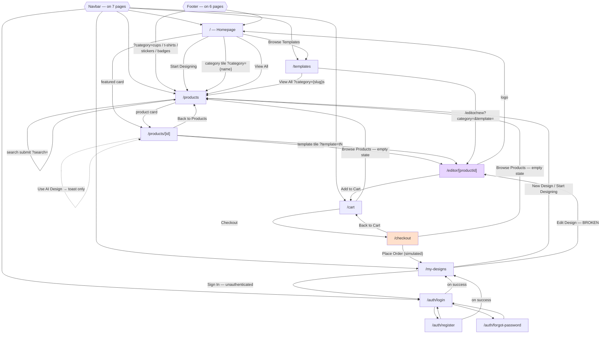

# 09 — Navigation Documentation

[← Index](./00-index.md)

## 9.1 Routing mechanism

Next.js 14 **App Router**, file-system based. There is no third-party router.

- Route files: `apps/web/src/app/**/page.tsx` — 11 pages + 1 root layout.
- Route groups (`(name)` directories, excluded from the URL): `(auth)`, `(shop)`, `(editor)`.
- Dynamic segments: `[id]` (product detail), `[productId]` (editor).
- **No** `layout.tsx` in any route group, **no** `loading.tsx`, **no** `error.tsx`, **no** `not-found.tsx`, **no** `template.tsx`, **no** `route.ts` API handlers, **no** `middleware.ts`, **no** `generateStaticParams`, **no** parallel or intercepting routes.

Navigation primitives in use:
- `next/link` `<Link>` — declarative, in 9 files
- `useRouter().push()` — imperative, in 4 files: `apps/web/src/app/(auth)/auth/login/page.tsx:31`, `register/page.tsx:44`, `(shop)/checkout/page.tsx:380`, `(shop)/products/[id]/page.tsx:251`, `components/editor/editor-toolbar.tsx:58`
- `useSearchParams()` — read URL query, in 5 files
- `useParams()` — read dynamic segment, in 3 files: `editor-left-panel.tsx:99`, `editor-right-panel.tsx:208`, `editor-3d-preview.tsx:105`

## 9.2 Complete route map

| URL | File | Rendering | Params / query read | Purpose |
|-----|------|-----------|--------------------|---------|
| `/` | `apps/web/src/app/page.tsx` | Server Component | — | Homepage: hero, 4 category tiles, 4 featured products, "How It Works" |
| `/products` | `(shop)/products/page.tsx` | Client (`"use client"` line 1) | `?category=`, `?search=` (lines 49-50) | Catalogue: 8 hardcoded products, category tabs, filter popover (sort + max price) |
| `/products/[id]` | `(shop)/products/[id]/page.tsx` | Client (line 1) | `params.id` (line 170) | Product detail: image, description, colour variants, 4 template shortcuts, CTAs |
| `/templates` | `(shop)/templates/page.tsx` | Server Component | — | Template gallery: 4 category sections, 15 template cards |
| `/cart` | `(shop)/cart/page.tsx` | Client (line 1) | — | Cart: line items, quantity steppers, order summary |
| `/checkout` | `(shop)/checkout/page.tsx` | Client (line 1) | — | 3-step wizard: shipping → payment → review |
| `/my-designs` | `(shop)/my-designs/page.tsx` | Client (line 1) | — | Saved designs read from `localStorage`, auth-gated |
| `/editor/[productId]` | `(editor)/editor/[productId]/page.tsx` | Client (line 1) | `params.productId` (line 14); children read `?category=`, `?template=` | The design editor |
| `/auth/login` | `(auth)/auth/login/page.tsx` | Client (line 1) | — | Email/password login + inert social buttons |
| `/auth/register` | `(auth)/auth/register/page.tsx` | Client (line 1) | — | Registration |
| `/auth/forgot-password` | `(auth)/auth/forgot-password/page.tsx` | Client (line 1) | — | Password-reset request (backend endpoint does not exist) |

### Routes that are linked but do not exist

| Broken link | Source | Result |
|-------------|--------|--------|
| `/templates/cup`, `/templates/t-shirt`, `/templates/sticker`, `/templates/badge` | *Historically* `(shop)/templates/page.tsx` — recorded as **BUG-T01** at `TEST_REPORT.md:80-85` | **Fixed.** The current code links to `/products?category=${slug}s` (`templates/page.tsx:97`), which resolves correctly through `categorySlugMap` (`products/page.tsx:25-34`) |
| `/products/[id]` for ids 9+ | Any hand-typed URL | Silently falls back to product 1 — `productCatalog[params.id] \|\| defaultProduct` (`products/[id]/page.tsx:170`). **No 404.** |
| `/editor/new` | `(shop)/templates/page.tsx:108` — every template card links to `/editor/new?category=…&template=…` | Renders the editor with `productId = "new"`. `resolveProductCategory("new", "cup")` returns `"cup"` from the query param (`product-catalog.ts:56-59`), so it works — but every template in every category saves to `design-new-{category}` in `localStorage`, so **all "new" designs of the same category overwrite each other** |
| `/editor/{id}-{category}` | `(shop)/my-designs/page.tsx:179` | **Broken.** See 9.6 below |

### `Not present`

No deep links, universal links, app links, or custom URL schemes exist — this is a web application with no native counterpart. No `manifest.json`, no `apple-app-site-association`, no `assetlinks.json`.

## 9.3 Navigation graph



Legend: dotted edge = the affordance exists but does not navigate.

## 9.4 Query-parameter contract

| Param | Route | Consumer | Accepted values | Fallback |
|-------|-------|----------|----------------|----------|
| `category` | `/products` | `products/page.tsx:49,52-54,62-67` via `categorySlugMap` | `cups`, `cup`, `t-shirts`, `t-shirt`, `stickers`, `sticker`, `badges`, `badge` (case-insensitive) | `"All"` |
| `search` | `/products` | `products/page.tsx:50,80-88` | any string; matched against `name`, `category`, `slug` | no filter |
| `category` | `/editor/[productId]` | `product-catalog.ts:52-64` via `CATEGORY_ALIASES` | `cup`, `cups`, `mug`, `mugs`, `t-shirt`, `t-shirts`, `tshirt`, `tee`, `sticker`, `stickers`, `badge`, `badges` | falls through to `PRODUCT_CATEGORIES[productId]`, else `"cup"` |
| `template` | `/editor/[productId]` | `editor-left-panel.tsx:120-131` | any template id in `TEMPLATE_SETS` for the resolved category | ignored if `"blank"` or unknown |

**Two independent slug maps exist for the same concept** and they are not the same:

| | `categorySlugMap` (`products/page.tsx:25-34`) | `CATEGORY_ALIASES` (`product-catalog.ts:37-50`) |
|---|---|---|
| Keys | 8 | 12 |
| Accepts `mug` / `mugs` / `tshirt` / `tee` | ❌ | ✅ |
| Output | Display name (`"Cup"`, `"T-Shirt"`) | Internal category (`"cup"`, `"t-shirt"`) |

`/products?category=mug` shows all products; `/editor/1?category=mug` correctly resolves to cup. This asymmetry is invisible until someone shares a link.

## 9.5 Route guards, redirects, and auth gating

There is **one** guard in the entire application.

```
apps/web/src/app/(shop)/my-designs/page.tsx:55
  const isAuthenticated = typeof window !== "undefined" && localStorage.getItem("auth_token");
apps/web/src/app/(shop)/my-designs/page.tsx:57-81
  if (!isAuthenticated) → render a "Sign in to view your designs" panel
```

Properties of this guard:

- **Client-side only.** It renders a different component tree; it does not redirect and does not prevent the page from being served.
- **Presence-only.** Any non-empty string in `localStorage.auth_token` passes. `localStorage.setItem("auth_token","x")` in DevTools defeats it. There is no signature check, no expiry check, and no server round trip.
- **It runs after `mounted`.** `my-designs/page.tsx:52` returns `null` until the mount effect fires, so the first paint is blank rather than a flash of protected content — accidental but correct.
- **It is the only one.** `/cart`, `/checkout`, and `/editor/*` are fully reachable while logged out. Checkout completes and clears the cart with no session.

**No redirects exist anywhere.** No `redirect()`, no `permanentRedirect()`, no `next.config.js` `redirects()`/`rewrites()`, no middleware.

Regression coverage: `e2e/bug-regression.spec.ts:36-42` (BUG-4) asserts the unauthenticated panel appears.

## 9.6 Back-navigation, history, and state persistence

| Behaviour | Implementation | Consequence |
|-----------|---------------|-------------|
| Browser back/forward | Default Next.js history | Works |
| "Back to Products" / "Back to Cart" | `<Link href="/products">` / `<Link href="/cart">` — **not** `router.back()` | `products/[id]/page.tsx:179-185`, `checkout/page.tsx:94-100`. Always goes to a fixed URL, discarding where the user came from |
| Checkout step back | `setStep("shipping" \| "payment")` — pure React state | `checkout/page.tsx:314,364`. **Browser Back exits checkout entirely** rather than stepping back. Steps are not in the URL. |
| Post-login destination | Hardcoded `/my-designs` | `login/page.tsx:31`, `register/page.tsx:44`. **No `returnTo` / `next` parameter** — a user deep-linking to a protected page loses their destination |
| Post-order destination | Hardcoded `/my-designs` | `checkout/page.tsx:380` — which then shows "No designs yet" because nothing was saved |
| Cart across navigations | Zustand `persist` → `localStorage["cart-storage"]`, only `items` persisted (`cart-store.ts:66-68`) | Survives reload and tab close |
| Editor design | Manual save only → `localStorage["design-{productId}-{category}"]` (`editor-toolbar.tsx:71`) | **Navigating away without pressing Save loses all work.** No `beforeunload`, no autosave, no dirty flag |
| Print dimensions | `localStorage["print-dims-{productId}-{category}"]` (`editor-store.ts:126`, read at `editor-canvas.tsx:171-172`) | Persists per product+category |
| Editor undo stack | In-memory Zustand array, capped at 50 (`editor-store.ts:133`) | Lost on navigation |
| Scroll restoration | Next.js default | — |
| Filter/sort state on `/products` | React `useState`, not in the URL (`products/page.tsx:58-59`) | Sort and max-price are **not shareable and are lost on back-navigation**, unlike category and search which are URL-driven |

### The broken "Edit Design" link

This is a live defect worth its own note.

1. Save writes the key `design-${productId}-${category}` — `apps/web/src/components/editor/editor-toolbar.tsx:71`. For product 1, category cup, the key is `design-1-cup`.
2. My Designs enumerates `localStorage`, matches keys starting with `design-`, and strips that prefix: `const productId = key.replace("design-", "")` — `apps/web/src/app/(shop)/my-designs/page.tsx:26-28`. This yields `"1-cup"`, not `"1"`.
3. The card links to `/editor/${design.id}` = `/editor/1-cup` — `my-designs/page.tsx:179`.
4. The editor resolves `resolveProductCategory("1-cup", null)`. `PRODUCT_CATEGORIES` has no `"1-cup"` key (`product-catalog.ts:26-35`), so it returns the default `"cup"` (`product-catalog.ts:63`).
5. The editor then looks for `localStorage["design-1-cup-cup"]` — `editor-canvas.tsx:325`. **That key does not exist.**

**Net effect: every saved design opens as a blank canvas.** `TEST_REPORT.md:40` records this test case as PASS ("Navigates to `/editor/{id}` and loads saved design"), which means the report is describing behaviour from before the `-${category}` suffix was added to the save key. This bug is invisible to the existing E2E suite because `e2e/user-journey.spec.ts:717-720` only asserts that an "Edit Design" link *exists*.

## 9.7 Navigation-related accessibility and UX gaps

| Gap | Location | Impact |
|-----|----------|--------|
| No skip-navigation link | `apps/web/src/app/layout.tsx:20-27` | Keyboard users tab through the whole navbar on every page. Violates the project's own rule at `.github/copilot-instructions.md:941` |
| No `<main>` landmark | Every page wraps content in `<div className="container …">` | Screen-reader landmark navigation is unavailable |
| No active-route indication in the navbar | `apps/web/src/components/layout/navbar.tsx:40-57` | All three nav links look identical regardless of the current page; `usePathname` is never used |
| No breadcrumbs beyond one back-link | `products/[id]/page.tsx:179-185` | Depth is invisible |
| Mobile menu does not close on navigation | `apps/web/src/components/layout/navbar.tsx:113-133` | `setMobileOpen(false)` is never called on link click; the drawer stays open after routing |
| Mobile menu has no Escape handler or focus trap | Same | Keyboard users can tab behind the open drawer |
| Footer "Company" and "Legal" links are inert `<span>` elements | `apps/web/src/components/layout/footer.tsx:36-49` | Eight dead affordances with `title="Coming soon"` and `cursor-default` — not focusable, not announced as disabled |
| Social login buttons are inert | `apps/web/src/app/(auth)/auth/login/page.tsx:140-166` | Google and GitHub buttons have no `onClick` and no `disabled` — they are focusable, clickable, and do nothing |
| Footer missing on `/checkout` | `apps/web/src/app/(shop)/checkout/page.tsx` — no `<Footer />` import | Inconsistent with the other five shop pages |
| Footer missing on all `(auth)` pages and the editor | By design | Acceptable for the editor; questionable for auth |
