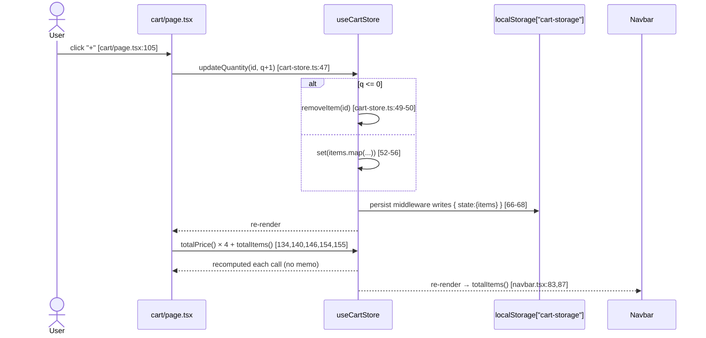

# 10 — State Management Documentation

[← Index](./00-index.md)

## 10.1 Approaches in use, and where they overlap

Five distinct state mechanisms coexist. Two of them hold the *same* data in different places, which is the root of several bugs.

| # | Mechanism | Scope | Files | Notes |
|---|-----------|-------|-------|-------|
| 1 | **Zustand — persisted** | Cart | `apps/web/src/store/cart-store.ts` | `persist` middleware → `localStorage["cart-storage"]` |
| 2 | **Zustand — ephemeral** | Editor | `apps/web/src/store/editor-store.ts` | No middleware; one field self-persists to `localStorage` imperatively |
| 3 | **Fabric.js Canvas object** | Editor document | Created in `editor-canvas.tsx:158`, published via `setCanvas` (`:322`) | **The real source of truth for the design.** Zustand only holds a reference to it |
| 4 | **React `useState`** | All local UI | 11 files | Forms, wizard step, modal open/closed, filter panel, uploads list |
| 5 | **URL query params** | `/products` category + search; `/editor` category + template | `useSearchParams()` in 5 files | Partially — sort and price filter are *not* in the URL |

**Declared but unused:** TanStack React Query is mounted (`apps/web/src/app/providers.tsx:19-21`) with zero queries. There is no server-state layer at all.

### The overlap that causes bugs

`useEditorStore` declares a complete layer-management subsystem — `layers: EditorLayer[]` plus `setLayers`, `addLayer`, `removeLayer`, `updateLayer`, `reorderLayers` (`apps/web/src/store/editor-store.ts:9-16, 21, 36-41, 84-107`). **Nothing calls any of it.** The actual Layers panel reads `canvas.getObjects()` directly and mutates Fabric objects in place (`apps/web/src/components/editor/editor-left-panel.tsx:606-667`). The store's layer state is permanently `[]`.

Ten unit tests exercise this dead subsystem (`apps/web/tests/unit/store/editor-store.spec.ts:119-247`) — though none has ever run, because the suite cannot start.

---

## 10.2 Store inventory

### `useCartStore` — `apps/web/src/store/cart-store.ts`

**Shape** (`cart-store.ts:16-26`):

| Field | Type | Initial | Persisted |
|-------|------|---------|-----------|
| `items` | `CartItem[]` | `[]` | ✅ |
| `isOpen` | `boolean` | `false` | ❌ (`partialize` at `:67` keeps only `items`) |

**`CartItem`** (`cart-store.ts:4-14`): `id` (uuid), `productId`, `productName`, `category`, `designData` (JSON string of the full Fabric canvas), `thumbnailUrl` (PNG data URL), `quantity`, `unitPrice`, `options`.

**Actions:**

| Action | Line | Behaviour | Notes |
|--------|------|-----------|-------|
| `addItem(item)` | 34-39 | Generates `crypto.randomUUID()`, appends | **No de-duplication** — adding the same design twice creates two rows, never increments quantity |
| `removeItem(id)` | 41-45 | Filters by id | |
| `updateQuantity(id, q)` | 47-57 | `q <= 0` delegates to `removeItem`; else maps | **No upper bound** — `999999` is accepted |
| `clearCart()` | 59 | `items: []` | Called only by checkout (`checkout/page.tsx:378`) |
| `toggleCart()` | 60 | Flips `isOpen` | **`isOpen` is never read by any component.** Dead state |
| `totalItems()` | 61 | Σ quantity | Derived getter, recomputed on every call |
| `totalPrice()` | 62-63 | Σ `unitPrice × quantity` | Derived getter. Called **6 times per render** on `/cart` (lines 134, 140, 146, 154, 155) |

**Storage key:** `"cart-storage"` (`cart-store.ts:66`). Default `createJSONStorage` → `localStorage`.

**Hydration safety:** every consumer guards against SSR mismatch with a `mounted` flag — `cart/page.tsx:13-26`, `navbar.tsx:20-22,83,87`. This is why the cart badge renders `0` on the server and the real count after mount.

**Weight risk:** each `CartItem` embeds a full Fabric JSON (`designData`) *and* a base64 PNG thumbnail (`thumbnailUrl`, produced at `editor-toolbar.tsx:42` with `multiplier: 0.3`). Both go into `localStorage`, which caps at ~5–10 MB per origin. **A handful of complex designs can exceed the quota.** `addItem` has no try/catch, and Zustand's `persist` will throw `QuotaExceededError` — see [13, BUG-LATENT-03](./13-historical-bug-report.md#unfixed-and-partially-fixed-issues).

---

### `useEditorStore` — `apps/web/src/store/editor-store.ts`

**Shape** (`editor-store.ts:18-58`):

| Field | Type | Initial | Who writes it | Who reads it |
|-------|------|---------|--------------|--------------|
| `canvas` | `FabricCanvas \| null` | `null` | `editor-canvas.tsx:322` | 5 components + `editor-artboard.ts` |
| `activeObjectId` | `string \| null` | `null` | `editor-canvas.tsx:240,247,252`; `editor-left-panel.tsx:643` | **Nobody.** Dead |
| `layers` | `EditorLayer[]` | `[]` | **Nobody** | **Nobody.** Dead subsystem |
| `zoom` | `number` | `1` | toolbar, wheel handler, Ctrl+0, `syncArtboardLayout` | toolbar display, subscribe handler |
| `canUndo` / `canRedo` | `boolean` | `false` | `pushUndo`, `resetHistory`, `undo`, `redo` | toolbar button `disabled` (`editor-toolbar.tsx:132,141`) |
| `undoStack` / `redoStack` | `string[]` | `[]` | same | `undo`/`redo` |
| `selectedTool` | `"select"\|"text"\|"shape"\|"draw"\|"pan"` | `"select"` | toolbar (`:158,169`) | canvas interaction mode (`editor-canvas.tsx:57,191,402`) |
| `leftPanelTab` | `string` | `"templates"` | `editor-left-panel.tsx:49` | `editor-left-panel.tsx:40,52,68` |
| `rightPanelOpen` | `boolean` | `true` | **Nobody** | `editor/[productId]/page.tsx:15,35` — **there is no UI to toggle it** |
| `activeTemplate` | `string \| null` | `null` | `editor-left-panel.tsx:111` | `editor-left-panel.tsx:143` (selection ring) |
| `backgroundColor` | `string` | `"#ffffff"` | `editor-canvas.tsx:39`; `editor-left-panel.tsx:114,514` | `editor-left-panel.tsx:489` |
| `productCategory` | `ProductCategory` | `"cup"` | `editor-canvas.tsx:169` | `editor-artboard.ts:92,105` fallback |
| `printDimensions` | `Record<ProductCategory, ArtboardSize>` | all four categories at max (`editor-store.ts:75-80`) | `setPrintDimensions` | `editor-artboard.ts:93`; `print-area-panel.tsx:21` |

**Only `selectedTool`, `zoom`, `canUndo`, `canRedo`, `leftPanelTab`, `activeTemplate`, `backgroundColor`, `printDimensions`, and `canvas` are live. `activeObjectId`, `layers`, and `rightPanelOpen` are write-only or read-only dead ends.**

**Notable action semantics:**

| Action | Line | Detail |
|--------|------|--------|
| `setZoom` | 109 | Clamps to `[0.25, 3]` via `Math.max(0.25, Math.min(3, zoom))`. **`apps/web/tests/unit/store/editor-store.spec.ts:257-288` asserts clamps of `[0.1, 5]` — four assertions that would fail if the suite ran.** Note this duplicates `clampZoom` in `canvas-viewport.ts:3-8`, which uses the same `[0.25, 3]` — two independent copies of the same constant |
| `setPrintDimensions` | 118-128 | Updates the store **and** writes `localStorage[persistKey]` when a key is supplied. A store action performing I/O |
| `pushUndo` | 130-138 | `undoStack: [...slice(-49), state]` → cap 50; clears `redoStack`; sets `canUndo: true`, `canRedo: false` |
| `resetHistory` | 143-150 | Seeds the stack with one baseline entry and clears redo. Carries an explicit comment (lines 140-142) explaining it exists to drop stale history from a previously edited product |
| `undo` | 152-175 | No-op if `undoStack.length <= 1` or no canvas. Loads `undoStack[len-2]`, pushes current onto redo, then **re-selects the last selectable object** (lines 161-166) |
| `redo` | 177-199 | Mirror image |

### The undo/redo race condition

`undo()` calls `canvas.loadFromJSON(...).then(...)` at `editor-store.ts:159` — **asynchronous** — and then synchronously calls `set({ undoStack: …, redoStack: … })` at `:169-174`. The stack pointers move *before* the canvas finishes loading.

Consequence: rapidly pressing Ctrl+Z twice starts a second `loadFromJSON` while the first is still resolving. The two `.then()` callbacks race, and whichever resolves last wins the visual state — which may not correspond to the stack pointer. There is no in-flight guard, no sequence number, and no promise chaining.

This is a **latent bug with no test coverage**. The keyboard handler at `editor-canvas.tsx:429-438` binds Ctrl+Z/Ctrl+Y with no debounce.

### `pushUndo` call-site inventory

Every mutation must remember to call it manually. Fifteen sites do:

| File | Lines |
|------|-------|
| `editor-canvas.tsx` | 264 (`object:modified`), 449 (Delete key), 464 (Ctrl+D) |
| `editor-left-panel.tsx` | 116 (template), 193 (upload), 269 (text), 396 (shape), 437 (stock image), 515 (background) |
| `editor-right-panel.tsx` | 240 (`pushHistory` helper → used by duplicate/delete/layer/lock/visibility), 90 (debounced, 500 ms) |

**Mutations that do NOT push undo** (found by comparing mutation sites to the list above):
- `LayersPanel` visibility toggle — `editor-left-panel.tsx:655-660` sets `obj.visible` and re-renders but never records history. **Undo cannot restore a hidden layer.**
- `ImageProperties.applyFilter` uses the *debounced* push (`editor-right-panel.tsx:921`), so rapid filter clicks collapse into one history entry.

---

## 10.3 State lifecycle

### Initialisation

| Store | When | How |
|-------|------|-----|
| `useCartStore` | Module import | Zustand `persist` rehydrates `localStorage["cart-storage"]` synchronously on the client |
| `useEditorStore` | Module import | Static initial object (`editor-store.ts:61-80`). `printDimensions` is computed eagerly for all four categories via `getDefaultPrintDimensions` |
| Fabric canvas | 100 ms after `EditorCanvas` mounts | `editor-canvas.tsx:144-147` sets `isReady`, then the main effect runs |
| Babylon scene | 60 ms after `ProductCanvas` mounts | `editor-3d-preview.tsx:58-65` |

### Hydration

Only the cart hydrates. Three components defend against the SSR/client mismatch it causes:

- `apps/web/src/app/(shop)/cart/page.tsx:13-26` — renders a pulsing placeholder until mounted
- `apps/web/src/components/layout/navbar.tsx:20-22,83,87` — renders `0` until mounted
- `apps/web/src/app/(shop)/my-designs/page.tsx:20,42,52` — returns `null` until mounted

`apps/web/src/app/(shop)/checkout/page.tsx` **does not guard**. It reads `items` and `totalPrice()` at lines 14, 61-64 during the first render. Because the whole component is `"use client"` and Next.js still SSRs client components, the server render sees an empty cart and shows the "Your cart is empty" branch (`checkout/page.tsx:66-87`), then the client render replaces it. This produces a visible flash and a React hydration warning. `[UNVERIFIED: whether React emits a hydration mismatch error in this exact case — I did not run the dev server. The structural condition for one is present.]`

### Persistence keys — complete inventory

| Key | Written at | Read at | Format | Cleared by |
|-----|-----------|---------|--------|-----------|
| `cart-storage` | Zustand `persist` (`cart-store.ts:66`) | Zustand rehydrate | `{ state: { items }, version: 0 }` | `clearCart()` writes `items: []`; never removed |
| `design-{productId}-{category}` | `editor-toolbar.tsx:71` | `editor-canvas.tsx:325` | Fabric `toJSON()` string | `my-designs/page.tsx:47` — but with the wrong key, see [09](./09-navigation.md#the-broken-edit-design-link) |
| `print-dims-{productId}-{category}` | `editor-store.ts:126` | `editor-canvas.tsx:172` | `{"width":n,"height":n}` | never |
| `auth_token` | `login/page.tsx:27`, `register/page.tsx:40` | `api.ts:17`, `my-designs/page.tsx:55` | opaque string | **never — there is no logout** |
| `user_id` | `login/page.tsx:28`, `register/page.tsx:41` | `api.ts:20` | uuid | never |
| `user_email` | `login/page.tsx:29`, `register/page.tsx:42` | **nobody** | email | never |

**No `sessionStorage`, no cookies, no IndexedDB, no Cache API, no service worker.** There is no logout affordance anywhere in the UI — the only way to sign out is to clear browser storage manually.

### Invalidation, reset, teardown

| Concern | Handling |
|---------|----------|
| Cart invalidation | None. Items persist indefinitely with whatever price was captured at add time |
| Editor history reset | `resetHistory` on canvas init (`editor-canvas.tsx:344,348`) |
| Canvas teardown | `canvas.dispose()` plus removal of 4 container listeners and 2 window listeners (`editor-canvas.tsx:378-389`) |
| Babylon teardown | `dispose()` removes the `visibilitychange` listener, stops the render loop, disposes the design texture, the scene, and the engine (`product-3d.ts:670-676`) |
| ResizeObserver teardown | `resizeObserver.disconnect()` (`editor-canvas.tsx:379`); `ro?.disconnect()` (`editor-3d-preview.tsx:69`) |
| Zustand subscription teardown | `return unsub` (`editor-canvas.tsx:421`) |
| Fabric event teardown | `canvas.off(...)` in `editor-right-panel.tsx:225-233` and `editor-left-panel.tsx:599-603` and `editor-3d-preview.tsx:166` |
| Debounce timer teardown | `clearTimeout` on unmount in `editor-3d-preview.tsx:165`. **`useDebouncedPushHistory` (`editor-right-panel.tsx:83-94`) never clears its timer on unmount** — a pending 500 ms push can fire after the component is gone |
| Store reset on unmount | **None.** `useEditorStore` retains `canvas`, `undoStack`, `activeTemplate`, and `backgroundColor` from the previous editing session. `setCanvas(null)` is never called |

**The stale-canvas hazard:** after leaving `/editor/1` and returning, `useEditorStore.getState().canvas` still points at the disposed Fabric instance until `editor-canvas.tsx:322` overwrites it ~100 ms into the new mount. Any component that reads `canvas` in that window operates on a disposed object. `Editor3DPreview` guards with `if (!canvas) return` (`editor-3d-preview.tsx:123`) — which does not help, because the reference is non-null and dead.

---

## 10.4 Side-effect handling

There is no side-effect middleware — no redux-saga, no thunk, no Zustand `subscribeWithSelector`, no effect library. Side effects live in three places:

1. **`useEffect`** — 14 occurrences. The largest is `editor-canvas.tsx:149-390`, a **241-line effect** with 6 dependencies that creates the canvas, registers 11 Fabric listeners, 4 DOM listeners, 2 window listeners and a `ResizeObserver`, loads from storage, and returns a 12-line cleanup.
2. **Direct imperative calls in event handlers** — the dominant pattern. Every editor mutation is `canvas.something(); canvas.renderAll(); pushUndo(...)`.
3. **A manual store subscription** — `editor-canvas.tsx:392-422` uses `useEditorStore.subscribe((state, prevState) => …)` to react to `zoom`, `selectedTool`, and `printDimensions` changes outside React's render cycle.

---

## 10.5 State anti-patterns present, with citations

| # | Anti-pattern | Location | Why it is a problem |
|---|-------------|----------|--------------------|
| 1 | **`forceUpdate` counter instead of derived state** | `editor-right-panel.tsx:206,217`; `editor-left-panel.tsx:590,595` | `const [, forceUpdate] = useState(0)` incremented on Fabric events. Every one of the ~7 subscribed events re-renders a 954-line component tree. `object:moving` fires on every mouse-move frame during a drag (`editor-right-panel.tsx:222`) |
| 2 | **Mutable object held in reactive state** | `editor-store.ts:61` (`canvas: null`) | Fabric mutates the canvas in place, so Zustand never sees a reference change and never notifies subscribers. That is exactly why #1 exists |
| 3 | **Derived state stored instead of computed** | `editor-store.ts:23-24` (`canUndo`, `canRedo`) | Both are functions of `undoStack.length` / `redoStack.length` but are stored separately and updated in four places (`:135-136, 146-147, 172-173, 196-197`). Any missed update desynchronises the toolbar buttons |
| 4 | **Dead state with tests** | `editor-store.ts:9-16,21,36-41,84-107` + `editor-store.spec.ts:119-247` | 5 actions and a type that nothing uses, plus 10 tests asserting they work |
| 5 | **Local state duplicating store state** | `print-area-panel.tsx:25-31`; `editor-right-panel.tsx:49-53,112-121` | Each keeps a shadow copy synced by `useEffect`. `NumberInput` additionally tracks `prevExternal` in a ref (`:113,117-120`) to decide whether an external change should overwrite the user's typing — a hand-rolled controlled/uncontrolled reconciliation |
| 6 | **Store action performing I/O** | `editor-store.ts:125-127` | `setPrintDimensions` writes `localStorage`, making the store impure and untestable without a DOM |
| 7 | **Global state read from a "pure" utility** | `editor-artboard.ts:4,92-93,105` | `layoutArtboardInCanvas` and `getActivePrintSize` reach into `useEditorStore.getState()`, so no consumer can inject a size |
| 8 | **Async state transition with synchronous bookkeeping** | `editor-store.ts:159-174, 183-198` | The undo/redo race described above |
| 9 | **`crypto.randomUUID()` called without a guard** | `cart-store.ts:35` | Available in all modern browsers over HTTPS/localhost, but **undefined on plain HTTP over a LAN IP** and in Node < 19 during any SSR path. No fallback |
| 10 | **A single 241-line effect owning eleven concerns** | `editor-canvas.tsx:149-390` | Any dependency change tears down and rebuilds the entire canvas. Its dep array (`:390`) includes `category` and `productId`, so switching category **destroys the canvas and all unsaved work** |

---

## 10.6 Data-flow diagrams

### Write path — cart mutation and persistence



### Streaming/continuous path — canvas → 3D texture

This is the closest thing to a real-time pipeline in the application.

```mermaid
sequenceDiagram
    participant FC as Fabric Canvas
    participant P3 as Editor3DPreview
    participant AB as editor-artboard.ts
    participant PC as ProductCanvas
    participant BS as Babylon scene
    participant GPU as WebGL

    Note over FC: user drags an object
    FC-->>P3: object:modified [editor-3d-preview.tsx:160-162]
    P3->>P3: scheduleCapture → clearTimeout + setTimeout 400 ms [151-154]
    Note over P3: further events reset the timer
    P3->>P3: captureDesign() [121]
    alt capturePendingRef already true
        P3-->>P3: return early [123]
    end
    P3->>P3: requestAnimationFrame [127]
    P3->>AB: getArtboardBounds(canvas) [130]
    P3->>P3: multiplier = clamp(1280 / longEdge, 0.75, 2) [131-135]
    P3->>AB: exportArtboardDataUrl → canvas.toDataURL(png, multiplier, bounds) [136-139]
    Note over AB: editor-artboard.ts:146-154 crops to the artboard rect
    P3->>P3: setDataUrl(url) [140]
    P3->>PC: prop change → effect [76-79]
    PC->>BS: handle.setDesignDataUrl(url) [78]
    BS->>BS: dispose previous Texture [571-574]
    BS->>BS: new Texture(dataUrl, …, onLoad, onError) [580-594]
    BS->>BS: applyTexture — wrap CLAMP, uScale −1, vScale −1, aniso 8 [595-599]
    BS->>BS: decal.isVisible = true; requestRender() [588-589]
    BS->>GPU: pendingFrames = 3 → loop renders 3 frames then idles [613-624]
```

**Cost per capture:** a full canvas rasterisation at up to 2× (so up to 2230 × 760 px for the cup artboard) into a base64 PNG string, then a GPU texture upload. Debounced at 400 ms, with a `capturePendingRef` mutex (`editor-3d-preview.tsx:114,123-124`) to prevent overlap.

### State-lifecycle diagram — undo/redo

```mermaid
stateDiagram-v2
    [*] --> Empty: store created<br/>undoStack=[] canUndo=false
    Empty --> Baseline: resetHistory(json)<br/>undoStack=[s0] canUndo=false

    Baseline --> Recorded: pushUndo(s1)<br/>undoStack=[s0,s1]<br/>canUndo=true canRedo=false
    Recorded --> Recorded: pushUndo(sN)<br/>slice(-49) caps at 50<br/>redoStack cleared

    Recorded --> Undoing: undo()
    Undoing --> Recorded: loadFromJSON resolves<br/>undoStack.pop → redoStack.push<br/>canUndo = len>2, canRedo=true
    Undoing --> RACE: second undo() before<br/>the first promise resolves
    RACE --> Recorded: last promise to resolve wins;<br/>canvas may not match stack pointer

    Recorded --> Redoing: redo()
    Redoing --> Recorded: redoStack.pop → undoStack.push<br/>canUndo=true, canRedo = len>1

    Recorded --> Baseline: navigate to a different<br/>product/category → canvas rebuilt<br/>→ resetHistory
    Recorded --> [*]: unmount — stack is NOT cleared;<br/>store keeps stale strings

    note right of RACE
        editor-store.ts:159-174
        No in-flight guard.
        No test coverage.
    end note
```


