# 11 — UI System Documentation

[← Index](./00-index.md)

There are **three competing definitions of the design system** in this repository, and they disagree:

| Source | Primary | Secondary | Accent/CTA | Status |
|--------|---------|-----------|-----------|--------|
| `apps/web/tailwind.config.ts:25,39,53` | `#7C3AED` | `#06B6D4` | `#F97316` | **The implementation. Authoritative.** |
| `README.md:11-13` | `#7C3AED` | `#06B6D4` | `#F97316` | Matches the implementation |
| `design-system/mylovelygift/MASTER.md:21-23` | `#6366F1` | `#818CF8` | `#22C55E` | **Contradicts both.** Generated 2026-05-30, never reconciled |
| `apps/web/src/app/globals.css:16,18,22` | `hsl(263 70% 58%)` ≈ `#7C3AED` | `hsl(187 94% 43%)` ≈ `#06B6D4` | `hsl(25 95% 53%)` ≈ `#F97316` | Duplicates the hex values in HSL |

Everything below documents **the implementation**.

---

## 11.1 Colour system

### Token architecture

Two parallel and partially-overlapping token systems exist:

1. **CSS custom properties** in `:root` (`apps/web/src/app/globals.css:8-30`) — 19 HSL triples, consumed by Tailwind via `hsl(var(--x))`.
2. **Literal hex scales** in `apps/web/tailwind.config.ts:18-105` — full 50→900 ramps.

`primary`, `secondary`, and `accent` are defined in **both** systems with equivalent but independently-maintained values. `--primary`, `--secondary`, `--accent`, `--primary-foreground`, `--secondary-foreground`, `--accent-foreground`, `--destructive`, and `--destructive-foreground` are declared in `globals.css` but **never referenced by `tailwind.config.ts`** — the config maps those names to literal hex instead (`tailwind.config.ts:24-25,38-39,52-53,74-77`). They are dead variables.

### Complete palette

#### Semantic tokens bound to CSS variables (`tailwind.config.ts:19-23,78-89`)

| Tailwind name | CSS var | HSL | ≈ Hex | Used at |
|---------------|---------|-----|-------|---------|
| `border` | `--border` | `270 20% 90%` | `#E8E1EF` | `globals.css:35` (`* { @apply border-border }`) |
| `input` | `--input` | `270 20% 90%` | `#E8E1EF` | `ui/input.tsx:13`, `editor-right-panel.tsx:683,716` |
| `ring` | `--ring` | `263 70% 58%` | `#7C3AED` | `ui/button.tsx:7` (`focus-visible:ring-ring`) |
| `background` | `--background` | `270 100% 99%` | `#FCFAFF` | `globals.css:38` |
| `foreground` | `--foreground` | `270 50% 10%` | `#1A0D26` | `globals.css:38` |
| `card` / `card-foreground` | `--card` / `--card-foreground` | `0 0% 100%` / `270 50% 10%` | `#FFFFFF` / `#1A0D26` | `ui/card.tsx:11` only |
| `popover` / `popover-foreground` | `--popover` / … | `0 0% 100%` / `270 50% 10%` | — | **Never used** |
| `muted` | `--muted` | `270 20% 95%` | `#F3EFF7` | `editor-left-panel.tsx:142,549`, `navbar.tsx:77` |
| `muted-foreground` | `--muted-foreground` | `270 10% 40%` | `#665C70` | 40+ sites — the most-used text colour after `foreground` |

`--radius: 0.75rem` (`globals.css:29`) drives `borderRadius.lg/md/sm` (`tailwind.config.ts:112-116`).

#### Brand scales (`tailwind.config.ts:24-105`) — literal hex

| Scale | 50 | 100 | 200 | 300 | 400 | **DEFAULT/500** | 600 | 700 | 800 | 900 |
|-------|----|----|----|----|----|----|----|----|----|----|
| `primary` | `#F5F3FF` | `#EDE9FE` | `#DDD6FE` | `#C4B5FD` | `#A78BFA` | **`#7C3AED`** | `#6D28D9` | `#5B21B6` | `#4C1D95` | `#3B0764` |
| `secondary` | `#ECFEFF` | `#CFFAFE` | `#A5F3FC` | `#67E8F9` | `#22D3EE` | **`#06B6D4`** | `#0891B2` | `#0E7490` | `#155E75` | `#164E63` |
| `accent` | `#FFF7ED` | `#FFEDD5` | `#FED7AA` | `#FDBA74` | `#FB923C` | **`#F97316`** | `#EA580C` | `#C2410C` | `#9A3412` | `#7C2D12` |

Foregrounds: `primary-foreground: #FFFFFF` (`:26`), `secondary-foreground: #FFFFFF` (`:40`), `accent-foreground: #FFFFFF` (`:54`).

#### Status colours (`tailwind.config.ts:66-77`) — DEFAULT only, no scale

| Token | Hex | Foreground | Used at |
|-------|-----|-----------|---------|
| `success` | `#10B981` | `#FFFFFF` | `cart/page.tsx:139`, `checkout/page.tsx:110,306,410`, `products/[id]/page.tsx:286`, `my-designs/page.tsx:134`, `forgot-password/page.tsx:88`, `templates/page.tsx:46` |
| `warning` | `#FBBF24` | `#1F2937` | `my-designs/page.tsx:132`, `page.tsx:22`, `templates/page.tsx:36`, `editor-left-panel.tsx:505` |
| `destructive` | `#EF4444` | `#FFFFFF` | `checkout/page.tsx` ×14 error states, `editor-right-panel.tsx:347,415`, `cart/page.tsx:115`, `login/page.tsx:71` |

**Naming trap:** these tokens have no `DEFAULT`-less form, so Tailwind requires the literal class `bg-success-DEFAULT` / `text-warning-DEFAULT`. That awkward string appears in 12 places, e.g. `apps/web/src/app/(shop)/cart/page.tsx:139`, `apps/web/src/app/(shop)/products/[id]/page.tsx:286`.

#### "Gen Alpha fun accents" (`tailwind.config.ts:90-105`) — a third naming scheme

| Token | DEFAULT | light | bright | Used at |
|-------|---------|-------|--------|---------|
| `pink` | `#EC4899` | `#F9A8D4` | `#F472B6` | `page.tsx:11`, `templates/page.tsx:11`, `products/[id]/page.tsx:198`, `globals.css:56`, `editor-left-panel.tsx:502` |
| `lime` | `#84CC16` | `#D9F99D` | `#A3E635` | `page.tsx:28`, `templates/page.tsx:46`, `editor-left-panel.tsx:503` |
| `sky` | `#0EA5E9` | `#BAE6FD` | `#38BDF8` | `page.tsx:16`, `templates/page.tsx:24`, `editor-left-panel.tsx:504` |

**These override Tailwind's built-in `pink`, `lime`, and `sky` palettes.** Any developer writing `bg-pink-500` gets nothing, because the scale only has `DEFAULT`, `light`, and `bright`.

### Hardcoded colour literals outside the token system

Complete inventory of hex values appearing in `.ts`/`.tsx` outside `tailwind.config.ts` and `globals.css`:

| Value | Location(s) | Purpose |
|-------|-------------|---------|
| `#ffffff` | `editor-store.ts:73`; `editor-canvas.tsx:509`; `editor-left-panel.tsx:500`; `editor-templates.ts:72,143,186,227,275` | Default artboard/background |
| `#e8eaed` | `editor-canvas.tsx:161` and `:494` | Canvas workspace grey. **Duplicated in a Tailwind arbitrary value** |
| `#1F2937` | `editor-left-panel.tsx:259,323,324,348,372`; `editor-right-panel.tsx:617,822` | Default text/shape fill |
| `#7C3AED` | `editor-left-panel.tsx:318,336,388`; `editor-right-panel.tsx:152,792`; `editor-templates.ts:130,189,231` | Primary as a canvas fill |
| `#06B6D4` | `editor-left-panel.tsx:319,342`; `editor-right-panel.tsx:151` | Secondary as a canvas fill |
| `#F97316` | `editor-left-panel.tsx:320,345`; `editor-right-panel.tsx:151`; `editor-templates.ts:252,256` | Accent as a canvas fill |
| `#FBBF24` | `editor-left-panel.tsx:321,353`; `editor-right-panel.tsx:151` | Warning as a canvas fill |
| `#EC4899` | `editor-left-panel.tsx:322,362`; `editor-right-panel.tsx:152` | Pink as a canvas fill |
| `#10B981` | `editor-left-panel.tsx:325,382`; `editor-right-panel.tsx:151` | Success as a canvas fill |
| `#000000`, `#FFFFFF`, `#EF4444`, `#3B82F6`, `#8B5CF6`, `#14B8A6`, `#F59E0B`, `#6366F1`, `#D946EF` | `editor-right-panel.tsx:151-153` (`COLOR_SWATCHES`) | User-facing colour picker. **6 of these 15 are not in the design system at all** |
| `#F3E8FF`, `#FFF0F5`, `#ECFDF5`, `#E0F2FE`, `#FEF3C7`, `#F8FAFC` | `editor-left-panel.tsx:501-506` | Background presets |
| `#FFFFFF`, `#1F2937`, `#EC4899`, `#1E3A5F`, `#374151`, `#6B7280`, `#86EFAC`, `#F3F4F6`, `#E5E7EB`, `#D1D5DB`, `#FBBF24` | `products/[id]/page.tsx:27-158` | Product colour swatches |
| `#FFF5F5`, `#7C3AED`, `#06B6D4` | `apps/api/prisma/seed.ts:169,171,196,198` | Seeded template canvas data — **the backend hardcodes frontend brand colours** |
| `#D946EF`, `#F9A8D4`, `#C084FC`, `#1C1917`, `#F5F5F4`, `#78716C`, `#1E293B`, `#475569`, `#E2E8F0`, `#94A3B8`, `#64748B`, `#0F172A`, `#FACC15`, `#F8FAFC`, `#111111`, `#A1A1AA`, `#F472B6`, `#FEF3C7`, `#DC2626`, `#FECACA` | `editor-templates.ts:88-311` | 13 template designs. **~25 literals with no token backing** |
| `rgba(0,0,0,0.1)` | `editor-canvas.tsx:514` | Artboard drop shadow |
| `rgba(124, 58, 237, 0.3/0.6)` | `tailwind.config.ts:131-132` | `pulse-glow` keyframe — primary re-expressed as RGB |
| `#f4f4f5`, `rgb(shade,…)` | `product-3d.ts:222,228` | Procedural cotton texture |
| `Color3(0.98,0.98,0.97)`, `(0.85,0.86,0.88)`, `(0.45,0.4,0.34)`, `(1,0.92,0.82)`, `(0.99,0.99,0.99)`, `(1,0.98,0.93)`, `(0,0,0)`, `(1,1,1)` | `product-3d.ts:151,286,339,353,388,403-404,491,499,503,514,552` | Babylon PBR materials — necessarily float-triples, outside any token system |
| `Color4(0.976, 0.961, 0.93, 1)` | `product-3d.ts:453` | 3D scene clear colour |
| `#f3f4f6` | `editor-left-panel.tsx:467` | Checkerboard transparency pattern, inline in a Tailwind arbitrary value |

**Total: roughly 90 distinct hardcoded colour literals across 8 files.**

### Light/dark mapping

`darkMode: ["class"]` is configured (`tailwind.config.ts:4`) but:
- `globals.css` defines **no `.dark` block**.
- No element ever receives a `dark` class.
- No `dark:` variant appears in any `.tsx` file.

**Dark mode is declared and non-functional.** There is also no `prefers-color-scheme` handling and no theme-persistence mechanism.

### Opacity / elevation / state layers

Opacity modifiers are used heavily and inconsistently — `/5`, `/10`, `/20`, `/30`, `/40`, `/50`, `/60`, `/70`, `/80`, `/90` all appear. The dominant idiom is `border-primary/10` + `hover:border-primary/30` + `hover:bg-primary/5`, repeated in 30+ places with no shared class.

### Gradients

| Gradient | Definition | Sites |
|----------|-----------|-------|
| Page background | `bg-gradient-to-br from-primary-50 via-white to-secondary-50` | `page.tsx:66`, `products/page.tsx:106`, `products/[id]/page.tsx:174`, `templates/page.tsx:58`, `cart/page.tsx:18,30,55`, `checkout/page.tsx:68,90`, `my-designs/page.tsx:59,84` — **11 duplications** |
| Auth background | `from-primary-100 via-secondary-50 to-accent-50` | `login/page.tsx:43`, `register/page.tsx:56`, `forgot-password/page.tsx:34` |
| Editor background | `from-primary-50/50 via-white to-secondary-50/50` | `editor/[productId]/page.tsx:18` |
| Brand button | `from-primary via-purple-500 to-secondary` | `globals.css:47`, `ui/button.tsx:22` — **duplicated**. Note `purple-500` is Tailwind's built-in, not a project token |
| Brand text | `from-primary via-pink to-accent` + `bg-clip-text text-transparent` | `globals.css:56` |
| Logo mark | `from-primary to-secondary` | `navbar.tsx:30`, `footer.tsx:11`, `login/page.tsx:56`, `register/page.tsx:66`, `forgot-password/page.tsx:44`, `editor-toolbar.tsx:110` — **6 duplications** |
| Category tiles | `from-pink-bright to-primary`, `from-secondary to-sky-bright`, `from-accent to-warning-DEFAULT`, `from-lime-bright to-success-DEFAULT` | `page.tsx:11,16,22,28` and `templates/page.tsx:11,24,36,46` — **each pair duplicated across two files** |
| 3D panel chrome | `from-amber-50 to-stone-100`, `from-amber-50 to-stone-200`, `from-black/50 to-transparent`, `from-white/90 to-transparent`, `from-black/30 to-transparent` | `editor-3d-preview.tsx:184,203,221,222,250,270` — uses `amber` and `stone`, **two Tailwind built-in palettes outside the design system** |

---

## 11.2 Typography

### Font loading

`apps/web/src/app/globals.css:1`

```css
@import url('https://fonts.googleapis.com/css2?family=Nunito+Sans:wght@300;400;500;600;700;800&family=Rubik:wght@300;400;500;600;700;800;900&display=swap');
```

**This is a render-blocking third-party request at the top of the stylesheet.** `next/font` is not used, so there is no self-hosting, no `font-display` control beyond `swap`, no preload hint, and no subsetting. Every page load contacts `fonts.googleapis.com` and then `fonts.gstatic.com` — a privacy consideration under GDPR as well as a performance one.

The weights requested (Rubik 300–900, Nunito Sans 300–800) total **16 font faces**.

### Families (`tailwind.config.ts:107-111`)

| Token | Stack | Applied |
|-------|-------|---------|
| `font-sans` | `["Rubik", "sans-serif"]` | Tailwind default for unstyled elements |
| `font-body` | `["Nunito Sans", "sans-serif"]` | `body` (`globals.css:38`) |
| `font-display` | `["Rubik", "sans-serif"]` | `h1`–`h6` (`globals.css:40-42`) + 40 explicit `font-display` classes |

`font-sans` and `font-display` are identical; only two real families exist.

### Type scale

There is **no defined scale**. Sizes come from Tailwind's defaults, used ad hoc:

| Class | px | Occurrences (approx.) | Representative sites |
|-------|-----|----------------------|---------------------|
| `text-[9px]` | 9 | 2 | `editor-left-panel.tsx:476,566` |
| `text-[10px]` | 10 | 18 | `editor-right-panel.tsx:169,427,443,459,478,679,700,712,739,759,770,866,883,935`; `navbar.tsx:86`; `my-designs/page.tsx:130`; `editor-left-panel.tsx:51,580` |
| `text-xs` | 12 | 60+ | Throughout |
| `text-sm` | 14 | 50+ | Throughout |
| `text-base` | 16 | 8 | CTA buttons |
| `text-lg` | 18 | 12 | Section headings, totals |
| `text-xl` | 20 | 5 | `navbar.tsx:33`, `checkout/page.tsx:132,247,334`, `my-designs/page.tsx:109` |
| `text-2xl` | 24 | 6 | `login/page.tsx:59`, `register/page.tsx:69`, `forgot-password/page.tsx:47`, `cart/page.tsx:36`, `checkout/page.tsx:72`, `my-designs/page.tsx:65` |
| `text-3xl` | 30 | 8 | Page titles |
| `text-4xl` | 36 | 5 | Responsive `md:` step |
| `text-5xl` | 48 | 2 | `page.tsx:86`, `templates/page.tsx:67` |
| `text-7xl` | 72 | 1 | `page.tsx:86` (`md:text-7xl`) |

**Eleven distinct sizes with no semantic naming and no `theme.extend.fontSize` block.** There are also two arbitrary sizes (`text-[9px]`, `text-[10px]`) below Tailwind's smallest step, both **below the 12 px minimum** most accessibility guidance recommends.

### Weights

`font-medium` (500), `font-semibold` (600), `font-bold` (700), `font-black` (900) are all used. `font-black` appears twice (`page.tsx:86`, `page.tsx:241`).

Inside the canvas, weights are set as raw Fabric values: `"300" | "normal" | "500" | "600" | "bold" | "800"` (`editor-right-panel.tsx:719-724`) — a **third** weight vocabulary mixing numeric strings and keywords.

### Line-height and letter-spacing

- No `lineHeight` or `letterSpacing` tokens in `tailwind.config.ts`.
- `tracking-wide` is used on ~14 uppercase micro-labels.
- Inside the canvas: `charSpacing` values of `40, 60, 80, 100, 120` and `lineHeight` of `0.95` appear as raw numbers in `editor-templates.ts:127,170,176,193,196,208,239,262,308`.

### Responsive typography

Only `md:` steps exist, on five headings: `text-5xl md:text-7xl` (`page.tsx:86`), `text-3xl md:text-4xl` (`page.tsx:122,157,210`; `products/page.tsx:113`; `products/[id]/page.tsx:208`), `text-3xl md:text-5xl` (`templates/page.tsx:67`), `text-lg md:text-xl` (`page.tsx:92`). Nothing scales below `md`, and nothing uses `clamp()` or fluid type.

---

## 11.3 Spacing, layout, and remaining tokens

### Spacing

**No spacing scale is defined.** Tailwind's default 4 px-based scale is used directly. Observed values: `gap-0.5, 1, 1.5, 2, 3, 4, 6, 8, 12`; `p-1.5, 2, 2.5, 3, 4, 6, 8`; `py-1, 1.5, 2, 2.5, 3, 4, 8, 12, 20, 32`; `mb-1, 1.5, 2, 3, 4, 6, 8, 10, 12, 16`; `space-y-1, 2, 3, 4, 5, 6`.

`design-system/mylovelygift/MASTER.md:41-51` defines seven spacing tokens (`--space-xs` 4 px through `--space-3xl` 64 px). **None of them exists in the code.**

### Container and breakpoints

`tailwind.config.ts:9-15`: `container` is centred with `padding: "2rem"` and a `2xl` screen cap of `1400px`. Breakpoints are Tailwind defaults — `sm` 640, `md` 768, `lg` 1024, `xl` 1280, `2xl` 1536 (overridden to 1400 for the container only).

**Breakpoint usage across the app:**

| Breakpoint | Count | Notes |
|-----------|------:|-------|
| `sm:` | ~25 | Grid columns, button label visibility in the editor toolbar |
| `md:` | ~30 | The main desktop/mobile switch — navbar (`navbar.tsx:39,61,100,113`), all grids, all responsive headings |
| `lg:` | ~12 | 3-column layouts on cart/checkout/product detail |
| `xl:` | 2 | `products/page.tsx:219`, `my-designs/page.tsx:123` (4-column grids) |
| `2xl:` | 0 | Never used outside the container config |

**The editor has no responsive treatment at all.** `apps/web/src/app/(editor)/editor/[productId]/page.tsx:18-37` uses `h-screen flex` with a fixed 64 px icon rail + 224 px panel on the left (`editor-left-panel.tsx:45,66`), a `min-w-[300px]` centre, and a 224 px right panel (`editor-right-panel.tsx:309,326,389`). Total fixed chrome is **512 px**, so below roughly 812 px viewport width the canvas is squeezed to its minimum and then overflows. There is no mobile editor layout, no collapsible panels, and no `rightPanelOpen` toggle in the UI despite the state existing.

### Border radius

| Token | Value | Source |
|-------|-------|--------|
| `rounded-lg` | `var(--radius)` = `0.75rem` = 12 px | `tailwind.config.ts:113`, `globals.css:29` |
| `rounded-md` | `calc(var(--radius) - 2px)` = 10 px | `tailwind.config.ts:114` |
| `rounded-sm` | `calc(var(--radius) - 4px)` = 8 px | `tailwind.config.ts:115` |

But the code overwhelmingly uses Tailwind's **untokenised** radii instead: `rounded-xl` (12 px, ~60 sites), `rounded-2xl` (16 px, ~25 sites), `rounded-3xl` (24 px, 2 sites), `rounded-full` (~20 sites). `rounded-md` and `rounded-sm` — the actual tokens — appear **twice total**. The token system is effectively bypassed.

### Elevation / shadows

No shadow tokens. Tailwind defaults used: `shadow-sm`, `shadow-md`, `shadow-lg`, `shadow-xl`, `shadow-2xl`. The recurring idiom `shadow-lg hover:shadow-xl` appears in `globals.css:47,50` and 8 component sites.

`design-system/mylovelygift/MASTER.md:55-60` defines four shadow tokens with explicit rgba values. **None is used.**

One shadow is defined in JS: the artboard's Fabric drop shadow, `{ color: "rgba(0,0,0,0.1)", blur: 16, offsetX: 0, offsetY: 4 }` (`editor-canvas.tsx:513-518`).

### z-index scheme

No token system; six raw values in use:

| Value | Element | Site |
|-------|---------|------|
| `z-10` | Design-card dropdown; 3D modal header/footer bars | `my-designs/page.tsx:152`; `editor-3d-preview.tsx:222,270` |
| `z-20` | 3D loading overlay | `editor-3d-preview.tsx:250` |
| `z-30` | Products filter popover; 3D thumbnail | `products/page.tsx:137`; `editor-3d-preview.tsx:180` |
| `z-50` | Sticky navbar; 3D expanded modal | `navbar.tsx:25`; `editor-3d-preview.tsx:215` |

**Collision:** the navbar (`z-50`, sticky) and the 3D modal (`z-50`, fixed) share the top layer. The editor route has no navbar, so they never coexist — but the invariant is undocumented and unenforced.

### Safe areas / insets

**Not present.** No `env(safe-area-inset-*)`, no viewport-fit meta, no notch handling. Not required for a desktop-first web app, but it means iOS Safari with a home indicator will clip the editor's bottom-right 3D thumbnail (`editor-3d-preview.tsx:180`, `bottom-4 right-4`).

---

## 11.4 Motion tokens

Defined in `tailwind.config.ts:117-152`.

| Animation | Keyframes | Duration | Easing | Iteration | Used at |
|-----------|-----------|----------|--------|-----------|---------|
| `animate-float` | `translateY(0) → -10px → 0` | 3 s | `ease-in-out` | infinite | `page.tsx:73,74,75,233,234`; `products/page.tsx:233,234`; `products/[id]/page.tsx:197,198`; `login/page.tsx:46,47,48`; `register/page.tsx:58,59`; `forgot-password/page.tsx:36,37` — **16 always-running instances** |
| `animate-pulse-glow` | `box-shadow` 5 px → 20 px purple | 2 s | `ease-in-out` | infinite | **Never used** |
| `animate-slide-in` | `translateX(-100%) opacity 0 → 0 / 1` | 0.3 s | `ease-out` | once | `navbar.tsx:114` (mobile drawer) |
| `animate-bounce-in` | `scale 0.3 → 1.05 → 0.9 → 1`, opacity 0→1 | 0.5 s | `ease-out` | once | `page.tsx:80` (hero badge) |
| `animate-accordion-down/up` | `height 0 ↔ var(--radix-accordion-content-height)` | 0.2 s | `ease-out` | once | **Never used** — depends on a Radix Accordion that is not installed |
| `animate-pulse` (Tailwind built-in) | opacity | 2 s | `cubic-bezier(.4,0,.6,1)` | infinite | `cart/page.tsx:21` (loading placeholder) |
| `animate-spin` (Tailwind built-in) | rotate | 1 s | linear | infinite | `editor-3d-preview.tsx:252` (3D loading spinner) |

**Staggering** is done with arbitrary Tailwind properties: `[animation-delay:1s]`, `[animation-delay:1.5s]`, `[animation-delay:2s]` (`page.tsx:74,75`; `products/page.tsx:234`; `products/[id]/page.tsx:198`; `login/page.tsx:47,48`; `register/page.tsx:59`; `forgot-password/page.tsx:37`).

### Transition durations

`duration-150` (3 sites), `duration-200` (~30 sites), `duration-300` (~6 sites). `transition-all` is the default form — it animates every animatable property, including `box-shadow` and `transform`, which is more expensive than transitioning specific properties.

### Reduced-motion support

**Absent.** No `prefers-reduced-motion` media query, no `motion-reduce:` Tailwind variant, no JS check. The 16 infinite `animate-float` blur elements and the 3D `autoRotate` loop (`product-3d.ts:614-617`) run unconditionally.

This directly violates `design-system/mylovelygift/MASTER.md:200` ("`prefers-reduced-motion` respected") — the project's own pre-delivery checklist.

### 3D motion

| Behaviour | Value | Site |
|-----------|-------|------|
| Auto-rotate | `camera.alpha += 0.0045` per frame; enabled only when `tier === "high" && category === "cup"` and the thumbnail is not expanded | `product-3d.ts:614-615`; `editor-3d-preview.tsx:191` |
| On-demand render | `pendingFrames = 3` after any change; `2` on camera move | `product-3d.ts:632-634,639` |
| Preview debounce | 400 ms | `editor-3d-preview.tsx:84,153` |
| Scene-creation defer | 60 ms | `editor-3d-preview.tsx:58,65` |
| Canvas-init defer | 100 ms | `editor-canvas.tsx:145` |
| History debounce | 500 ms | `editor-right-panel.tsx:83,92` |

---

## 11.5 Component hierarchy

### Complete component inventory

| Component | File | Lines | Type | Exported | Consumers |
|-----------|------|------:|------|:--------:|----------:|
| `RootLayout` | `app/layout.tsx` | 28 | Server | default | Next |
| `Providers` | `app/providers.tsx` | 22 | Client | named | 1 |
| `HomePage` | `app/page.tsx` | 258 | Server | default | Next |
| `ProductsPage` | `app/(shop)/products/page.tsx` | 260 | Client | default | Next |
| `ProductDetailPage` | `app/(shop)/products/[id]/page.tsx` | 298 | Client | default | Next |
| `TemplatesPage` | `app/(shop)/templates/page.tsx` | 151 | Server | default | Next |
| `CartPage` | `app/(shop)/cart/page.tsx` | 180 | Client | default | Next |
| `CheckoutPage` | `app/(shop)/checkout/page.tsx` | 431 | Client | default | Next |
| `MyDesignsPage` | `app/(shop)/my-designs/page.tsx` | 194 | Client | default | Next |
| `EditorPage` | `app/(editor)/editor/[productId]/page.tsx` | 39 | Client | default | Next |
| `LoginPage` | `app/(auth)/auth/login/page.tsx` | 183 | Client | default | Next |
| `RegisterPage` | `app/(auth)/auth/register/page.tsx` | 163 | Client | default | Next |
| `ForgotPasswordPage` | `app/(auth)/auth/forgot-password/page.tsx` | 109 | Client | default | Next |
| `Navbar` | `components/layout/navbar.tsx` | 137 | Client | named | 7 |
| `Footer` | `components/layout/footer.tsx` | 60 | Server | named | 6 |
| `Button` | `components/ui/button.tsx` | 61 | Server-safe | named | 9 |
| `Input` | `components/ui/input.tsx` | 24 | Server-safe | named | 4 |
| `Card` + 5 sub-parts | `components/ui/card.tsx` | 78 | Server-safe | named | **0 — dead file** |
| `EditorToolbar` | `components/editor/editor-toolbar.tsx` | 238 | Client | named | 1 |
| `EditorLeftPanel` | `components/editor/editor-left-panel.tsx` | 671 | Client | named | 1 |
| ├ `PanelContent` | same | 20 | — | local | 1 |
| ├ `TemplatesPanel` | same, 96-162 | 67 | — | local | 1 |
| ├ `UploadsPanel` | same, 164-237 | 74 | — | local | 1 |
| ├ `TextPanel` | same, 239-313 | 75 | — | local | 1 |
| ├ `ShapesPanel` | same, 315-418 | 104 | — | local | 1 |
| ├ `ImagesPanel` | same, 420-485 | 66 | — | local | 1 |
| ├ `BackgroundsPanel` | same, 487-586 | 100 | — | local | 1 |
| └ `LayersPanel` | same, 588-671 | 84 | — | local | 1 |
| `EditorCanvas` | `components/editor/editor-canvas.tsx` | 520 | Client | named | 1 |
| └ `createArtboard` | same, 502-520 | 19 | factory | local | 1 |
| `EditorRightPanel` | `components/editor/editor-right-panel.tsx` | 953 | Client | named | 1 |
| ├ `OpacityControl` | same, 38-80 | 43 | — | local | 2 |
| ├ `NumberInput` | same, 97-147 | 51 | — | local | 5 |
| ├ `ColorPickerWithSwatches` | same, 156-202 | 47 | — | local | 3 |
| ├ `TextProperties` | same, 610-786 | 177 | — | local | 1 |
| ├ `ShapeProperties` | same, 788-900 | 113 | — | local | 1 |
| └ `ImageProperties` | same, 902-953 | 52 | — | local | 1 |
| `Editor3DPreview` | `components/editor/editor-3d-preview.tsx` | 281 | Client | named | 1 |
| └ `ProductCanvas` | same, 35-82 | 48 | — | local | 2 |
| `PrintAreaPanel` | `components/editor/print-area-panel.tsx` | 162 | Client | named | 1 |

**35 components in 22 files. Only 4 are shared (`Navbar`, `Footer`, `Button`, `Input`). One (`Card`) is dead.**

### Shared-component API reference

#### `Button` — `components/ui/button.tsx`

```ts
interface ButtonProps extends React.ButtonHTMLAttributes<HTMLButtonElement>,
                              VariantProps<typeof buttonVariants> {
  asChild?: boolean;   // never used by any caller
}
```

| Prop | Values | Default | Class output |
|------|--------|---------|-------------|
| `variant` | `default` | `default` | `bg-primary text-primary-foreground hover:bg-primary-600 shadow-md hover:shadow-lg hover:scale-[1.02]` (`:11-12`) |
| | `destructive` | | `bg-destructive text-destructive-foreground hover:bg-destructive/90` (`:13-14`) |
| | `outline` | | `border-2 border-primary/20 bg-background hover:bg-primary/5 hover:border-primary/40 text-primary` (`:15-16`) |
| | `secondary` | | `bg-secondary text-secondary-foreground hover:bg-secondary-600 shadow-md` (`:17-18`) |
| | `ghost` | | `hover:bg-primary/5 hover:text-primary` (`:19`) |
| | `link` | | `text-primary underline-offset-4 hover:underline` (`:20`) |
| | `gradient` | | `bg-gradient-to-r from-primary via-purple-500 to-secondary text-white shadow-lg hover:shadow-xl hover:scale-[1.02]` (`:21-22`) |
| | `accent` | | `bg-accent text-accent-foreground hover:bg-accent-600 shadow-md` (`:23-24`) — **never used by any caller** |
| `size` | `default` | `default` | `h-10 px-5 py-2` (`:27`) |
| | `sm` | | `h-9 rounded-lg px-3` (`:28`) |
| | `lg` | | `h-12 rounded-xl px-8 text-base` (`:29`) |
| | `xl` | | `h-14 rounded-2xl px-10 text-lg` (`:30`) — **never used** |
| | `icon` | | `h-10 w-10` (`:31`) |
| `asChild` | boolean | `false` | Swaps `<button>` for Radix `Slot` (`:49`) — **never used** |

Base classes (`:7`): `inline-flex items-center justify-center whitespace-nowrap rounded-xl text-sm font-semibold ring-offset-background transition-all duration-200 focus-visible:outline-none focus-visible:ring-2 focus-visible:ring-ring focus-visible:ring-offset-2 disabled:pointer-events-none disabled:opacity-50 cursor-pointer`

**States supported:** default, hover, focus-visible, disabled. **Not supported:** active/pressed, loading (callers hand-roll it, e.g. `checkout/page.tsx:388` `{placing ? "Placing..." : …}`), selected/aria-pressed (`editor-toolbar.tsx:156,167` fakes it by swapping `variant`).

#### `Input` — `components/ui/input.tsx`

```ts
interface InputProps extends React.InputHTMLAttributes<HTMLInputElement> {}
```
No extra props. Fixed classes (`:13`): `flex h-10 w-full rounded-xl border-2 border-input bg-background px-4 py-2 text-sm … focus-visible:ring-2 focus-visible:ring-primary/30 focus-visible:border-primary/50 disabled:cursor-not-allowed disabled:opacity-50 transition-all duration-200`.

**No `error` prop, no `label` prop, no `helperText`.** Every error state is achieved by the caller passing `className={errors.x ? "border-destructive" : ""}` — 11 times in `checkout/page.tsx` alone.

#### `Card` — `components/ui/card.tsx`

Six exports (`Card`, `CardHeader`, `CardTitle`, `CardDescription`, `CardContent`, `CardFooter`). **Zero imports anywhere.** The visual role it would fill is served by the `.card-fun` CSS class (`globals.css:49-51`), used in 15 places.

#### `Navbar` — `components/layout/navbar.tsx`

No props. Internal state: `mobileOpen`, `search`, `mounted`. Renders a sticky `glass-card` bar with logo, three desktop links, a search form that pushes `/products?search=`, a cart link with a count badge, and a user link. Mobile: a hamburger toggling a five-link drawer.

#### `Footer` — `components/layout/footer.tsx`

No props, no state. Four columns: brand blurb, four product category links, four inert "Company" spans, four inert "Legal" spans, copyright.

### Composition tree — the editor screen

```mermaid
graph TD
    EP["EditorPage — h-screen flex flex-col"]
    EP --> TB["EditorToolbar — h-14 shrink-0"]
    EP --> Main["div.flex-1.flex"]
    Main --> LP["EditorLeftPanel — max-w-[352px]"]
    Main --> Center["div.flex-1.min-w-[300px].relative"]
    Main --> RP["EditorRightPanel — w-56, conditional on rightPanelOpen"]

    TB --> Logo["Link /"] & SaveB["Button ghost — Save"] & UndoB["Button icon — Undo"] & RedoB["Button icon — Redo"]
    TB --> SelB["Button icon — Select"] & PanB["Button icon — Pan"] & ZoomOut["Button icon"] & ZoomLbl["button — %"] & ZoomIn["Button icon"]
    TB --> PrevB["Button ghost — Preview"] & ExpB["Button outline — Export"] & InfoB["Button icon — Info"] & CartB["Button gradient — Add to Cart"]

    LP --> Rail["w-16 icon rail — 7 tab buttons"]
    LP --> Body["w-56 scroll area"]
    Body --> PC["PanelContent — switch on leftPanelTab"]
    PC --> T1["TemplatesPanel"] & T2["UploadsPanel"] & T3["TextPanel"] & T4["ShapesPanel"] & T5["ImagesPanel"] & T6["BackgroundsPanel"] & T7["LayersPanel"]

    Center --> EC["EditorCanvas — div + canvas"]
    Center --> P3D["Editor3DPreview"]
    P3D --> Thumb["thumbnail — absolute bottom-4 right-4 z-30"]
    P3D --> Modal["expanded modal — fixed inset-0 z-50"]
    Thumb --> PCv1["ProductCanvas — Babylon"]
    Modal --> PCv2["ProductCanvas — Babylon, interactive"]

    RP --> NoSel["no selection → PrintAreaPanel + hint"]
    RP --> Multi["activeselection → count + Opacity(All) + Layer"]
    RP --> Single["single object"]
    Single --> Hdr["header + Duplicate + Delete"]
    Single --> PS["Position & Size — 4 × NumberInput"]
    Single --> Rot["Rotation — NumberInput"]
    Single --> Op["OpacityControl"]
    Single --> TP["TextProperties — i-text / textbox"]
    Single --> SP["ShapeProperties — rect/circle/triangle/polygon/line/path"]
    Single --> IP["ImageProperties — image"]
    Single --> Lay["Layer controls — Forward/Back/Lock/Visible"]
    TP --> CP1["ColorPickerWithSwatches"]
    SP --> CP2["ColorPickerWithSwatches × 2"]
```



**Only one of `ProductCanvas` is mounted at a time** — the thumbnail is unmounted while the modal is open (`editor-3d-preview.tsx:178`), with an explicit comment at line 177 explaining this keeps a single WebGL context. That is defensive code; see [13](./13-historical-bug-report.md#defensive-code-inventory).

### Duplicated components that should be one component

| Duplication | Instances | Evidence |
|-------------|----------:|----------|
| **Product card** | 3 | `page.tsx:174-201`, `products/page.tsx:221-253`, `my-designs/page.tsx:125-186`. All three: `card-fun group overflow-hidden` + aspect box + `` + name/category/price block |
| **Auth page shell** | 3 | `login/page.tsx:43-52`, `register/page.tsx:56-63`, `forgot-password/page.tsx:34-41`. Identical gradient background, floating blur decorations, `glass-card p-8`, logo header |
| **Page shell** | 8 | The `min-h-screen bg-gradient-to-br from-primary-50 via-white to-secondary-50` + `<Navbar/>` + `container mx-auto px-4 py-N` + `<Footer/>` pattern, repeated with slight variations |
| **Empty state** | 4 | `cart/page.tsx:28-52`, `checkout/page.tsx:66-87`, `my-designs/page.tsx:57-81`, `my-designs/page.tsx:104-121`. All: circular icon well + h1 + paragraph + gradient CTA |
| **Order summary** | 2 | `cart/page.tsx:124-172` and `checkout/page.tsx:396-426`. Same four rows with different arithmetic |
| **Colour swatch grid** | 2 | `editor-right-panel.tsx:188-198` (15 swatches) and `editor-left-panel.tsx:531-543` (7 backgrounds) |
| **Hex-input + colour-picker pair** | 2 | `editor-right-panel.tsx:170-187` and `editor-left-panel.tsx:550-578` — same idea, different markup and different validation regexes (`/^#[0-9a-fA-F]{6}$/` vs `/^#[0-9A-Fa-f]{6}$/`) |
| **Free-shipping / tax arithmetic** | 3 | `cart/page.tsx:140,146,154-156`; `checkout/page.tsx:62-64`; `orders.service.ts:51-53` |
| **Category → gradient map** | 2 | `page.tsx:6-31` and `templates/page.tsx:6-54` |

### Component size outliers

| Rank | File | Lines | Responsibilities |
|-----:|------|------:|-----------------|
| 1 | `editor-right-panel.tsx` | 953 | 7 components, 3 property inspectors, a debounce hook, 15 colour constants |
| 2 | `editor-left-panel.tsx` | 671 | 8 components covering 7 unrelated tool panels |
| 3 | `product-3d.ts` | 679 | 4 product-mesh builders, a procedural texture, scene/camera/light/pipeline setup, render scheduling, disposal |
| 4 | `editor-canvas.tsx` | 520 | Canvas lifecycle, 11 Fabric handlers, pan/zoom, keyboard shortcuts, artboard migration, persistence |
| 5 | `checkout/page.tsx` | 431 | 3 wizard steps, 2 validators, 11 fields, summary sidebar, simulated order placement |
| 6 | `editor-templates.ts` | 315 | 13 template definitions inline |
| 7 | `products/[id]/page.tsx` | 298 | An entire 8-product catalogue plus the detail UI |
| 8 | `editor-3d-preview.tsx` | 281 | Tier detection, capture pipeline, thumbnail, modal |
| 9 | `page.tsx` | 258 | Hero, categories, featured, how-it-works, plus two data arrays |
| 10 | `products/page.tsx` | 260 | Catalogue data, filter popover, sort, category tabs, grid |

**Longest single function:** the `useEffect` at `editor-canvas.tsx:149-390` — **241 lines**.
