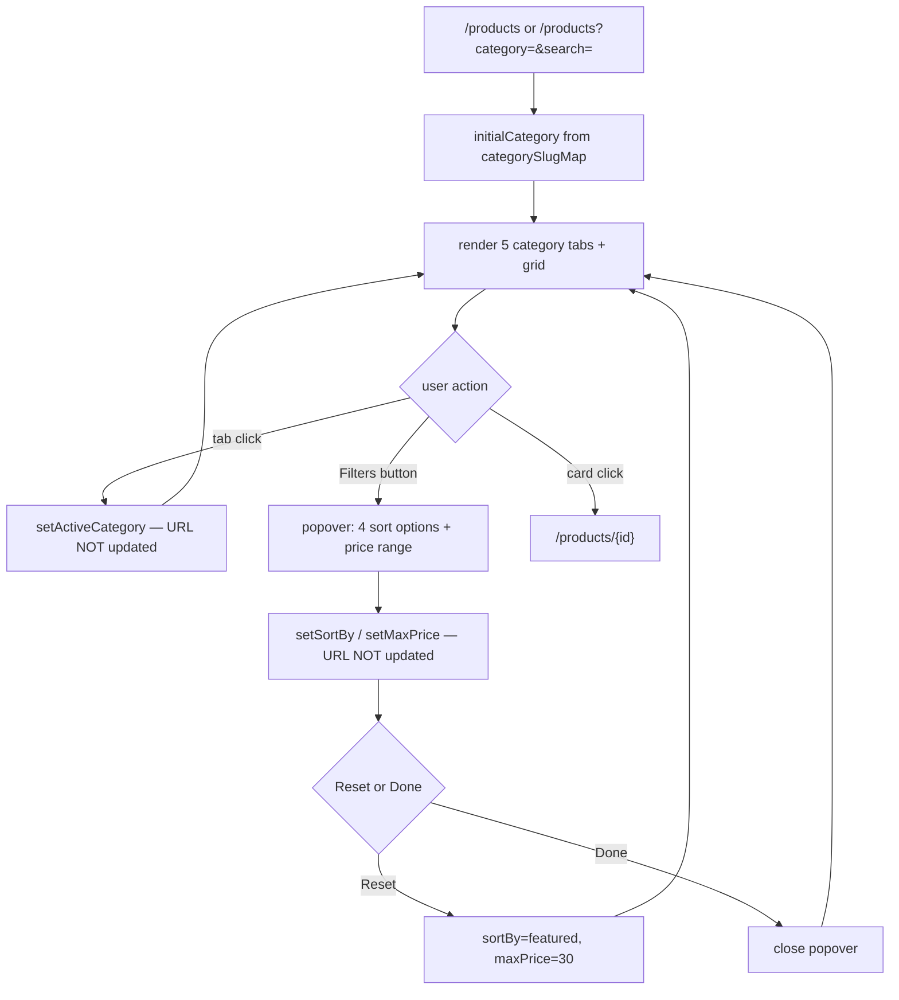
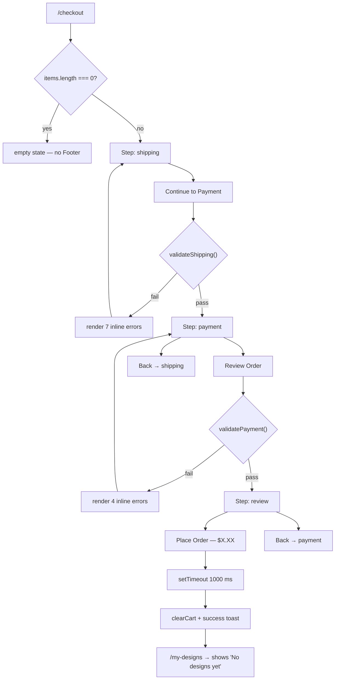

# 12 — Feature Inventory

[← Index](./00-index.md)

Every feature reachable in this codebase, including backend-only capabilities that have no UI, dormant service methods with no route, and affordances that exist but do nothing.

**Status legend:** ✅ Working · ⚠️ Partial / degraded · 🎭 Facade (looks functional, is not) · 💀 Dead (implemented, unreachable) · ❌ Broken

---

## Feature register

| ID | Feature | Status | Surface |
|----|---------|--------|---------|
| F-01 | Homepage / marketing | ✅ | Web |
| F-02 | Product catalogue browse, filter, sort, search | ⚠️ | Web |
| F-03 | Product detail | ⚠️ | Web |
| F-04 | Template gallery | ✅ | Web |
| F-05 | Canvas editor (12 sub-features) | ✅ / ⚠️ | Web |
| F-06 | 3D product preview | ✅ | Web |
| F-07 | Cart | ⚠️ | Web |
| F-08 | Checkout | 🎭 | Web |
| F-09 | My Designs | ❌ | Web |
| F-10 | Authentication | ⚠️ | Web + API |
| F-11 | Multi-tenancy | ⚠️ | API |
| F-12 | Asset upload pipeline | 💀 | API |
| F-13 | Order management | 💀 | API |
| F-14 | Design persistence API | 💀 | API |
| F-15 | Product / template read API | 💀 | API |
| F-16 | Swagger API explorer | ✅ | API |
| F-17 | Database seeding | ✅ | Tooling |
| F-18 | Agent-driven browser QA | ✅ | Tooling |
| F-19 | Design-system generator | ✅ | Tooling |

**Feature-flag system: Not present.** There is no flag inventory, no remote config, no kill switch, and no role-gated UI. The only conditional capability is the 3D quality tier (see F-06). There are no admin, merchant, or debug screens.

---

## F-01 — Homepage

**Purpose.** Marketing landing page that funnels visitors into the catalogue or the template gallery.

**Business logic.** None. Two hardcoded arrays: `categories` (4 items with emoji, gradient, and a **fabricated** template count of 12/24/36/18 — `apps/web/src/app/page.tsx:6-31`) and `featuredProducts` (4 items — `page.tsx:33-62`).

**User flow.** Land → hero CTA (`/products` or `/templates`) → or click a category tile (`/products?category={name.toLowerCase()}`, `page.tsx:134`) → or click a featured card (`/products/{id}`, `page.tsx:176`).

**Technical implementation.** `apps/web/src/app/page.tsx` (258 lines), a **Server Component** — the only page with no `"use client"` besides `/templates`. Composes `Navbar` and `Footer`.

**State.** None.

**Navigation.** Entry: `/`. Exits: `/products`, `/products?category=…`, `/products/{1,2,3,4}`, `/templates`, plus navbar/footer links.

**Data flow.** Static arrays → JSX. No I/O.

**API usage.** None.

**Loading / error / empty states.** None — nothing can fail.

**Edge cases.**
- The category tile builds `?category=${cat.name.toLowerCase()}` giving `cups`, `t-shirts`, `stickers`, `badges` — all four resolve via `categorySlugMap` (`products/page.tsx:25-34`). ✅
- The template counts (12/24/36/18) are fiction. `/templates` actually shows 5/4/3/3.
- **Featured product `2` is "Classic Tee" $24.99** (`page.tsx:43-47`) while `/products/2` is "15oz Black Mug" $14.99 (`products/[id]/page.tsx:43-49`). Clicking the homepage's Classic Tee lands on a mug.
- The "Customize →" `<button>` at `page.tsx:196` is nested **inside** an `<a>` (`page.tsx:174`). Invalid HTML (interactive content inside an anchor) and a nested-interactive a11y violation.

**Performance.** Three always-running `animate-float` blur-3xl elements (`page.tsx:73-75`) plus two more per product card (`page.tsx` has none; `products/page.tsx:233-234` does). `blur-3xl` on a 384 px element forces continuous compositing.

**Platform behaviour.** Web only.

**Coupling.** Depends on `Navbar`, `Footer`, `lucide-react`, and the eight `/products/*.svg` assets. Nothing depends on it.

**Test coverage.** `e2e/user-journey.spec.ts:37-85` — tests 01-05 cover hero, categories, featured images, "How It Works", navbar. Would pass if the suite could reach the server.

---

## F-02 — Product catalogue

**Purpose.** Browse and narrow the eight products.

**Business logic.**
- Category filter: exact match on `p.category` against the display name (`products/page.tsx:75-77`).
- Search: case-insensitive substring across `name`, `category`, `slug` (`products/page.tsx:80-88`).
- Price filter: `p.price <= maxPrice`, range 4–30, default 30 (`products/page.tsx:45,91,171-172`).
- Sort: `featured` (source order), `price-asc`, `price-desc`, `name` via `localeCompare` (`products/page.tsx:94-100`).
- "Filters active" indicator: `sortBy !== "featured" || maxPrice < MAX_PRICE` (`products/page.tsx:69`).

**User flow.**



**Technical implementation.** `apps/web/src/app/(shop)/products/page.tsx` (260 lines). Client component. `useSearchParams` at line 48; a `useEffect` at 62-67 re-syncs `activeCategory` when `categoryParam` changes. Filtering is an IIFE (`:71-103`) recomputed on every render — no `useMemo`.

**State.** `activeCategory`, `filtersOpen`, `sortBy`, `maxPrice` — all local `useState`, none persisted, none in the URL.

**Navigation.** Entry: navbar, homepage tiles, footer links, template "View All", navbar search. Exit: `/products/{id}`.

**Data flow.** A hardcoded 8-item array (`products/page.tsx:11-20`) → filter → sort → map.

**API usage.** None. `productsApi.list` exists (`lib/api.ts:28-29`) and is never called.

**Loading states.** None — data is synchronous.

**Error states.** None. No error boundary.

**Empty states.** **Missing.** If the filters exclude everything (e.g. `?search=zzz`, or Sticker + maxPrice 4), the grid renders zero children and the user sees a blank area with no message. Contrast with `ImagesPanel`, which does handle this (`editor-left-panel.tsx:459-461`).

**Edge cases.**
- `?category=Cups` (capital) → `.toLowerCase()` handles it ✅
- `?category=mug` → **not in `categorySlugMap`** → falls back to `"All"`. The editor's `CATEGORY_ALIASES` *does* accept `mug`. Two vocabularies.
- Navigating from `?category=cups` to `/products` (no param): the effect at `:62-67` only runs `if (categoryParam)`, so the previous category **persists**. Clicking "Products" in the navbar from a filtered view does not reset the filter.
- Manually setting `activeCategory` does not update the URL, so the state is unshareable and lost on back-navigation.
- `useSearchParams()` in a client component without a `<Suspense>` boundary. In Next 14 this opts the route into client-side rendering and emits a build warning. `[UNVERIFIED: whether `next build` errors or only warns here — I did not run a production build.]`

**Performance.** 8 items; trivial. `filteredProducts` recomputes on every keystroke of the price slider, which is fine at this scale and would not be at 1,000.

**Coupling.** `Navbar`, `Footer`, `Button`, the 8 product SVGs. Its hardcoded array must stay in sync with `products/[id]/page.tsx:41-166` — it currently does for ids 1–8.

**Test coverage.** `e2e/bug-regression.spec.ts:10-18` (BUG-1, category param) — **will fail**: it asserts the active tab matches `/Cups|Mugs/i` but the tab label is `"Cup"`. `e2e/bug-regression.spec.ts:73-80` (BUG-8, search). `e2e/user-journey.spec.ts:98-140` (tests 07-09). No unit tests.

---

## F-03 — Product detail

**Purpose.** Show one product and route into the editor.

**Business logic.** Lookup `productCatalog[params.id]` with fallback to `defaultProduct` (`products/[id]/page.tsx:170`). Each product carries 2–4 colour variants and 3–4 template shortcuts.

**User flow.** Arrive → optionally pick a colour swatch → click a template tile (`/editor/{id}?template=t{N}`) or "Start Designing" (`/editor/{id}`).

**Technical implementation.** `apps/web/src/app/(shop)/products/[id]/page.tsx` (298 lines), of which **150 lines are the hardcoded catalogue** (`:16-166`).

**State.** `selectedVariant` — `useState` initialised to `productData.variants[0].id` (`:171`). **It is set but never read for anything except the ring styling** (`:231`). The chosen colour is not passed to the editor, not stored, and not added to the cart.

**Navigation.** Entry: homepage cards, catalogue cards, direct URL. Exits: `/products`, `/editor/{id}`, `/editor/{id}?template=tN`.

**Data flow.** `params.id` → object lookup → JSX.

**API usage.** None.

**Loading / error states.** None. An unknown id silently renders product 1 — **no 404**.

**Empty states.** N/A.

**Edge cases.**
- `/products/999` → shows "11oz White Mug" with the URL still reading `999`. Then "Start Designing" goes to `/editor/999`, where `resolveProductCategory("999", null)` → `"cup"` (`product-catalog.ts:60-63`). Coincidentally consistent, but by accident.
- **The `template=t1..t4` parameter is meaningless.** The tiles emit `?template=t1`, `t2`, `t3`, `t4` (`:251`), but the editor's template ids are `blank`, `birthday-cup`, `coffee-cup-1`, `corporate-cup`, `photo-mug`, `sports-tee`, … (`editor-templates.ts:78-313`). `editor-left-panel.tsx:124` checks `templates.some(t => t.id === templateParam)` and finds nothing, so **no template is ever applied from this page**. The four tiles are decorative.
- `allProducts` is declared at `:17` and never used — dead variable.
- "Use AI Design" fires `toast.info("AI Design is coming soon! ✨")` (`:268`).
- The colour swatch buttons have `title={v.name}` but no text, no `aria-label`, and no `aria-pressed` (`:227-237`).

**Performance.** Negligible.

**Coupling.** Must stay in sync with `products/page.tsx:11-20`. Currently does for name/price on all 8.

**Test coverage.** `e2e/bug-regression.spec.ts:45-51` (BUG-5) — **will fail**: it asserts `"Classic White Mug"` and `"Cotton Tee"`, but the code says `"11oz White Mug"` (`:20`) and `"Classic Cotton Tee"` (`:63`). `e2e/user-journey.spec.ts:146-176` (tests 10-14).

---

## F-04 — Template gallery

**Purpose.** Browse 15 starter designs grouped by product category.

**Business logic.** Static: 4 categories × 3–5 templates (`templates/page.tsx:6-54`). Each category's first entry is a synthetic `blank` card rendered as a dashed "Start Fresh" placeholder (`:113-126`).

**User flow.** Browse → click a card → `/editor/new?category={slug}&template={id}` (`:108`).

**Technical implementation.** `apps/web/src/app/(shop)/templates/page.tsx` (151 lines). **Server Component** — no client JS.

**State.** None.

**Navigation.** Entry: navbar, homepage CTA. Exits: `/editor/new?…`, `/products?category={slug}s`.

**Data flow.** Static array → JSX. Thumbnails are 11 SVGs in `public/templates/`.

**API usage.** None. `templatesApi` exists and is unused.

**Edge cases.**
- Every card routes to `/editor/**new**`, so **all designs from this page share the `localStorage` key `design-new-{category}`**. Starting a Birthday Cup, saving, then starting a Corporate Cup and saving **overwrites the first**.
- The `?template=blank` case is explicitly skipped by the auto-apply guard (`editor-left-panel.tsx:123`), so blank cards open an empty canvas — correct.
- The `count` field says 5/4/3/3 and the arrays contain 5/4/3/3. ✅ Consistent here (unlike the homepage).
- "View All →" builds `/products?category=${category.slug}s` → `cups`, `t-shirts`, `stickers`, `badges`. All four are in `categorySlugMap`. ✅ **This is the BUG-T01 fix** (`TEST_REPORT.md:80-85`).

**Test coverage.** `e2e/user-journey.spec.ts:182-201` (tests 15-17).

---

## F-05 — Canvas editor

The most substantial feature. Twelve sub-features share one Fabric canvas.

### Shared foundation

**Entry.** `/editor/[productId]`, optionally `?category=` and `?template=`.

**Bootstrap sequence** (`apps/web/src/components/editor/editor-canvas.tsx:144-390`):
1. 100 ms timer → `isReady` (`:145`) — defers past the first paint so the container has been laid out.
2. Guard: abort silently if `container.clientWidth <= 0 || clientHeight <= 0` (`:156`).
3. `new Canvas(el, { width, height, backgroundColor: "#e8eaed", selection: true, preserveObjectStacking: true })` (`:158-164`).
4. Add a non-interactive artboard `Rect` with a drop shadow (`:166-168`, factory at `:502-520`).
5. Resolve category, restore or default print dimensions from `localStorage["print-dims-{id}-{cat}"]` (`:169-186`).
6. Lay out the artboard to the print aspect ratio (`:188` → `editor-artboard.ts:97-124`).
7. Register 11 Fabric listeners, 4 container DOM listeners, 2 window key listeners, 1 `ResizeObserver` (`:221-319`).
8. Publish the canvas to the store (`:322`).
9. Restore `localStorage["design-{id}-{cat}"]` if present, strip legacy `print-guide` objects, migrate legacy artboards, reset history (`:325-349`).

**Artboard model.** The artboard is a plain `Rect` with `id: "artboard"`, `selectable: false`, `evented: false` (`:504-512`). It is kept at the back on every `object:added` (`:259`). Its bounds define both the print area and the export crop (`editor-artboard.ts:142-155`). Its `fill` is the design background.

**Print aspect ratios** (`product-catalog.ts:19-24`): cup `1115×380` (≈2.934, matching the 3D mug wrap band), t-shirt `600×760`, sticker `640×640`, badge `640×640`. `computeArtboardLayout` (`editor-artboard.ts:53-88`) fits the ratio into the container with a 32 px margin — landscape fills width, portrait fills height.

**Global keyboard shortcuts** (`editor-canvas.tsx:424-489`):

| Keys | Action | Line |
|------|--------|------|
| `Ctrl+Z` | Undo | 429-433 |
| `Ctrl+Y` / `Ctrl+Shift+Z` | Redo | 434-438 |
| `Delete` | Remove active object (skipped while an `IText` is being edited) | 439-451 |
| `Ctrl+D` | Duplicate with +20/+20 offset | 452-467 |
| `Ctrl+0` | Reset zoom to 100 % and reset viewport | 468-472 |
| `Ctrl+A` | Select all selectable objects into an `ActiveSelection` | 473-484 |
| `Space` (hold) | Temporary pan; ignored while focus is in an input/textarea/contenteditable | 351-373 |

**Not bound:** `Ctrl+S` (Save), `Ctrl+C`/`Ctrl+V`, `Escape` to deselect, arrow-key nudging, `Ctrl+G` grouping. `Ctrl+D` conflicts with the browser's bookmark shortcut but calls `preventDefault` (`:453`).

**Mouse interaction.** Left-drag pans when the Pan tool is active or Space is held; middle-button (`evt.button !== 1` check at `:269,282`) always pans. Wheel zooms in ±0.1 steps, clamped to `[0.25, 3]` (`:298-308`, `canvas-viewport.ts:3-8`). Pan is clamped to ±(dimension × zoom) (`canvas-viewport.ts:19-33`), described in a comment as "Photoshop-like".

**Snapping.** On `object:moving`, if the object's centre is within 10 px of the artboard centre on either axis, it snaps (`:221-235`). Centre-only — no edge snapping, no object-to-object snapping, and **no visual guide lines** despite `README.md:112` claiming "Smart alignment & snap guides".

---

### F-05a — Templates panel ✅

Applies one of 13 code-defined designs. `applyTemplateById` (`editor-templates.ts:46-58`) clears all non-artboard objects, sets the artboard fill, then runs the template's `build(canvas, bounds)`.

**Template inventory** (`editor-templates.ts:78-314`):

| Category | Templates |
|----------|-----------|
| cup | `blank`, `birthday-cup` ("Birthday Fun"), `coffee-cup-1` ("But First, Coffee"), `corporate-cup` ("Corporate Clean"), `photo-mug` ("Photo Mug") |
| t-shirt | `blank`, `sports-tee` ("Sports Jersey"), `event-tee` ("Event Day"), `fashion-tee` ("Minimal Fashion") |
| sticker | `blank`, `logo-sticker` ("Logo Badge"), `product-sticker` ("New Arrival") |
| badge | `blank`, `name-badge` ("Hello Name Tag"), `event-badge` ("VIP Access") |

All positions are expressed as fractions of the artboard bounds (e.g. `b.top + b.height * 0.36`), so templates scale with the print area. ✅

**URL auto-apply** (`editor-left-panel.tsx:119-131`): a `useRef` latch (`appliedFromUrl`) ensures it runs once; skips `blank`; verifies the id exists in the current category's set.

**Edge cases.** Applying a template **destroys all existing work with no confirmation** (`editor-templates.ts:50`). It does push undo afterwards (`editor-left-panel.tsx:116`), so Ctrl+Z recovers.

`findTemplate` (`editor-templates.ts:64-70`) searches **all** categories, so applying a cup template while in t-shirt mode is possible via URL — the artwork would be laid out against the t-shirt artboard.

**Test coverage.** `e2e/user-journey.spec.ts:219-242` — test 21 clicks `"Retro Vibes"`, `"Nature Chill"`, and `"Neon Pop"`, **none of which exist**. That test will fail.

---

### F-05b — Uploads ⚠️

`UploadsPanel` (`editor-left-panel.tsx:164-237`). Hidden `<input type="file" accept="image/png,image/jpeg,image/svg+xml,image/webp" multiple>` (`:202-209`).

**Validation** (`:174-175`): MIME must start with `image/` (or be `image/svg+xml`), size ≤ 10 MB. **Both failures are silent** — the file is simply skipped with no toast, no message, no logging.

**Pipeline:** `FileReader.readAsDataURL` → push to a local `uploads` array → `addImageFromUrl(canvas, dataUrl, 200)`.

**Edge cases.**
- Uploads live in component `useState` (`:166`) and are **lost when the user switches tabs** — `PanelContent` unmounts the panel (`editor-left-panel.tsx:76-94`). The image stays on the canvas; the reusable thumbnail does not.
- Base64 data URLs are embedded in the canvas JSON, which is what gets written to `localStorage`. A 10 MB image becomes ~13.3 MB of base64 and will blow the storage quota on save.
- No upload progress, no cancel, no server upload — `assetsApi` is never called.
- The input is reset (`e.target.value = ""`, `:186`) so the same file can be re-selected. That is a deliberate fix for a known browser behaviour.

---

### F-05c — Text ✅

`TextPanel` (`editor-left-panel.tsx:239-313`). Four presets:

| Preset | Text | Size | Weight |
|--------|------|-----:|--------|
| heading | "Your Heading" | 36 | bold |
| subheading | "Your Subheading" | 24 | 600 |
| body | "Body text here" | 16 | normal |
| caption | "Caption text" | 12 | normal |

All use `fontFamily: "Rubik"`, `fill: "#1F2937"`, and an id of `text-${Date.now()}` (`:255-261`). Placed at the artboard centre via `placeAtCenter` (`fabric-objects.ts:18-26`).

**Text effects.** Four buttons — Curved, Shadow, Outline, Glow — each fires `toast.info("{effect} effect coming soon!")` (`:302`). `README.md:111` advertises "Rich text editing with effects".

**Edge case.** Adding four presets in the same millisecond would collide on `Date.now()` ids. Practically impossible via clicks.

---

### F-05d — Shapes ✅

`ShapesPanel` (`editor-left-panel.tsx:315-418`). Eight shapes:

| Shape | Fabric class | Geometry | Fill |
|-------|-------------|----------|------|
| Rectangle | `Rect` | 100×60, rx/ry 8 | `#7C3AED` |
| Circle | `Circle` | r 30 | `#06B6D4` |
| Triangle | `Triangle` | 60×60 | `#F97316` |
| Line | `Line` | ±50 px horizontal, stroke 3 | `#1F2937` |
| Star | `Path` (10-point SVG path) | ~58 px | `#FBBF24` |
| Heart | `Path` (bezier), `scaleX/Y: 2` | ~60 px | `#EC4899` |
| Arrow | `Path` (7-point) | 80×30 | `#1F2937` |
| Polygon | `Polygon` (5 points) | 58×52 | `#10B981` |

**Note:** `Line` is created with absolute coordinates (`:348`) and does **not** go through `placeAtCenter`, unlike the other seven. It is subsequently normalised by the `object:added` handler (`editor-canvas.tsx:258` → `normalizeObjectOrigin`), which sets centre origin for non-image objects.

This panel is the **BUG-E01 fix** — `TEST_REPORT.md:73` records "All shapes (Star/Heart/Arrow/Polygon) ✅ PASS — BUG-E01 fix verified", meaning those four were previously broken or missing.

---

### F-05e — Stock images ✅

`ImagesPanel` (`editor-left-panel.tsx:420-485`). Six SVGs: landscape, person, stars, heart, smiley, photo-frame (`:425-430`). Client-side name search (`:443-445`) with a proper empty state (`:459-461`).

**Loading path** — `addImageFromUrl` (`fabric-objects.ts:54-91`):
1. Prefix relative `/…` paths with `window.location.origin` (`:59-62`).
2. `loadImageSource` (`:28-52`) — sets `crossOrigin = "anonymous"` for cross-origin URLs, awaits `onload`.
3. **If the URL contains `.svg`, rasterise it to an offscreen `<canvas>`** (`:40-51`). The comment at line 43 reads: *"Rasterize SVGs — Fabric's live canvas often fails to paint vector sources."* This is defensive code for a real past defect.
4. Scale to fit a 120 px box (200 px for uploads), centre on the artboard, `objectCaching: false` (`:73-83`).

**Consequence of rasterisation:** stock images and SVG uploads become bitmaps at their intrinsic size (200×200 for stock), so scaling up pixelates. A vector workflow is lost.

**`crossOrigin` and `toDataURL`:** setting `crossOrigin = "anonymous"` on non-same-origin images is what keeps the canvas untainted, which is what allows `exportArtboardDataUrl` and the 3D texture capture to work. Remove it and both silently break with a `SecurityError`.

---

### F-05f — Backgrounds ✅

`BackgroundsPanel` (`editor-left-panel.tsx:487-586`). Seven presets plus a native colour picker and a hex text field.

**Sync mechanism:** a `useEffect` (`:494-497`) mirrors `store.backgroundColor` into two local states, so a background set by a *template* is reflected in the panel. The comment at line 493 makes the intent explicit. This is the **BUG-E08-adjacent fix**.

**Hex validation:** `/^#[0-9A-Fa-f]{6}$/` after prefixing `#` if missing (`:518-526`). Invalid input updates the text field but not the canvas — no error message.

**Note:** the preset swatches display Tailwind *gradients* (`:501-506` `css` field) but apply flat `color` values. What you see in the picker is not what you get on the artboard.

---

### F-05g — Layers ⚠️

`LayersPanel` (`editor-left-panel.tsx:588-671`). Lists non-artboard objects in reverse z-order (`:627`).

**Naming** (`:630-636`): `i-text` → `Text: "first 15 chars"`, `rect` → `Rectangle`, `circle` → `Circle`, `triangle` → `Triangle`, `line` → `Line`, `image` → `Image`, everything else → capitalised type. So `path` renders as "Path" and `polygon` as "Polygon" — user-hostile names for Star, Heart, and Arrow.

**Interactions:** click a row to select it; click the eye glyph to toggle `visible`.

**Defects:**
- `key={i}` uses the array index (`:639`). Reordering or deleting mid-list causes React to reuse the wrong DOM nodes.
- The visibility toggle **does not push undo** (`:655-660`). Hiding a layer is unrecoverable via Ctrl+Z.
- Locked state is inferred from `lockMovementX` only (`:629`), while `handleLockToggle` sets five lock flags (`editor-right-panel.tsx:282-288`). Partial locks display incorrectly.
- The eye glyph is a raw emoji `👁` / `🚫` (`:663`) — no `aria-label`, and it violates `design-system/mylovelygift/MASTER.md:181` ("Emojis as icons — ❌ forbidden").
- **No reordering UI.** `README.md:109` promises "Layer management (lock, hide, reorder, group)". Reorder exists only via the right panel's Forward/Back buttons; grouping does not exist at all.

---

### F-05h — Properties inspector ✅

`EditorRightPanel` (`editor-right-panel.tsx`, 953 lines). Three modes: nothing selected → `PrintAreaPanel` + hint (`:307-319`); `activeselection` → count, Opacity(All), Delete All, Layer (`:323-386`); single object → the full inspector (`:388-607`).

**Universal controls:** Duplicate, Delete, X/Y/W/H, Rotation (0–360), Opacity (0–100 %), Forward/Back, Lock/Unlock, Visible/Hidden.

**Type-specific:**
- **Text** (`TextProperties`, `:610-786`): font family (8 options — Rubik, Nunito Sans, Inter, Poppins, Montserrat, Arial, Georgia, Courier New), size, weight (6 options), colour + 15 swatches, alignment (left/center/right), letter spacing, line height.
  **Only Rubik and Nunito Sans are actually loaded** (`globals.css:1`). Inter, Poppins, and Montserrat will silently fall back to a system font on the canvas *and* in the 3D texture.
- **Shape** (`ShapeProperties`, `:788-900`): fill + swatches, stroke + swatches, stroke width (0–20), and rounding (0–100) for `rect` only.
- **Image** (`ImageProperties`, `:902-953`): Crop (toast "coming soon"), and 5 filters — None, Grayscale, Sepia, Blur (0.2), Invert — applied via a dynamic `import("fabric")` (`:908`).

**The `forceUpdate` mechanism.** `:206,215-234` subscribes to 7 Fabric events and bumps a counter. Each handler then calls `canvas.fire("object:modified", { target })` **manually** after a programmatic `.set()` — e.g. `:435,451,469,487,513,533`. This is the **BUG-P01 fix** and is the single most important piece of defensive code in the editor. See [13](./13-historical-bug-report.md#bug-p01).

**`NumberInput`** (`:97-147`) holds a local string, commits on every change *and* on blur, and uses a `prevExternal` ref (`:113,117-120`) so canvas-driven updates overwrite the field but the user's own typing does not get clobbered.

**Defects:**
- `commit()` runs on every keystroke (`:137`), so typing "100" applies X=1, then X=10, then X=100 — three canvas mutations and three debounced history pushes.
- `parseInt(raw) || 0` (`:124`) turns an empty field into `0`, snapping the object to the origin.
- W/H set `scaleX`/`scaleY` (`:466,485`) rather than `width`/`height`, so text and paths scale their strokes too.
- Rotation is clamped `[0, 360]` (`:516-517`), so negative angles from canvas rotation are unrepresentable.
- **The multi-select branch (`:323-386`) is missing `data-testid="right-panel"`** and offers no Duplicate, no position/size, and no alignment tools.

---

### F-05i — Print-area control ✅

`PrintAreaPanel` (`print-area-panel.tsx`, 162 lines). Two range sliders plus number inputs for width and height, bounded by `getPrintLimitsForCategory` — min is 25 % of max (`product-print-limits.ts:22,29-30`), max is the category's `ARTBOARD_SIZES` entry.

Changes flow: `applyDimensions` → `clampPrintDimensions` → `setPrintDimensions(category, clamped, persistKey)` → store + `localStorage` → the store subscription in `editor-canvas.tsx:412-419` fires → `syncArtboardLayout(canvas, category, **true**)` → **all objects are rescaled proportionally** (`:66-91`).

Copy is category-aware: the cup gets a bespoke hint about the wrap band (`print-area-panel.tsx:66-69`).

**Edge case.** The rescale threshold is `Math.abs(sx - 1) > 0.01` (`:73`). Sub-1 % changes move the artboard without moving the content, so repeated tiny adjustments accumulate drift.

---

### F-05j — Undo / redo ⚠️

Covered in detail in [10](./10-state-management.md#the-undoredo-race-condition). Summary: a 50-entry stack of full canvas-JSON snapshots; 15 explicit `pushUndo` call sites; an async `loadFromJSON` with synchronous stack bookkeeping, creating a race under rapid input; and one mutation path (layer visibility) that never records history.

Both `undo` and `redo` re-select the last selectable object after loading (`editor-store.ts:161-166, 185-190`) — deliberate, so the properties panel does not go blank after an undo.

---

### F-05k — Zoom and pan ✅

Zoom `[0.25, 3]` in 0.1 steps via wheel, toolbar buttons, or `Ctrl+0` to reset. `applyCanvasZoom` (`canvas-viewport.ts:10-17`) zooms to the canvas centre — **not to the cursor**, which is unusual for a design tool.

Pan: Pan tool, held Space, or middle mouse. `clampCanvasPan` (`:19-33`) allows the artboard to travel one full canvas-dimension beyond each edge.

`updateInteractionMode` (`editor-canvas.tsx:190-197`) sets `canvas.selection`, `skipTargetFind`, `defaultCursor`, `hoverCursor`, and the container's CSS cursor together — five pieces of state that must agree.

---

### F-05l — Save, export, preview, add-to-cart ⚠️

`EditorToolbar` (`editor-toolbar.tsx`).

| Action | Implementation | Issue |
|--------|---------------|-------|
| **Save** (`:64-73`) | `localStorage.setItem("design-{id}-{cat}", canvas.toJSON())`, toast | Local only. Re-reads the category from `window.location.search` (`:69`) rather than using the already-resolved value — a third parsing path |
| **Export** (`:75-87`) | `exportArtboardDataUrl(canvas, { png, multiplier: 2 })` → synthetic `<a download>` click | Fixed 2× multiplier. For the cup artboard on a 1200 px viewport that is roughly 2230×760 — well under 300 DPI for an 8-inch wrap. No DPI choice, no PDF, no bleed |
| **Preview** (`:89-100`) | `window.open("", "_blank")` then `document.write` of an HTML string containing the data URL | **Popup-blocked by default in most browsers.** `if (win)` guards the null but shows no message when blocked. `document.write` on a blank window is deprecated |
| **Info** (`:223-230`) | Toast: `Canvas: {w}×{h}px \| Objects: {n}` | Reports the *viewport* size, not the artboard size — misleading |
| **Add to Cart** (`:36-62`) | Serialises the canvas, exports a 0.3× thumbnail, `addItem({...})`, toast, `router.push("/cart")` | **`unitPrice` is hardcoded to `24.99`** (`:54`) and `productName` to `Custom Design #{productId}` (`:51`), `category: "custom"` (`:52`). A $12.99 mug is billed at $24.99 |

The thumbnail export is wrapped in its own try/catch that falls back to `""` (`:41-46`), with the comment "Fallback if canvas export fails" — defensive code for a tainted-canvas failure.

---

## F-06 — 3D product preview ✅

**Purpose.** Render the design on a photoreal 3D product, live.

**Business logic.**

*Quality tiering* (`editor-3d-preview.tsx:16-23`): `low` if mobile UA **or** `hardwareConcurrency <= 4` **or** `deviceMemory <= 4`; otherwise `high`. Defaults to 4 cores / 4 GB when the APIs are missing (`deviceMemory` is Chromium-only).

| | high | low |
|---|---|---|
| Antialiasing | on | off |
| Hardware scaling | 1 | 1.5 |
| Power preference | `high-performance` | `low-power` |
| Environment intensity | 0.9 | 0.7 |
| Mug tessellation | 96 | 40 |
| Shadows | `ShadowGenerator` 1024, blur-exponential, kernel 32 | a flat translucent disc |
| Post-processing | FXAA, 4× MSAA, bloom | none |
| Auto-rotate (cup thumbnail) | yes | no |

*Geometry* (`product-3d.ts`): mug = 12-point lathe profile (`:61-77`) + cubic-bezier handle tube (`:103-121`) + a tapered print band. T-shirt = 12-point extruded flat-lay silhouette (`:238-251`) + torus collar + a ground-plane chest decal. Sticker = rounded-rect extrusion (`:317-332`) + a ground decal. Badge = cylinder with per-face UVs so the design lands only on the top cap (`:382-397`) + a metallic torus rim.

*The mug wrap constraint.* `product-3d.ts:167-177` documents the arithmetic: average radius ≈ 0.852, circumference ≈ 5.356, wrap = 1 − 76/360 ≈ 0.789, arc length ≈ 4.226, band height = 1.78 − 0.34 = 1.44, **aspect ≈ 2.934**. `ARTBOARD_SIZES.cup = { width: 1115, height: 380 }` gives 2.934. **These two numbers must move together or the artwork stretches.** `MUG_3D_PRINT` (`product-print-limits.ts:9-13`) carries the same constants with its own "must stay in sync" warning.

*Texture orientation.* Each builder returns an `applyTexture` closure. The mug mirrors horizontally (`uScale: -1, uOffset: 1`) so text reads correctly from *outside* the cylinder, and flips vertically (`:206-210`). The other three flip vertically only. All four clamp both axes. All set `anisotropicFilteringLevel = 8` (`:598`) with a comment explaining it prevents blur at grazing angles.

*Render scheduling* (`:603-661`). Not a continuous loop. `pendingFrames` is set to 3 on any change and decremented per frame; when it reaches 0 and the scene is ready, `scene.render()` is skipped entirely. Auto-rotate bypasses this. A `visibilitychange` listener stops the loop when the tab is hidden (`:647-658`).

**User flow.** The thumbnail is always visible bottom-right in the editor → click to expand to a modal → drag/scroll/right-drag to orbit, zoom, pan → Refresh forces a recapture → X or backdrop click closes.

**Loading states.** A spinner overlay shown only when `captureDesign({ showLoading: true })` is called — on mount (`:158`) and on expand (`:171`). Debounced updates show nothing.

**Error states.** Three silent failure paths:
- Capture throws → `catch {}` with the comment "ignore capture failures" (`:141-143`). No toast, no log.
- Texture load fails → the decal is hidden, except for the badge whose face *is* the decal (`:591-593`).
- WebGL unavailable → **unhandled.** `new Engine(...)` throws and there is no error boundary anywhere in the app, so the whole editor route white-screens.

**Edge cases.**
- **React StrictMode double-mount.** The 60 ms deferred creation (`editor-3d-preview.tsx:55-65`) exists because building two engines on the same canvas corrupted the `.env` IBL decode. The comment is explicit: *"building two Babylon engines on the same canvas corrupts pending shader compiles (rgbdDecode for the .env IBL times out and the scene goes black)."*
- **Single WebGL context.** The thumbnail unmounts while the modal is open (`:178`), with the comment "unmounted while modal is open to keep a single WebGL context".
- Changing category/tier/interactive/autoRotate **rebuilds the entire scene** (dep array at `:74`), reloading all three textures.
- `capturePendingRef` (`:114,123-124`) is a mutex against overlapping captures.
- `PREVIEW_TARGET_RESOLUTION = 1280` with the multiplier clamped to `[0.75, 2]` (`:131-135`) keeps the texture sharp regardless of artboard size.

**Performance.** Assets total **5,316,056 bytes** for `studio-bg.jpg` + `studio.env` + `wood-table.jpg`, all loaded eagerly when the editor mounts. `wood-table.jpg` alone is 3.42 MB. There is no lazy loading, no `next/image` optimisation (they are fetched by Babylon, not React), no WebP/AVIF, and no responsive variants.

**Platform behaviour.** Requires WebGL 2. `touchAction: "none"` is set on both canvases (`:193,266`) to stop mobile scroll hijacking. `pointerEvents: "none"` on the thumbnail (`:193`) so the wrapper handles the click.

**Coupling.** Depends on `product-catalog.ts` (artboard ratios), `product-print-limits.ts` (mug band constants), `editor-artboard.ts` (bounds + export), and the store (`canvas`). **Changing `ARTBOARD_SIZES.cup` without changing `MUG_3D_PRINT` breaks the mapping.**

**Test coverage.** None. No unit test, no E2E test, no visual regression. The only evidence of testing is ~40 PNG files in `.playwright-cli/` with names like `cup-3d-front.png`, `babylon-heart.png`, `tshirt-modal4.png`, `fix3d.png`, `grey1.png`.

---

## F-07 — Cart ⚠️

**Business logic.** No de-duplication; quantity 0 or below removes the item; totals recomputed on demand. Display arithmetic: shipping = `totalPrice() > 50 ? "FREE" : "$5.99"` (`cart/page.tsx:140`), tax = `totalPrice() * 0.1` (`:146`), total = `totalPrice() * 1.1 + (totalPrice() > 50 ? 0 : 5.99)` (`:154-156`).

**User flow.** Editor "Add to Cart" → `/cart` → adjust quantities or remove → "Checkout".

**State.** `useCartStore` (persisted) + a local `mounted` flag.

**Loading state.** A pulsing circle placeholder before hydration (`:16-26`).

**Empty state.** ✅ Proper: cart icon, "Your cart is empty", "Time to create something amazing!", "Browse Products" CTA (`:28-52`).

**Error states.** **None.** `localStorage` quota exhaustion during `addItem` is unhandled.

**Edge cases.**
- The heading says `Shopping Cart ({items.length})` — **line count, not quantity**. Three of one item reads "(1)" while the navbar badge reads "3".
- Quantity has no upper bound. Clicking "+" 100 times gives 100.
- `unitPrice` is frozen at add time; no repricing.
- Every item is `productName: "Custom Design #{id}"` and `category: "custom"` (`editor-toolbar.tsx:51-52`), so the category column always reads "custom".
- `thumbnailUrl` is a base64 PNG rendered with a raw `` (`:74`).

**Test coverage.** `apps/web/tests/unit/store/cart-store.spec.ts` — **36 well-written behavioural tests that have never executed.** `e2e/user-journey.spec.ts:563-607` (tests 56-61).

---

## F-08 — Checkout 🎭

**This feature does not do what it appears to do.**

**Business logic.** A three-step wizard with per-field validation.

*Shipping validation* (`checkout/page.tsx:36-47`) — 7 required fields, all `.trim()` non-empty: firstName, lastName, address1, city, state, zip, country. Messages are `"{Field} is required"`.

*Payment validation* (`:49-59`) — cardNumber required and ≥ 13 digits after stripping spaces; expiry required; cvc required and ≥ 3 chars; nameOnCard required. **No Luhn check, no expiry-date parsing, no card-type detection, no CVC-length-by-brand.**

*Order placement* (`:373-386`):
```
setPlacing(true)
await new Promise((r) => setTimeout(r, 1000))   // ← the entire "order"
clearCart()
toast.success("Order placed successfully! 🎉")
router.push("/my-designs")
```
The comment at line 376 reads `// Simulate order placement (backend may not be running)`. **No API call. No order record. No payment. The catch block at :381 is unreachable** because nothing inside the try can throw.

**User flow.**



**Edge cases and defects.**
- **The card data is captured into React state** (`:29-34`) and discarded. It is never transmitted — which is accidentally the *safest* possible outcome, but the UI claims "Your payment info is encrypted and secure" (`:307`), which is a false statement to the user.
- **"Address Line 2" is an uncontrolled input with no `value` and no `onChange`** (`:178`). Whatever the user types is silently dropped.
- No hydration guard, so the server render sees an empty cart and shows the empty state, then the client swaps it in — a visible flash on every load.
- Back/forward navigation exits checkout entirely; steps are not in the URL.
- Placing an order **clears the cart** even though nothing was recorded. The user's work is destroyed.
- The success destination `/my-designs` requires auth and shows "Sign in to view your designs" if the user is not logged in — which is likely, since checkout has no auth gate.
- `state` and `country` are free-text inputs, not selects.
- No `autoComplete` attributes on any of the 11 fields, so browser autofill is unavailable.
- Naming: `shipping_form` / `payment_form` are snake_case (`:20,29`) while their setters are camelCase (`setShippingForm`, `setPaymentForm`) — the only snake_case variables in the frontend.

**Test coverage.** `e2e/bug-regression.spec.ts:54-64` (BUG-6) — **will fail twice**: it clicks a `"Add to Cart"` button on `/products/1` (that page has "Start Designing", not "Add to Cart"), and asserts the error text `"Full name is required"` when the code produces `"First name is required"` (`:38`). `e2e/user-journey.spec.ts:613-686` (tests 62-71).

---

## F-09 — My Designs ❌

**Purpose.** List and manage saved designs.

**Business logic.** Enumerate `localStorage`, take every key starting with `design-`, strip the prefix, synthesise a card (`my-designs/page.tsx:23-39`).

**Auth gate.** `localStorage.getItem("auth_token")` truthiness (`:55`) → sign-in panel (`:57-81`). Client-side and trivially bypassable.

**Why it is broken.** The key-parsing bug documented in [09](./09-navigation.md#the-broken-edit-design-link): the save key is `design-{productId}-{category}` but the read strips only `design-`, so the derived id is `"1-cup"` and the Edit link points at `/editor/1-cup`, which then looks for the nonexistent key `design-1-cup-cup`. **Every "Edit Design" click opens a blank canvas.**

**Delete** (`:46-50`) removes `design-{id}` — for id `"1-cup"` that is `design-1-cup`, which **is** the correct key. So delete works while edit does not.

**Displayed metadata is fabricated:** name is always `Design for Product #{id}`, product is always `"Custom Product"`, `updatedAt` is the literal string `"Saved locally"`, status is always `"DRAFT"` (`:30-35`). The status-badge styling handles `FINALIZED` and `ORDERED` (`:130-139`) but those values can never occur.

**Empty state.** ✅ Proper (`:104-121`).

**Loading state.** Returns `null` until mounted (`:52`) — a blank page, not a skeleton.

**More-menu.** Implemented (`:142-164`) with a single Delete action. This is the **BUG-D01/BUG-D02 fix** (`TEST_REPORT.md:94-106`). It has no Escape handler, no outside-click dismissal, and no focus management.

**Test coverage.** `e2e/bug-regression.spec.ts:36-42` (BUG-4, auth gate) — should pass. `e2e/user-journey.spec.ts:692-726` (tests 72-77) — **will fail**: it asserts `"Birthday Mug for Mom"`, `"Team Event Tee"`, `"Logo Stickers v2"`, `"2 hours ago"`, `"FINALIZED"`, `"ORDERED"` — mock data that no longer exists. It also does not log in first, so it would hit the auth gate.

---

## F-10 — Authentication ⚠️

**Registration** (`register/page.tsx` + `auth.service.ts:75-100`).

Client rules (`register/page.tsx:25-33`): passwords must match; length ≥ 8. Server rules (`auth.service.ts:83-92`): email unique per tenant → `409`; password ≥ 8 → `400`. Role is always `CUSTOMER`.

**Password storage** (`auth.service.ts:27-31`): `scryptSync(password, randomBytes(16).toString("hex"), 64)`, stored as `"{salt}:{hash}"`. Verification uses `timingSafeEqual` inside a try/catch that returns `false` on a length mismatch (`:38-45`). **This is correct, competent crypto** — scrypt with a per-user salt and a constant-time comparison.

**Caveat:** `scryptSync` uses Node's default cost parameters (N=16384, r=8, p=1) and is **synchronous**, so it blocks the event loop for tens of milliseconds per login. With no rate limiting, this is a cheap denial-of-service vector.

**Token generation** (`auth.service.ts:110-121`):
```
payload = { sub: userId, email, iat: Date.now() }
token   = base64url(JSON(payload)) + "." + HMAC-SHA256(JSON(payload), JWT_SECRET ?? "dev-secret-key")
```

This is **not a JWT** — no header segment, no `alg`, no `exp`. And critically: **no verification function exists anywhere in the codebase.** Grep the whole tree for `verifyToken`, `createHmac` (verification side), `JwtStrategy`, `canActivate`, `AuthGuard` — none appear. The token is issued, stored, sent, and ignored.

The fallback secret `"dev-secret-key"` (`:117`) means a deployment that forgets `JWT_SECRET` signs with a value published in this repository.

**Login flow.** Documented as a sequence diagram in [07](./07-architecture.md#c-cross-boundary-path--login-the-only-real-clientserver-round-trip).

**Forgot password** 🎭. `POST /auth/forgot-password` does not exist on the server. The client's `catch` (`forgot-password/page.tsx:24-28`) shows a success message for the guaranteed 404. The stated rationale in the comment at line 25 — "Show success even on error to prevent email enumeration" — is a real security principle applied to a feature that does not exist.

**Session lifecycle.** Login/register write three `localStorage` keys. **There is no logout anywhere in the UI.** No token expiry check, no refresh, no revocation, no multi-device handling, no session list.

**Social login.** Google and GitHub buttons are rendered with full brand SVGs (`login/page.tsx:140-166`) and **no `onClick` and no `disabled`**. They are focusable and clickable and do nothing.

**"Remember me"** checkbox (`login/page.tsx:106`) — no `id`, no `name`, no state binding, no effect.

**Authorization model.** Roles exist in the schema (`ADMIN | MERCHANT | CUSTOMER`, `schema.prisma:49-53`) and are returned in the login response (`auth.controller.ts:33`). **Nothing reads the role.** No role check exists on the client or the server. There are no admin or merchant surfaces to gate.

**Enforcement-point inventory:**

| Check | Location | Enforced where | Bypassable? |
|-------|----------|---------------|-------------|
| Password correctness | `auth.service.ts:104` | Server | No ✅ |
| Password length | `auth.service.ts:90` + `register/page.tsx:30` | Both | Server-side check holds ✅ |
| Email uniqueness per tenant | `auth.service.ts:83-88` + DB unique index | Both | No ✅ |
| Tenant exists | `auth.service.ts:21-23` | Server | No ✅ |
| "Is logged in" (My Designs) | `my-designs/page.tsx:55` | **Client only** | **Yes** — one `localStorage.setItem` |
| Design ownership | `designs.service.ts:19` | Server, on unverified input | **Yes** — forge `x-user-id` |
| Order ownership | `orders.service.ts:29` | Server, on unverified input | **Yes** — forge `x-user-id` |
| Asset ownership | **Nowhere** | — | N/A — no check at all |
| Role/permission | **Nowhere** | — | N/A |

**Test coverage.** `apps/api/tests/unit/modules/auth/auth.service.spec.ts` — 20 tests including scrypt round-trips and token structure. `auth.controller.spec.ts` — 9 tests. `e2e/bug-regression.spec.ts:83-90` (BUG-9, label association).

---

## F-11 — Multi-tenancy ⚠️

Covered in [07](./07-architecture.md#78-multi-tenancy-architecture). Schema-level isolation is real; runtime enforcement is not. `Design` has no `tenantId`. `GET /products/:id` and both template-by-id endpoints are unscoped. The frontend sends a single build-time tenant id.

---

## F-12 — Asset upload pipeline 💀

Fully implemented server-side (`assets.service.ts`, `assets.controller.ts`), fully tested (17 tests), and **never called**. The editor keeps uploads as base64 data URLs in the browser instead.

Intended flow: `POST /assets/upload-url` → presigned `PUT` to MinIO → `POST /assets/confirm` → DB row. Security gaps enumerated in [08](./08-api-documentation.md#assets--appsapisrcmodulesassetsassetscontrollerts).

---

## F-13 — Order management 💀

`GET /orders`, `GET /orders/:id`, `POST /orders` exist and are tested (24 tests including all pricing boundaries). Nothing calls them. `updateStatus` has no route, so an order created via the API is frozen at `PENDING` forever.

---

## F-14 — Design persistence API 💀

Full CRUD + finalize, 20 tests, ownership checks. Nothing calls it. The frontend uses `localStorage`.

---

## F-15 — Product / template read API 💀

Seven endpoints, 24 tests. Nothing calls them. Two service methods (`ProductsService.create/update/delete`, `TemplatesService.createDesignTemplate`) have no route at all.

---

## F-16 — Swagger API explorer ✅

`SwaggerModule.setup("api/docs", app, document)` (`main.ts:39`). All six controllers carry `@ApiTags`; all 20 routes carry `@ApiOperation`; `ProductsController` additionally documents four query params (`products.controller.ts:22-25`).

**Gaps:** no `@ApiResponse` decorators, so no response schemas are published. No `@ApiHeader` for `x-tenant-id`/`x-user-id`, so the two headers every endpoint depends on are invisible in the docs. `addBearerAuth()` advertises an auth scheme that is not enforced. It is served in all environments with no gating.

---

## F-17 — Database seeding ✅

`apps/api/prisma/seed.ts` (242 lines). Creates 1 tenant (`slug: "default"`), 4 category templates, 4 products, 6 design templates.

**Category constraints seeded** (never read by any code):

| Category | Canvas | Print area | Materials | Colours | Base price | minDPI | maxFileSize |
|----------|--------|-----------|-----------|---------|-----------:|-------:|------------:|
| cup | 800×400 | 700×320 @ (50,40) | ceramic, stainless-steel, plastic | white, black, navy, red, pink | 12.99 | 150 | 10,485,760 |
| t-shirt | 600×800 | 500×650 @ (50,75) | cotton, polyester, blend | white, black, navy, grey, red, pink, yellow | 24.99 | 200 | 15,728,640 |
| sticker | 400×400 | 360×360 @ (20,20) | vinyl, paper, holographic, clear | white | 4.99 | 300 | 5,242,880 |
| badge | 300×300 | 260×260 @ (20,20) | metal, plastic, wood | silver, gold, white | 6.99 | 300 | 5,242,880 |

**These dimensions contradict the frontend.** `ARTBOARD_SIZES` (`product-catalog.ts:19-24`) uses cup `1115×380`, t-shirt `600×760`, sticker/badge `640×640`. The DB says cup `800×400` with a `700×320` print area. Two independent geometry models.

**Defects:**
- `blankCupTemplate` is assigned at `:151` and never used.
- The 6 design templates use `prisma.designTemplate.create`, not `upsert` (`:151,162,178,189,205,216`), while everything else upserts. **Re-running the seed duplicates all 6 templates.**
- Pricing rules (`perColor`, `perSide`, `perSheet`, quantity breaks) are seeded and never read.

---

## F-18 — Agent-driven browser QA ✅

A genuine, working developer feature. `.cursor/rules/browser-testing.mdc` and `.cursor/skills/playwright-cli/SKILL.md` define a token-efficient workflow: open a named Playwright session, snapshot the accessibility tree to `.playwright-cli/*.yml`, read the file for element refs, interact by ref. Backed by `package.json:22-24`. `.github/prompts/deep-test-report.prompt.md` is the QA-agent prompt that produced `TEST_REPORT.md`.

Evidence of heavy use: 352 artifact files across `.playwright-cli/` and `.playwright-mcp/`.

---

## F-19 — Design-system generator ✅

Vendored `ui-ux-pro-max` toolkit: BM25 search over 24 reference CSVs, with a `--design-system --persist` mode that writes `design-system/{slug}/MASTER.md` (`search.py:76-98`). It produced `design-system/mylovelygift/MASTER.md`, whose palette the implementation then ignored.

---

## Cross-feature interaction matrix

### Shared resources

| Resource | F-02 | F-03 | F-04 | F-05 | F-06 | F-07 | F-08 | F-09 | F-10 |
|----------|:----:|:----:|:----:|:----:|:----:|:----:|:----:|:----:|:----:|
| `useCartStore` | | | | ✏️ | | ✏️ | ✏️ | | |
| `useEditorStore` | | | | ✏️ | 👁 | | | | |
| Fabric `Canvas` | | | | ✏️ | 👁 | | | | |
| `localStorage["design-*"]` | | | | ✏️ | | | | ✏️ | |
| `localStorage["cart-storage"]` | | | | ✏️ | | ✏️ | ✏️ | | |
| `localStorage["auth_token"]` | | | | | | | | 👁 | ✏️ |
| `localStorage["print-dims-*"]` | | | | ✏️ | | | | | |
| `product-catalog.ts` | | | | 👁 | 👁 | | | | |
| Hardcoded product arrays | ✏️ | ✏️ | | | | | | | |
| `Navbar` / `Footer` | 👁 | 👁 | 👁 | | | 👁 | 👁 | 👁 | |
| `Button` / `Input` | 👁 | 👁 | | 👁 | 👁 | 👁 | 👁 | 👁 | 👁 |
| Pricing rules (10 % tax, $50 free ship) | | | | | | ✏️ | ✏️ | | |

✏️ writes · 👁 reads

### Coupling and blast radius

| If you change… | These break | Why |
|----------------|-------------|-----|
| `ARTBOARD_SIZES.cup` (`product-catalog.ts:20`) | F-06 mug mapping, F-05i limits, F-05l export size | The 2.934 ratio is duplicated in `product-3d.ts:167-177` and derived from `MUG_3D_PRINT` |
| `MUG_3D_PRINT` (`product-print-limits.ts:9-13`) | F-06 geometry, F-05i limits | `buildMug` reads it at `product-3d.ts:158-176` |
| The `localStorage` key format in `editor-toolbar.tsx:71` | F-05 restore, F-09 listing **and** the already-broken edit link | Three independent parsers: `editor-canvas.tsx:325`, `my-designs/page.tsx:27`, `editor-toolbar.tsx:69` |
| `CartItem` shape (`cart-store.ts:4-14`) | F-05l, F-07, F-08 + every persisted cart in every browser | `persist` has no `version`/`migrate` — a shape change silently corrupts existing carts |
| Fabric's JSON format (a library upgrade) | F-05 restore, F-05j undo, F-07 `designData`, F-13 `canvasData` | Four persistence surfaces |
| `FabricObject.customProperties` (`editor-canvas.tsx:29`) | F-05j undo, F-05 restore, F-05g locked layers | Removing it makes the artboard selectable after any reload |
| `resolveProductCategory` (`product-catalog.ts:52-64`) | F-05 layout, F-06 model choice, F-05i limits, storage keys | Called from 5 files with three different argument shapes |
| `getArtboardBounds` (`editor-artboard.ts:28-45`) | F-05c/d/e placement, F-05l export, F-06 capture, F-05a templates | 9 call sites |
| The 10 % tax / $50 threshold | F-07, F-08, F-13 | Three independent copies (`cart/page.tsx:140,146,154`; `checkout/page.tsx:62-64`; `orders.service.ts:51-53`) |
| Hardcoded product arrays | F-01, F-02, F-03 | Four copies including `seed.ts` |

### Regression-risk hot spots

| Rank | Area | Why |
|-----:|------|-----|
| 1 | `editor-canvas.tsx:149-390` | 241-line effect, 6 deps, owns 11 concerns. Any dep change destroys the canvas |
| 2 | `editor-right-panel.tsx` `forceUpdate` + manual `canvas.fire` | Six handlers must each remember to fire the event. Omitting one silently reintroduces BUG-P01 |
| 3 | The mug 2D↔3D constant pair | Two files, no test, visually subtle when wrong |
| 4 | `localStorage` key construction | Three parsers, already out of sync |
| 5 | Undo/redo async race | No guard, no test |
| 6 | Cart persistence shape | No migration path; user-visible data loss |
| 7 | `FabricObject.customProperties` global | Load-order dependent; a library rename kills it silently |

---

## Test coverage map

### API — 15 suites, 146 tests, all passing (verified by execution)

| Area | Spec | Tests |
|------|------|------:|
| AuthService | `tests/unit/modules/auth/auth.service.spec.ts` | 20 |
| AuthController | `tests/unit/modules/auth/auth.controller.spec.ts` | 9 |
| ProductsService | `tests/unit/modules/products/products.service.spec.ts` | 15 |
| ProductsController | `tests/unit/modules/products/products.controller.spec.ts` | 5 |
| TemplatesService | `tests/unit/modules/templates/templates.service.spec.ts` | 12 |
| TemplatesController | `tests/unit/modules/templates/templates.controller.spec.ts` | 5 |
| DesignsService | `tests/unit/modules/designs/designs.service.spec.ts` | 14 |
| DesignsController | `tests/unit/modules/designs/designs.controller.spec.ts` | 7 |
| OrdersService | `tests/unit/modules/orders/orders.service.spec.ts` | 15 |
| OrdersController | `tests/unit/modules/orders/orders.controller.spec.ts` | 4 |
| Order business rules | `tests/unit/modules/orders/order-business-rules.spec.ts` | 4 |
| AssetsService | `tests/unit/modules/assets/assets.service.spec.ts` | 12 |
| AssetsController | `tests/unit/modules/assets/assets.controller.spec.ts` | 3 |
| MedusaService | `tests/unit/common/medusa.service.spec.ts` | 6 |
| PrismaService | `tests/unit/common/prisma.service.spec.ts` | 6 |

`packages/types` — 1 suite, 17 tests, passing.

### Untested areas, ranked by risk

| Rank | Area | Files | Why it matters |
|-----:|------|-------|----------------|
| 1 | **Every React component** | 22 `.tsx` files | Zero component tests exist. `@testing-library/react` is installed but only `act` is imported |
| 2 | The entire 3D pipeline | `product-3d.ts` (679 lines), `editor-3d-preview.tsx` | The most complex code in the repo, zero automated coverage |
| 3 | Canvas lifecycle & shortcuts | `editor-canvas.tsx` (520 lines) | Includes the legacy-migration path, which is exactly the code that runs on users' existing saved designs |
| 4 | Artboard geometry | `editor-artboard.ts`, `product-print-limits.ts`, `product-catalog.ts` | Pure functions, trivially testable, and they encode the 2D↔3D contract |
| 5 | Template application | `editor-templates.ts` (315 lines) | Destructive operation with no test |
| 6 | Image loading & SVG rasterisation | `fabric-objects.ts` | Contains defensive code for a known Fabric bug |
| 7 | Checkout validation | `checkout/page.tsx:36-59` | The E2E test that covers it asserts the wrong string |
| 8 | `main.ts` bootstrap | `apps/api/src/main.ts` | Explicitly excluded from coverage (`apps/api/jest.config.ts:13`) |
| 9 | Prisma seed | `apps/api/prisma/seed.ts` | Contains the duplicate-on-rerun bug |
| 10 | Any integration test | — | `.github/copilot-instructions.md:789-794` prescribes them; none exist |
