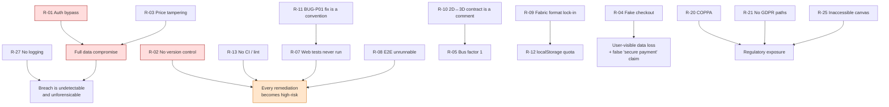

# 14 — Known Risks

[← Index](./00-index.md)

Risks are scored **Likelihood × Impact**, both on a 1–5 scale, with the product giving a priority. "Current mitigation" records what actually exists in the repository today, not what should exist.

---

## Risk register

| ID | Risk | Category | L | I | Score | Current mitigation | Residual exposure |
|----|------|----------|:-:|:-:|:-----:|-------------------|-------------------|
| **R-01** | Any actor can read, modify, or delete any user's designs and orders by forging `x-user-id` | Security | 5 | 5 | **25** | None. Ownership checks exist (`designs.service.ts:19`, `orders.service.ts:29`) but operate on unverified input | **Total.** Full data compromise on any network-reachable deployment |
| **R-02** | No version control — no revert, no blame, no recovery from a bad change | Operational | 5 | 5 | **25** | None | **Total.** Every edit is irreversible |
| **R-03** | Order prices are client-controlled | Security / financial | 5 | 4 | **20** | None. `orders.controller.ts:33` accepts `unitPrice`; the global `ValidationPipe` is inert because no DTO class exists | **Total** on any live order path |
| **R-04** | Checkout collects card data and shows "Order placed successfully" while recording nothing | Business continuity / legal | 5 | 4 | **20** | None. `checkout/page.tsx:373-386` is a `setTimeout` | Users lose their cart and believe they have bought something |
| **R-05** | Bus factor of 1 across the entire repository; the 3D and print-area subsystems encode knowledge nowhere else | Bus factor | 4 | 5 | **20** | Partial. Eleven explanatory comments in `product-3d.ts` and two "keep in sync" warnings (`product-3d.ts:167-177`, `product-print-limits.ts:5-8`) | High. No author metadata exists; nobody can be asked |
| **R-06** | `.gitignore:48` excludes `apps/api/prisma/migrations/` — the schema history will be lost the moment git is initialised | Data / operational | 4 | 5 | **20** | None. `migration_lock.toml:2` warns against exactly this and is itself excluded | Schema state becomes unreproducible across environments |
| **R-07** | ~90 web tests have never executed; the suite cannot start | Technical / quality | 5 | 4 | **20** | None. `apps/web/jest.config.ts:9` is malformed (verified by execution) | Zero regression protection on the entire frontend |
| **R-08** | The E2E suite cannot run (port mismatch) and at least 8 of its assertions are stale | Technical / quality | 5 | 3 | **15** | None. `playwright.config.ts:12` targets 3001; `dev:web` serves 3000 | The nine "verified fixed" QA bugs cannot be re-verified |
| **R-09** | Fabric.js JSON is the persisted format in four places with no schema version and no migration hook | Technical / data | 3 | 5 | **15** | Partial. `migrateLegacyArtboard` (`editor-canvas.tsx:96-142`) handles two prior *artboard* models, not Fabric format changes | A Fabric minor upgrade could silently corrupt every saved design and cart |
| **R-10** | The mug's 2D↔3D aspect-ratio contract is enforced only by comments | Technical | 3 | 4 | **12** | Comments at `product-3d.ts:167-177` and `product-print-limits.ts:5-8`. **No test, no assertion, no constant shared between the files** | Visibly stretched artwork on every mug, discovered only by eye |
| **R-11** | BUG-P01's fix is a convention (call `canvas.fire` manually) rather than a mechanism | Technical | 4 | 3 | **12** | 10 correct call sites in `editor-right-panel.tsx` | Any new property control silently reintroduces the bug, in that control only |
| **R-12** | `localStorage` quota exhaustion is unhandled — base64 images in cart items and design saves | Technical / data loss | 3 | 4 | **12** | None. No try/catch around `setItem` at `editor-toolbar.tsx:71` or in Zustand `persist` | Silent `QuotaExceededError`; the user's design is not saved and no error is shown |
| **R-13** | No CI, no pre-commit hooks, no lint configuration | Operational | 5 | 2 | **10** | None. `.eslintrc*` does not exist, so `npm run lint` fails in both apps | Defects reach the working tree unimpeded |
| **R-14** | Product catalogue duplicated in four files and already divergent | Technical / data | 5 | 2 | **10** | None | `page.tsx:43-47` says product 2 is "Classic Tee $24.99"; `products/[id]/page.tsx:43-49` says "15oz Black Mug $14.99" |
| **R-15** | Pricing rules duplicated in three layers | Technical / financial | 3 | 3 | **9** | None. `cart/page.tsx:140,146,154`; `checkout/page.tsx:62-64`; `orders.service.ts:51-53` | Frontend and backend totals can diverge with no test to catch it |
| **R-16** | The `.github/copilot-instructions.md` "single source of truth" contains ~14 statements contradicted by the code | Operational | 5 | 2 | **10** | None | Future agents will build on false premises — e.g. "use Three.js", "rate limiting already configured", "cache in Redis" |
| **R-17** | Undo/redo race: async `loadFromJSON` with synchronous stack bookkeeping | Technical | 3 | 3 | **9** | None. No in-flight guard, no test | Rapid Ctrl+Z leaves the canvas out of sync with the history pointer |
| **R-18** | "Edit Design" always opens a blank canvas | Technical / UX | 5 | 2 | **10** | None. Three independent `localStorage` key derivations, already divergent | Saved work appears lost to the user |
| **R-19** | No error boundary anywhere — any render throw white-screens the route | Technical | 3 | 4 | **12** | None. `QA_AUDIT_REPORT.md:132` recommends adding them | A WebGL failure or a corrupt `localStorage` value kills the whole editor |
| **R-20** | The product is targeted at "Gen Alpha" with no age gate and no parental consent | Compliance (COPPA) | 3 | 5 | **15** | None. No age field exists in the schema or UI | Regulatory exposure if launched to a US audience as positioned |
| **R-21** | No GDPR erasure or export path; no retention policy; PII plaintext at rest | Compliance | 3 | 4 | **12** | None. `DELETE /designs/:id` exists; there is no user deletion or export | Unmeetable data-subject requests |
| **R-22** | The three infrastructure Dockerfiles/Compose definitions cannot build or run as written | Operational | 4 | 3 | **12** | None. `Dockerfile.web` needs `output: "standalone"`; `Dockerfile.api` needs a lockfile in its context; MinIO and Medusa collide on host port 9000 | There is no working deployment path |
| **R-23** | `minio/minio:latest` unpinned; no dependency-vulnerability monitoring across 1,648 packages | Supply chain | 3 | 3 | **9** | Partial. The lockfile is clean — 100 % `registry.npmjs.org`, no overrides, no patches | Silent image drift; unknown CVE exposure |
| **R-24** | 5.3 MB of unoptimised 3D textures load eagerly for a 144 px thumbnail | Technical / UX | 4 | 2 | **8** | Partial. Quality tiering (`editor-3d-preview.tsx:16-23`) reduces *rendering* cost but not *download* cost | Slow editor entry, especially on mobile |
| **R-25** | The canvas editor is completely inaccessible to assistive technology | Compliance / UX | 4 | 3 | **12** | None. `<canvas>` has no `role`, no label, no keyboard alternative | The product's core feature excludes disabled users; legal exposure in regulated markets |
| **R-26** | 21 declared-but-unimported dependencies, including `sharp` and `@medusajs/medusa` | Technical | 5 | 1 | **5** | None | Install size, audit surface, and misleading signals about what the system does |
| **R-27** | No monitoring, logging, crash reporting, or health endpoint | Operational | 4 | 3 | **12** | None. Two `console.log` startup banners are the entire observability story | An incident would be undetectable and unforensicable |
| **R-28** | Re-running `npm run db:seed` duplicates all 6 design templates | Technical / data | 3 | 2 | **6** | Partial. Tenant, categories, and products correctly `upsert`; only the templates use `create` (`seed.ts:151,162,178,189,205,216`) | Template list grows on every seed |
| **R-29** | `packages/types` has no consumers and no declared dependencies | Technical | 4 | 1 | **4** | None | Types are duplicated in both apps and can drift |
| **R-30** | Prisma client generation is not hooked to install or build | Technical / build | 4 | 3 | **12** | Partial. `docker/Dockerfile.api:9` runs `prisma generate`; local `npm run build` does not | A fresh clone reproduces the 4-error build failure recorded in `apps/api/.turbo/turbo-build.log` |

---

## Top risks by score

| Score | Risks |
|------:|-------|
| **25** | R-01 (auth bypass), R-02 (no version control) |
| **20** | R-03 (price tampering), R-04 (fake checkout), R-05 (bus factor), R-06 (migrations gitignored), R-07 (web tests never run) |
| **15** | R-08 (E2E unrunnable), R-09 (Fabric format lock-in), R-20 (COPPA) |
| **12** | R-10, R-11, R-12, R-19, R-21, R-22, R-25, R-27, R-30 |

---

## Risk categories in aggregate

### Security
R-01, R-03 are the dominant pair. The backend has a *correctly shaped* authorization layer sitting on top of *no authentication whatsoever*, and a business layer that trusts client-supplied money. Full detail in [16](./16-security-findings.md).

### Operational / business continuity
R-02 is the enabling risk for everything else: without version control there is no safe way to remediate any other risk. R-22 means there is currently no path to production. R-27 means a production incident would be invisible.

### Bus factor
R-05. One author, no history, no attribution, and two subsystems (`product-3d.ts` + the print-area constants) whose correctness depends on numbers that were derived once and documented in prose. The comment at `product-3d.ts:172-176` — showing the arithmetic that produces 2.934 — is the single most valuable artifact for continuity in the repository. **Preserve it verbatim.**

### Compliance
R-20 (COPPA) is the sharpest: the product is explicitly positioned for a cohort that is substantially under 13 (`package.json:5`, `README.md:3`, `.github/copilot-instructions.md:43`) with no age gate anywhere. R-21 and R-25 are the standard GDPR and accessibility exposures, both unaddressed.

### Quality assurance
R-07 and R-08 together mean **the project has no working automated verification of its frontend at all.** 146 API tests pass; ~90 web unit tests and ~109 E2E tests have never run. The nine bugs marked "Verified ✅" in `QA_AUDIT_REPORT.md` cannot be re-verified, and three of their regression tests would fail today against the current code.

---

## Risk interactions

Some risks amplify each other and should be read together.

**The single highest-leverage action** is R-02: initialise git and commit. It costs minutes and converts every other remediation from irreversible to reversible. It must also be done **carefully**, because R-06 means the current `.gitignore` would drop the migration history on the first commit.
