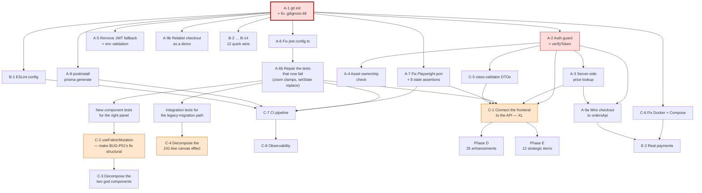

# 20 — Future Improvement Opportunities

[← Index](./00-index.md)

Two parts:
- **Part 1 (Phase 6):** a prioritised roadmap. **Recommendations only — nothing in this dossier was implemented.**
- **Part 2 (Phase 7):** the context a future redesign would need. **Research only — no redesign was performed, no UI code written, no token altered.**

---

# PART 1 — Prioritised Roadmap

Every item carries: problem + evidence, approach, files affected, effort, risk of doing it, risk of *not* doing it, dependencies, validation, and rollback.

**Effort:** S ≤ 2 h · M ≤ 1 day · L ≤ 1 week · XL > 1 week

---

## Phase A — Critical / Immediate

### A-1 — Initialise version control (and fix `.gitignore` first)

**Problem.** `git rev-parse --is-inside-work-tree` → `fatal: not a git repository`. There is no undo for anything. **Additionally**, `.gitignore:48` excludes `apps/api/prisma/migrations/`, so a naive `git init && git add .` would permanently drop the only schema history — the file it would drop literally says *"It should be added in your version-control system (i.e. Git)"* (`migration_lock.toml:2`).

**Approach.** Delete `.gitignore:48`. Add `.playwright-mcp/` and root `*.png` to `.gitignore`. Verify `git status` does **not** list `apps/api/.env` or `apps/web/.env.local`. Then `git init`, commit.

**Files.** `.gitignore`.

**Effort.** S · **Risk of doing.** Very low, *provided* the ignore review happens first. · **Risk of not doing.** Catastrophic — every subsequent item in this roadmap is irreversible without it.

**Dependencies.** None. **This must be first.**

**Validation.** `git status --porcelain` shows no `.env`; `git ls-files apps/api/prisma/migrations` lists the migration.

**Rollback.** `rm -rf .git`.

---

### A-2 — Implement token verification and a global auth guard

**Problem.** `AuthService.generateToken` (`auth.service.ts:110-121`) issues an HMAC token that **no code ever verifies**. Every ownership check reads a client-supplied `x-user-id` header (`designs.controller.ts:21`, `orders.controller.ts:39`). Any actor can read, modify, or delete any user's data. → [16, SEC-01/02](./16-security-findings.md)

**Approach.** Add `verifyToken(token): { sub, email, iat } | null` as the inverse of `generateToken`, using `timingSafeEqual` on the recomputed HMAC. Add an `exp` claim and enforce it. Create an `AuthGuard implements CanActivate` reading `Authorization: Bearer`, attaching the principal to `request.user`. Register it globally via `APP_GUARD` with a `@Public()` decorator on `/auth/login` and `/auth/register`. Replace every `@Headers("x-user-id")` with a `@CurrentUser()` param decorator.

**Files.** `apps/api/src/modules/auth/auth.service.ts`, new `apps/api/src/common/auth/auth.guard.ts` + `current-user.decorator.ts` + `public.decorator.ts`, `apps/api/src/app.module.ts`, all 3 controllers using `x-user-id`, `apps/web/src/lib/api.ts:20` (drop the `x-user-id` header).

**Effort.** M · **Risk of doing.** Medium — every API test that passes `x-user-id` needs updating (`designs.controller.spec.ts`, `orders.controller.spec.ts`, `assets.controller.spec.ts`, `order-business-rules.spec.ts`). · **Risk of not doing.** Total data compromise on any network-reachable deployment.

**Dependencies.** A-1.

**Validation.** A new test asserting that a request with a forged `x-user-id` and no `Authorization` returns 401; existing 146 tests still pass.

**Rollback.** Remove the `APP_GUARD` registration — one line.

---

### A-3 — Look up order prices server-side

**Problem.** `orders.controller.ts:33` accepts `unitPrice` from the request body; `orders.service.ts:48` multiplies it into the subtotal. Nothing consults `products.basePrice` or `product_variants.price`. → [16, SEC-03](./16-security-findings.md)

**Approach.** Change the DTO to `{ designId, quantity, variantId?, options? }`. In `createOrder`, resolve `designId → design.productId → product/variant` and read the authoritative price. Reject items whose design does not belong to the caller or is not `FINALIZED` (the rule `.github/copilot-instructions.md:691` already states).

**Files.** `apps/api/src/modules/orders/orders.controller.ts`, `orders.service.ts`, `apps/api/tests/unit/modules/orders/*.spec.ts` (all 23 pricing tests need reshaping), `apps/web/src/lib/api.ts:59-63`.

**Effort.** M · **Risk of doing.** Medium — rewrites the most-tested code in the backend. · **Risk of not doing.** Anyone can order anything for one cent.

**Dependencies.** A-2 (needs a real caller identity).

**Validation.** A test asserting that a client-supplied `unitPrice` is ignored and the product's price is used.

**Rollback.** Revert the commit.

---

### A-4 — Add an ownership check to `DELETE /assets/:id`

**Problem.** `assets.service.ts:75-87` deletes the S3 object and the row with **no authorization whatsoever**. → [16, SEC-04](./16-security-findings.md)

**Approach.** Require the authenticated principal; verify `asset.uploadedBy === userId` or admin-for-tenant. Throw `NotFoundException` on mismatch (consistent with the designs/orders pattern).

**Files.** `assets.controller.ts:40-44`, `assets.service.ts:75-87`, `assets.controller.spec.ts:81-95`, `assets.service.spec.ts:198-251`.

**Effort.** S · **Risk of doing.** Very low. · **Risk of not doing.** Anyone can destroy any asset, cross-tenant, irrecoverably.

**Dependencies.** A-2. **Validation.** A test for the cross-user delete case. **Rollback.** Revert.

---

### A-5 — Remove the published JWT fallback secret and assert required env vars at boot

**Problem.** `auth.service.ts:117` — `process.env.JWT_SECRET || "dev-secret-key"`. A deployment that forgets the variable signs tokens with a value readable in this repository.

**Approach.** Throw at module init if `JWT_SECRET` is unset. Add a `ConfigModule.forRoot({ validationSchema })` covering `DATABASE_URL`, `JWT_SECRET`, and the four S3 variables.

**Files.** `apps/api/src/modules/auth/auth.service.ts:117`, `apps/api/src/app.module.ts:14`, `.env.example` (replace values with `<CHANGE_ME>`).

**Effort.** S · **Risk of doing.** Low — will make a misconfigured environment fail loudly, which is the point. · **Risk of not doing.** Forgeable tokens once A-2 lands.

**Dependencies.** None. **Rollback.** Revert.

---

### A-6 — Fix the web Jest configuration

**Problem.** `apps/web/jest.config.ts:9` — `["@swc/jest"]` is a 1-tuple where a 2-tuple is required. Jest aborts in `readConfigFileAndSetRootDir` with `TS2322` before collecting a single test. ~90 written tests have never run. `apps/web/jest.config.ts:16` additionally uses the non-existent option `setupFilesAfterFramework`. **Verified by execution during this audit.**

**Approach.** `transform: { "^.+\\.(t|j)sx?$": ["@swc/jest", {}] }`; `setupFilesAfterEnv: ["<rootDir>/jest.setup.ts"]` with a new `jest.setup.ts` importing `@testing-library/jest-dom`.

**Files.** `apps/web/jest.config.ts`, new `apps/web/jest.setup.ts`.

**Effort.** S · **Risk of doing.** Very low, but **expect failures once it runs** — `editor-store.spec.ts:257-288` asserts zoom clamps of 0.1/5 while the code clamps 0.25/3, and `:10-23` calls `setState(obj, true)` with an object that omits the store's action functions. Budget a follow-up **S** to repair those.

· **Risk of not doing.** Zero regression protection on the entire frontend; every subsequent refactor is blind.

**Dependencies.** A-1. **Validation.** `cd apps/web && npx jest` collects and runs. **Rollback.** Revert two lines.

---

### A-7 — Fix the Playwright port and the stale E2E assertions

**Problem.** `playwright.config.ts:12,23` targets `http://localhost:3001` while `webServer.command` is `npm run dev:web` → `next dev` → port **3000**. The suite cannot start. Separately, at least 8 assertions reference removed features or renamed strings — see [13, BUG-LIVE-28](./13-historical-bug-report.md).

**Approach.** Set `baseURL`/`webServer.url` to 3000 (matching `apps/web/package.json:6`, `package.json:22`, and `.cursor/rules/browser-testing.mdc:12`). Then fix, in order:
- `bug-regression.spec.ts:17` — `/Cups|Mugs/i` → `Cup`
- `:47,50` — `"Classic White Mug"` → `"11oz White Mug"`; `"Cotton Tee"` → `"Classic Cotton Tee"`
- `:57` — `"Add to Cart"` does not exist on `/products/1`; use the editor path
- `:63` — `"Full name is required"` → `"First name is required"`
- `user-journey.spec.ts:230-236` — `"Retro Vibes"`/`"Nature Chill"`/`"Neon Pop"` do not exist
- `:701-714` — the My Designs mock data no longer exists and the page is auth-gated
- `:781` — the `"Sharpen"` filter no longer exists
- `:892` — the "safe zone indicator" no longer exists

**Files.** `playwright.config.ts`, `e2e/bug-regression.spec.ts`, `e2e/user-journey.spec.ts`. Also update `.github/prompts/deep-test-report.prompt.md:48`.

**Effort.** M · **Risk of doing.** Low. · **Risk of not doing.** The nine "verified fixed" QA bugs can never be re-verified.

**Dependencies.** A-1. **Validation.** `npx playwright test` runs to completion. **Rollback.** Revert.

---

### A-8 — Hook Prisma generation to install

**Problem.** `apps/api/package.json:7` is bare `nest build`. `apps/api/.turbo/turbo-build.log:12-23` captures a real 3-error failure from a stale generated client. Any fresh clone reproduces it.

**Approach.** Add `"postinstall": "prisma generate"` to `apps/api/package.json`.

**Files.** `apps/api/package.json`.

**Effort.** S · **Risk.** Very low. · **Risk of not doing.** Broken onboarding for every new contributor.

**Dependencies.** None. **Validation.** `rm -rf node_modules && npm install && npm run build --workspace=@my-lovely-gift/api` succeeds. **Rollback.** Revert one line.

---

### A-9 — Make checkout place a real order (or stop claiming it does)

**Problem.** `checkout/page.tsx:373-386` is `await new Promise(r => setTimeout(r, 1000))` followed by `clearCart()` and a success toast. Card data is collected (`:29-34`) under a "Your payment info is encrypted and secure" label (`:307`) and discarded. → [12, F-08](./12-feature-inventory.md#f-08--checkout)

**Approach — two options, pick one now:**
- **(a) Wire it up.** Call `ordersApi.create` (`lib/api.ts:59-63` — it already exists), handle the response, only `clearCart()` on success, and route to a real confirmation page. Payment stays out of scope until a processor is chosen. **M.**
- **(b) Be honest.** Relabel the flow as a demo, remove the card form, remove the "encrypted and secure" claim, and do not clear the cart. **S.**

**Recommendation: (b) immediately, (a) as part of C-1.** Shipping a card form that discards input under a security claim is the worst of both worlds.

**Files.** `apps/web/src/app/(shop)/checkout/page.tsx`.

**Effort.** S or M · **Risk of not doing.** User-visible data loss plus a false security representation.

**Dependencies.** (a) depends on A-2 and A-3.

---

## Phase B — High Value / Low Risk (quick wins)

| ID | Item | Problem + evidence | Approach | Files | Effort | Risk of not doing |
|----|------|-------------------|----------|-------|--------|-------------------|
| **B-1** | Create `.eslintrc.json` | No ESLint config exists, so `eslint-config-next` (with `jsx-a11y` and `react-hooks`) is installed and inert; `npm run lint` fails in both apps | `{ "extends": ["next/core-web-vitals", "plugin:jsx-a11y/recommended"] }` for web; `@typescript-eslint/recommended` for api | 2 new files; fix `apps/api/package.json:10`'s bogus glob | S | Catches 14 `` violations, 16 label violations, and the `any` usage automatically. **Expect an initial wave of errors — budget S more to triage** |
| **B-2** | Delete `apps/web/public/3d/wood_diff.jpg` | 215,573 B, referenced nowhere (verified by grep) | Delete | 1 file | S | 215 KB shipped for nothing |
| **B-3** | Fix the "Edit Design" key mismatch | `my-designs/page.tsx:27` derives `"1-cup"` from `design-1-cup`; the link `/editor/1-cup` then looks for `design-1-cup-cup` | Store a `{ productId, category }` pair, or parse the key properly and emit `/editor/{productId}?category={category}` | `my-designs/page.tsx` | S | Every saved design appears lost |
| **B-4** | Add error boundaries | Zero `ErrorBoundary` in `apps/web/src`; any render throw white-screens the route. `QA_AUDIT_REPORT.md:132` recommends this | Add `app/error.tsx` and `app/(editor)/error.tsx` (App Router convention) | 2 new files | S | Total UI loss on a recoverable error, e.g. WebGL unavailable |
| **B-5** | Fix the 16 unassociated form labels | `register`, `checkout`, `forgot-password`, `print-area-panel`, `editor-right-panel`. BUG #9 fixed login only | Add `id`/`htmlFor` pairs | 5 files | S | WCAG A failure |
| **B-6** | Extract shared pricing rules | 10 % tax and the $50 threshold exist independently at `cart/page.tsx:140,146,154`, `checkout/page.tsx:62-64`, `orders.service.ts:51-53` | New `packages/shared/src/pricing.ts` consumed by all three | 3 files + 1 package | S | Financial divergence with no test to catch it |
| **B-7** | Remove 21 unused dependencies | See [05](./05-dependency-analysis.md#declared-but-imported-nowhere-candidate-removals) | Remove; or **adopt** the 9 Radix packages, which fixes 4 a11y findings | 2 manifests | S | Install size, audit surface, misleading architecture signals |
| **B-8** | Fix `.env.example` port | `:5` says 5432; `docker-compose.yml:11` publishes 5433 | Change to 5433; replace secret placeholders with `<CHANGE_ME>` | 1 file | S | Every new developer's first `npm run dev:api` fails |
| **B-9** | Delete the dead layer subsystem | `editor-store.ts:9-16,21,36-41,84-107` + 10 tests at `editor-store.spec.ts:119-247` | Delete both | 2 files | S | Misleads readers into thinking layers are store-managed |
| **B-10** | Add `prefers-reduced-motion` | 16 infinite `animate-float` blur-3xl elements + 3D auto-rotate, no escape. Required by `MASTER.md:200` | One `@media` block in `globals.css` disabling animation; gate `autoRotate` in `editor-3d-preview.tsx:191` | 2 files | S | Accessibility + continuous GPU load |
| **B-11** | Compress the 3D textures | 5,316,056 B for a 144 px thumbnail | WebP/AVIF or KTX2; add a thumbnail-tier variant | 3 assets + `product-3d.ts:457,465,508` | M | Slow editor entry, especially on mobile |
| **B-12** | Add DB indexes | No index on `products.status`, `products.categoryId`, `designs.userId`, `orders.userId`, `order_items.orderId`, `design_templates.categoryId`. Required by `copilot-instructions.md:527-529` | `@@index([...])` in `schema.prisma` + a migration | 1 file + 1 migration | S | Sequential scans at scale |
| **B-13** | Self-host fonts | `globals.css:1` is a render-blocking `@import` to two Google origins | `next/font/google` in `layout.tsx` | 2 files | S | Slower first paint + a GDPR question |
| **B-14** | Fix the seed's duplicate templates | `seed.ts:151,162,178,189,205,216` use `create` while everything else uses `upsert` | Switch to `upsert` on a natural key | 1 file | S | Templates multiply on every seed |

---

## Phase C — Structural

### C-1 — Connect the frontend to the backend

**Problem.** Five API namespaces exist in `lib/api.ts:27-73` with **zero importers**. The frontend hardcodes products in three files and templates in two, stores designs in `localStorage`, and simulates orders. Twenty tested endpoints are unreachable. → [12, F-12 to F-15](./12-feature-inventory.md)

**Approach.** Sequenced, feature by feature, each behind its own change:
1. Products list + detail → `useQuery(productsApi.list / getById)`. Delete the three hardcoded arrays.
2. Templates gallery → `templatesApi.getCategories` + `getDesignTemplates`.
3. Designs → `designsApi` CRUD; keep `localStorage` as an offline cache with a sync-on-login step.
4. Orders → `ordersApi.create` from checkout (completes A-9a).
5. Assets → `assetsApi.getUploadUrl` + `confirmUpload` in `UploadsPanel`, replacing base64 data URLs.

**Files.** `products/page.tsx`, `products/[id]/page.tsx`, `page.tsx`, `templates/page.tsx`, `my-designs/page.tsx`, `checkout/page.tsx`, `editor-toolbar.tsx`, `editor-left-panel.tsx`, `editor-canvas.tsx`.

**Effort.** XL · **Risk of doing.** High — this is the largest behavioural change available, and there is currently no frontend test to catch a regression. **A-6 and A-7 must land first.** · **Risk of not doing.** The project never becomes a product.

**Dependencies.** A-2, A-3, A-6, A-7.

**Validation.** Each step gets an E2E test before the switch. Feature-flag each migration with an env var so it can be reverted without a deploy.

**Rollback.** Per-step revert; the hardcoded arrays stay in git history.

---

### C-2 — Make the BUG-P01 fix structural

**Problem.** Every programmatic Fabric mutation must be followed by `canvas.fire("object:modified", …)`. Ten call sites do it. An eleventh that forgets silently reintroduces BUG-P01 in that one control. → [13, BUG-P01](./13-historical-bug-report.md#bug-p01)

**Approach.** A single `useFabricMutation()` hook returning `mutate(fn: (obj) => void)` that performs the `.set()`, `setCoords()`, `renderAll()`, `fire()`, and debounced `pushUndo()` in one place. Replace all 10 sites. Optionally move the subscription to `useSyncExternalStore` so React subscribes properly instead of polling a counter.

**Files.** `editor-right-panel.tsx`, new `hooks/use-fabric-mutation.ts`.

**Effort.** L · **Risk of doing.** **High — this is the most bug-prone file in the repository and there is no test for the behaviour being preserved.** Write the component tests first. · **Risk of not doing.** BUG-P01 recurs.

**Dependencies.** A-6, plus new component tests. **Do not attempt before both exist.**

---

### C-3 — Decompose the two god components

**Problem.** `editor-right-panel.tsx` — 953 lines, 7 components. `editor-left-panel.tsx` — 671 lines, 8 components. Generic primitives (`NumberInput`, `ColorPickerWithSwatches`, `OpacityControl`) are trapped as unexported locals.

**Approach.** Extract the three primitives to `components/ui/`. Extract each of the 7 left-panel tabs and 3 right-panel inspectors to its own file. Lazy-load the panels.

**Effort.** L · **Risk.** Medium — mechanical, but touches the fragile zone. Do **after** C-2. · **Risk of not doing.** The files are already at the limit of what one person can hold in mind.

---

### C-4 — Decompose the 241-line canvas effect

**Problem.** `editor-canvas.tsx:149-390` owns 11 concerns with 6 dependencies. A change to `category` or `productId` destroys the canvas and all unsaved work.

**Approach.** Split into `useFabricCanvas` (create/dispose), `useCanvasEvents`, `usePanZoom`, `useKeyboardShortcuts`, and `useDesignPersistence`. Separate "create the canvas" from "load a design into it" so switching category reloads content without rebuilding the engine.

**Effort.** L · **Risk.** **High** — this effect contains D-1, D-12, D-13, D-14, D-16, and D-17 from the defensive-code inventory. Every one must survive. · **Risk of not doing.** Data loss on category switch; nobody can safely modify canvas behaviour.

**Dependencies.** A-6 + integration tests for the legacy-migration path.

---

### C-5 — Add `class-validator` DTOs

**Problem.** The global `ValidationPipe` (`main.ts:20-26`) has no metadata to work from because every request body is an inline TypeScript interface. All input validation is absent. → [16, SEC-06](./16-security-findings.md)

**Approach.** Create 8 DTO classes with decorators; add `@ApiProperty` at the same time to fix the Swagger schema gap.

**Effort.** M · **Risk.** Low-medium — will start rejecting requests that previously succeeded, including some tests. · **Risk of not doing.** Enables A-3's vulnerability class and unbounded payloads.

---

### C-6 — Fix the deployment path

**Problem.** Three independent blockers: `Dockerfile.web:22` copies `.next/standalone`, which `next.config.js` never produces; `Dockerfile.api:5-6` runs `npm ci` in a context (`./apps/api`) with no lockfile; MinIO and Medusa both bind host port 9000.

**Approach.** Add `output: "standalone"` to `next.config.js`. Change the API build context to the repo root with a workspace-aware Dockerfile. Move Medusa to 9001 (or MinIO's console to 9002 and Medusa to 9001). Add `.dockerignore`. Add healthchecks for `api` and `web`.

**Files.** `apps/web/next.config.js`, `docker/Dockerfile.api`, `docker/Dockerfile.web`, `docker-compose.yml`, new `.dockerignore`.

**Effort.** M · **Risk of not doing.** There is no way to ship.

---

### C-7 — Add CI

**Approach.** `.github/workflows/ci.yml` running `npm ci`, `turbo run lint`, `turbo run build`, `turbo run test`, and `npx playwright test` against a Postgres service container.

**Effort.** M · **Dependencies.** A-6, A-7, A-8, B-1 — CI is pointless while three of four gates are broken. · **Risk of not doing.** Defects reach the tree unimpeded.

---

### C-8 — Add observability

**Approach.** NestJS `Logger` with a correlation-id interceptor; a global exception filter; a `/health` endpoint using `@nestjs/terminus`; Sentry (or equivalent) on both sides with source-map upload.

**Effort.** M · **Risk of not doing.** An incident would be undetectable and unforensicable.

---

### C-9 — Adopt or delete `packages/types`

**Problem.** 12 interfaces, zero consumers, zero declared dependencies (it only runs because npm hoists). Both apps duplicate the shapes.

**Approach.** Add `typescript`/`jest`/`ts-jest` to its manifest and a `test` script; import it in both apps. Or delete it.

**Effort.** M

---

## Phase D — Enhancement

| ID | Item | Evidence | Effort |
|----|------|----------|--------|
| **D-1** | Replace hand-rolled dialogs/menus/tabs with the installed Radix primitives | Fixes A11Y-03, A11Y-04, A11Y-05, A11Y-10 in one change; 9 packages already installed and unused | M |
| **D-2** | Add `aria-label` to all 16 icon-only controls | [17, A11Y-08](./17-accessibility-findings.md) | S |
| **D-3** | Add `aria-invalid` + `aria-describedby` + `role="alert"` to all validation errors | [17, A11Y-02](./17-accessibility-findings.md) | S |
| **D-4** | Add a skip link and `<main>` landmarks | [17, A11Y-06/07](./17-accessibility-findings.md) | S |
| **D-5** | Fix the 9 failing contrast pairs — darken `secondary`/`success`/`accent` or use dark foregrounds | [17](./17-accessibility-findings.md#computed-contrast-ratios) | S |
| **D-6** | Add `aria-pressed`/`aria-selected`/`aria-current` to all toggles | Also fixes the colour-only state indication (§1.4.1) | S |
| **D-7** | Add an empty state to `/products` | A zero-result filter renders a blank grid (`products/page.tsx:219-254`) | S |
| **D-8** | Put sort and max-price in the URL | `products/page.tsx:58-59` — the fourth instance of the URL-param pattern | S |
| **D-9** | Add a 404 for unknown product ids | `products/[id]/page.tsx:170` silently renders product 1 | S |
| **D-10** | Fix or remove the product-detail template tiles | They emit ids (`t1`–`t4`) matching nothing (`products/[id]/page.tsx:251`) | S |
| **D-11** | Disable or remove the inert social-login buttons | `login/page.tsx:140-166` — focusable, clickable, no handler | S |
| **D-12** | Route `/editor/new` to a unique id | All templates of a category share one `localStorage` slot | S |
| **D-13** | Pass the real product price to the cart | `editor-toolbar.tsx:54` hardcodes `24.99` | S |
| **D-14** | Add a logout affordance | There is none anywhere in the UI | S |
| **D-15** | Add unsaved-work protection to the editor | No `beforeunload`, no autosave, no dirty flag; navigating away loses everything | M |
| **D-16** | Handle `localStorage` quota exhaustion | No try/catch anywhere; base64 images will exceed the quota | S |
| **D-17** | Downsample uploaded images before adding to the canvas | A 4000×3000 photo enters the canvas JSON, all 50 undo entries, and `localStorage` at full size | M |
| **D-18** | Add undo to the layer-visibility toggle | `editor-left-panel.tsx:655-660` | S |
| **D-19** | Guard the undo/redo race | `editor-store.ts:159-174` — an in-flight flag | S |
| **D-20** | Add `next/dynamic` for the editor and 3D preview | No code splitting exists | S |
| **D-21** | Throttle the `object:moving`/`scaling`/`rotating` subscriptions | ~60 full re-renders per second of drag | S |
| **D-22** | Add a `beforeunload`-safe `<Footer/>` to checkout and add route-group layouts | `checkout/page.tsx` has no footer; 8 pages duplicate the shell | M |
| **D-23** | Add `autoComplete` to all 17 form fields | [17, A11Y-22](./17-accessibility-findings.md) | S |
| **D-24** | Extract the duplicated product card, empty state, order summary, and auth shell | 4 duplication clusters | M |
| **D-25** | Add a keyboard-shortcut reference to the editor UI | 7 shortcuts are documented only in `title` attributes | S |

---

## Phase E — Long-Term / Strategic

| ID | Item | Rationale | Effort |
|----|------|-----------|--------|
| **E-1** | **Design a keyboard and screen-reader model for the canvas** | The product's core feature is entirely inaccessible: `<canvas>` has no role, no label, and no keyboard alternative (`editor-canvas.tsx:497`). Arrow-key nudge, Tab-between-objects, and a Layers panel that acts as a full keyboard proxy | XL |
| **E-2** | **Real payment integration** | Stripe Elements or equivalent. Depends on A-9a. Removes the current false security claim and the PCI question | L |
| **E-3** | **Server-side cart** | `.github/copilot-instructions.md:715` acknowledges the gap. Enables cross-device and removes the `localStorage` quota ceiling | L |
| **E-4** | **Version the persisted design format** | Fabric JSON is the format in four places with no `schemaVersion`. A Fabric upgrade could corrupt every saved design and cart. Add a version field and a migration registry — the `migrateLegacyArtboard` precedent shows this is already needed | M |
| **E-5** | **Decide Medusa's fate** | `@medusajs/medusa` (heavy), `medusa-js` in both apps, a `MedusaService` with 6 methods, a Compose service that cannot run Medusa, and 4 `medusaId` columns — all carrying zero traffic. Either integrate or remove | L |
| **E-6** | **Internationalisation** | 400+ hardcoded strings, no i18n library, no RTL support, all prices `.toFixed(2)` with a hardcoded `$` despite a `currency` column existing. Full extraction + an RTL layout audit | XL |
| **E-7** | **Real multi-tenancy** | Currently one tenant per build (`NEXT_PUBLIC_TENANT_ID` is baked in). `Design` has no `tenantId`; 3 endpoints are unscoped. Needs host-based or path-based resolution and a tenant guard | L |
| **E-8** | **Admin / merchant surfaces** | Roles exist in the schema and are read by nothing. `ProductsService.create/update/delete` and `TemplatesService.createDesignTemplate` are implemented and unreachable. There is no way to add a product | XL |
| **E-9** | **Print-production pipeline** | The seeded `validationRules` (`minDPI`, `maxFileSize`) are read by nothing. Export is a fixed 2× PNG (`editor-toolbar.tsx:78`) with no DPI control, no CMYK, no bleed, and no PDF | XL |
| **E-10** | **Resolve the COPPA question** | The product is explicitly positioned for Gen Alpha with no age gate | M (legal-led) |
| **E-11** | **Framework upgrades** | Next 15 (async `params` — 2 files affected), Tailwind 4 (CSS-first config), Prisma 6, Nest 11. All medium risk, none urgent | L |
| **E-12** | **Real-time collaboration** | `README.md:148` Phase 3. Would require server-authoritative design state, which C-1 step 3 lays the groundwork for | XL |

---

## Sequencing rationale

**Why A-1 is absolutely first.** Every other item modifies code. Without version control, a mistake in any of them is unrecoverable. A-1 also has a trap — `.gitignore:48` — that must be handled *before* the first commit, or the schema history is lost permanently.

**Why the testing gates (A-6, A-7) come before any refactor.** C-2, C-3, and C-4 all touch the fragile zones identified in [13](./13-historical-bug-report.md#fragile-zones--disproportionate-defect-history). Refactoring `editor-right-panel.tsx` without a test that catches BUG-P01's recurrence is how BUG-P01 comes back. **The rule: no Phase C work until `npx jest` and `npx playwright test` both run.**

**Why security (A-2 → A-5) precedes features.** A-3 depends on A-2 for a real caller identity. A-4 does too. And C-1 (connecting the frontend) would expose the vulnerable endpoints to real traffic — doing it before A-2 turns a latent hole into a live one.

**Why B comes before C.** Every Phase B item is **S** effort with low risk, and several (B-1 ESLint, B-6 shared pricing, B-9 dead code) reduce the surface area that Phase C has to refactor.

**Why C-2 precedes C-3.** Extracting components from `editor-right-panel.tsx` while the `canvas.fire` convention is still per-handler means replicating the convention into every extracted file. Making it structural first means the extraction is mechanical.

**Why C-1 is last in its phase despite being the most valuable.** It is XL, it depends on four other items, and it is the change most likely to break something with no test to catch it.

## Roadmap dependency graph

---

## 🚨 Do-not-touch-without-extreme-care list

Derived from the fragile zones and the 42-item defensive-code inventory in [13](./13-historical-bug-report.md#defensive-code-inventory). Before modifying anything below, read that section.

| Rank | Code | Why | Minimum precaution |
|-----:|------|-----|--------------------|
| **1** | `FabricObject.customProperties = ["id","selectable","evented"]` — `editor-canvas.tsx:29` | A global static mutation at module scope. Looks like stray configuration. Removing it makes the artboard draggable after any undo or reload | Never remove. If Fabric is upgraded, verify this API still exists |
| **2** | The 10 `canvas.fire("object:modified", …)` calls — `editor-right-panel.tsx:289,363,435,451,469,487,513,533,827,838` | Each looks redundant next to a `renderAll()`. Each is load-bearing for BUG-P01 | Do not remove. Do not add a control without one. Fix structurally via C-2 |
| **3** | `setTimeout(…, 60)` before `createProductScene` — `editor-3d-preview.tsx:58,65` | Looks like a superstitious delay. Removing it turns the 3D scene black under React StrictMode | Never remove without disabling StrictMode and re-testing in dev |
| **4** | `{!isExpanded && (…thumbnail…)}` — `editor-3d-preview.tsx:178` | Looks like a rendering optimisation. It prevents two simultaneous WebGL contexts | Never render both canvases at once |
| **5** | The SVG rasterisation branch — `fabric-objects.ts:40-51` | Looks like an unnecessary detour for vector assets. Removing it makes all stock images invisible | Verify against real Fabric behaviour before touching |
| **6** | `img.crossOrigin = "anonymous"` — `fabric-objects.ts:30-32` | Three lines. Removing them taints the canvas and **simultaneously breaks export, preview, cart thumbnails, and the entire 3D preview** | Never remove |
| **7** | `MUG_3D_PRINT` + `ARTBOARD_SIZES.cup` — `product-print-limits.ts:9-13`, `product-catalog.ts:20` | Two files, one invariant (aspect ≈ 2.934), no test. Changing either alone stretches the mug artwork | Change both together; add the assertion test the codebase lacks |
| **8** | The texture-orientation block — `product-3d.ts:204-211` | `uScale: -1`, `vScale: -1` look like arbitrary sign flips. They make text read correctly and right-way-up | Verify visually on all four products after any change |
| **9** | `eps = 0.013` — `product-3d.ts:164-166` | A magic number. It prevents z-fighting between the print band and the bulging mug wall | Do not "round it off" |
| **10** | `migrateLegacyArtboard` — `editor-canvas.tsx:96-142` | 47 lines that look like dead compatibility code. **It runs against real saved user designs** | Do not remove until you can prove no user has a legacy design |
| **11** | The `print-guide` removal — `editor-canvas.tsx:328-331` | Removes objects from a feature that no longer exists. Looks like dead code | Same as #10 |
| **12** | `resetHistory` on canvas init — `editor-canvas.tsx:344,348` | Looks redundant with the store's empty initial state. Prevents undo crossing product boundaries | Keep. The comment at `editor-store.ts:140-142` explains why |
| **13** | `setTimeout(…, 100)` before canvas creation — `editor-canvas.tsx:145` | Undocumented magic number. Removing it means the container has zero dimensions and the canvas silently never initialises | Replace with a `ResizeObserver` (safe), not with nothing |
| **14** | The `mounted` guards — `cart/page.tsx:13-26`, `navbar.tsx:20-22`, `my-designs/page.tsx:20,42,52` | Look like unnecessary loading states. They prevent SSR hydration mismatches on persisted state | Keep. Note `checkout/page.tsx` is *missing* one and shows the flash |
| **15** | The Space-key input guard — `editor-canvas.tsx:353-360` | Three conditions that look defensive. Without them you cannot type a space in any editor field | Keep |
| **16** | The Delete-key `IText` guard — `editor-canvas.tsx:443-444` | Without it, Delete destroys the whole text object while you are editing it | Keep |
| **17** | `objectCaching: false` — `fabric-objects.ts:82` | A performance anti-pattern that exists to prevent stale bitmaps after filters | Replace with targeted `dirty = true` only, never just delete |
| **18** | `decalMat.transparencyMode = 2` — `product-3d.ts:310` | One line. Without it the t-shirt shows an opaque white box instead of the design | Keep |
| **19** | `faceUV[1] = Vector4(0,0,0.02,0.02)` — `product-3d.ts:384` | Looks like a placeholder. It stops the design smearing down the badge rim | Keep |
| **20** | `scene.clearColor` with alpha 1 — `product-3d.ts:452-453` | The comment explains it; the value looks arbitrary. Post-processing does not preserve canvas alpha | Keep |

---

# PART 2 — Future Redesign Context (research only)

> **No redesign was performed.** No UI code was written, no component restyled, no token altered, no mockup produced. This section assembles what a future redesign effort would need.

## 7.1 Current UI inventory

Eleven screens plus one editor shell. Full per-screen detail is in [12](./12-feature-inventory.md); the design-token snapshot is in [11](./11-ui-system.md).

| Screen | Route | Layout | Visual states present | States missing |
|--------|-------|--------|----------------------|----------------|
| Homepage | `/` | Hero → 4-col categories → 4-col featured → 3-col how-it-works → footer | default | — |
| Catalogue | `/products` | Header + filter popover → tab row → 1/2/3/4-col grid | default, filtered, filters-open | **empty (zero results)**, loading, error |
| Product detail | `/products/[id]` | 2-col: image / info | default, variant-selected | not-found, loading, error |
| Templates | `/templates` | 4 stacked sections, 2–5-col grids | default | empty, loading |
| Cart | `/cart` | 2/1-col: items / sticky summary | pre-hydration, empty, populated | error, quota-exceeded |
| Checkout | `/checkout` | Stepper → 2/1-col: form / sticky summary | empty-cart, shipping, payment, review, placing, field-error | success page, server error |
| My Designs | `/my-designs` | Header → 1/2/3/4-col grid | unauthenticated, empty, populated, menu-open | loading (renders `null`), error |
| Editor | `/editor/[productId]` | Fixed toolbar + 3-column flex | default, object-selected, multi-selected, pan-mode, 3D-expanded, 3D-loading | error, saving, mobile |
| Login | `/auth/login` | Centred `glass-card` | default, loading, error | success |
| Register | `/auth/register` | Centred `glass-card` | default, loading, error | success |
| Forgot password | `/auth/forgot-password` | Centred `glass-card` | default, loading, sent | error (deliberately hidden) |

**Design-token snapshot as it exists today:** see [11](./11-ui-system.md) for the complete palette (3 ten-step scales + 3 status + 3 "fun accent" + 9 CSS-variable semantics), typography (2 families, 11 ad-hoc sizes, 4 weights, no scale), spacing (Tailwind defaults, no tokens), radii (3 tokens defined, `rounded-xl`/`2xl` used instead), shadows (Tailwind defaults, no tokens), and motion (6 keyframes, 6 animations, 2 unused).

## 7.2 Functional contract to preserve — the regression checklist

Nothing on this list may be lost in a redesign. Each item cites where it is implemented.

**Navigation (23 paths)** — every edge in the navigation graph at [09](./09-navigation.md#93-navigation-graph), including the four footer category links and the four homepage category tiles.

**URL contract (4 params)** — `/products?category=` (8 accepted slugs), `/products?search=`, `/editor/*?category=` (12 accepted aliases), `/editor/*?template=`.

**Business rules (11)**
1. Tax = 10 % of subtotal — `orders.service.ts:51`
2. Free shipping when subtotal **strictly** > $50 — `:52`
3. Flat shipping $5.99 otherwise, **including on an empty order** — `:52`, asserted at `orders.service.spec.ts:286-303`
4. Password ≥ 8 characters — `auth.service.ts:90`
5. Email unique per tenant — `auth.service.ts:83-88` + DB index
6. Only `ACTIVE` products are listed — `products.service.ts:18`
7. Only `PUBLIC` design templates are listed — `templates.service.ts:20,35`
8. Designs and orders are user-scoped — `designs.service.ts:19`, `orders.service.ts:29`
9. Print dimensions clamp to `[25 %, 100 %]` of the category maximum — `product-print-limits.ts:22,39-55`
10. Zoom clamps to `[0.25, 3]` — `editor-store.ts:109`, `canvas-viewport.ts:3-4`
11. Undo history caps at 50 entries — `editor-store.ts:133`

**Validation (13 rules)** — 7 shipping fields + 4 payment fields (`checkout/page.tsx:36-59`), password match and length (`register/page.tsx:25-33`).

**Editor capabilities (must all survive)** — 13 templates; multi-file upload with a 10 MB cap; 4 text presets; 8 shapes; 6 stock images; 7 background presets + a custom colour picker + hex entry; the layers list with visibility toggle; position/size/rotation/opacity; text font/size/weight/colour/alignment/letter-spacing/line-height; shape fill/stroke/stroke-width/rounding; image filters (None/Grayscale/Sepia/Blur/Invert); duplicate; delete; forward/back; lock; hide; multi-select with bulk opacity and bulk delete; print-area width/height sliders + inputs + reset-to-max.

**Keyboard (7 bindings)** — `Ctrl+Z`, `Ctrl+Y`, `Ctrl+Shift+Z`, `Delete`, `Ctrl+D`, `Ctrl+0`, `Ctrl+A`, plus held `Space` for pan. `editor-canvas.tsx:424-489,351-373`.

**Gestures (5)** — wheel zoom, left-drag pan (pan tool or Space), middle-drag pan, artboard-centre snapping at 10 px, 3D orbit/zoom/pan in the expanded modal.

**Persisted state (6 keys)** — `cart-storage`, `design-{productId}-{category}`, `print-dims-{productId}-{category}`, `auth_token`, `user_id`, `user_email`. **Any redesign that changes a key format must ship a migration**, and `cart-storage` has no `version` field today.

**Platform integrations** — Google Fonts (`globals.css:1`), MinIO/S3 presigned uploads (implemented, unused), Babylon WebGL 2, three `/3d/*` assets.

**Analytics events to preserve: none.** No analytics exists — see [18](./18-performance-findings.md#analytics-and-telemetry-phase-217). A redesign is a natural moment to add them.

**Notification behaviours to preserve: none.** No push or local notifications exist. The 12 Sonner toasts (`layout.tsx:24`, `position="bottom-center"`, `richColors`) are the entire feedback surface.

## 7.3 UX friction catalogue

| # | Friction | Evidence |
|---|----------|----------|
| 1 | **Saved designs cannot be reopened** — "Edit Design" always yields a blank canvas | `my-designs/page.tsx:179` |
| 2 | **Checkout destroys the cart and records nothing**, then routes to a page that says "No designs yet" | `checkout/page.tsx:377-380` |
| 3 | **Unsaved editor work is lost on navigation** — no autosave, no `beforeunload`, no dirty indicator | `editor-canvas.tsx:378-389` |
| 4 | **No logout anywhere** | Grep across `apps/web/src` |
| 5 | **Zero-result searches show a blank area** with no message | `products/page.tsx:219-254` |
| 6 | **Sort and price filters are not shareable** and are lost on back-navigation | `products/page.tsx:58-59` |
| 7 | **Browser Back exits checkout** instead of stepping back — steps are React state, not URL | `checkout/page.tsx:17` |
| 8 | **Eight dead affordances** — the footer Company and Legal columns are inert ``s | `footer.tsx:36-49` |
| 9 | **Two more dead affordances** — Google and GitHub login buttons are focusable, clickable, inert | `login/page.tsx:140-166` |
| 10 | **Four dead affordances** — product-detail template tiles emit ids matching nothing | `products/[id]/page.tsx:251` |
| 11 | **Six "coming soon" toasts** — 4 text effects, crop, AI design | `editor-left-panel.tsx:302`; `editor-right-panel.tsx:931`; `products/[id]/page.tsx:268` |
| 12 | **Unknown product ids silently show product 1** | `products/[id]/page.tsx:170` |
| 13 | **The cart header counts lines, not items** — "(1)" while the navbar badge says "3" | `cart/page.tsx:60` |
| 14 | **Every cart item is "Custom Design #N" in category "custom"** | `editor-toolbar.tsx:51-52` |
| 15 | **Every cart item costs $24.99** regardless of product | `editor-toolbar.tsx:54` |
| 16 | **Preview is popup-blocked by default** with no fallback message | `editor-toolbar.tsx:93-96` |
| 17 | **Applying a template destroys all work with no confirmation** | `editor-templates.ts:50` |
| 18 | **Deleting a design has no confirmation** | `my-designs/page.tsx:46-50` |
| 19 | **File-upload rejections are silent** — wrong type or >10 MB is skipped with no message | `editor-left-panel.tsx:174-175` |
| 20 | **Upload thumbnails vanish on tab switch** | `editor-left-panel.tsx:166` |
| 21 | **No active-route indication in the navbar** | `navbar.tsx:40-57` |
| 22 | **The mobile menu does not close on navigation** | `navbar.tsx:113-133` |
| 23 | **The design-card "More" button is invisible until hover** — unreachable on touch and keyboard | `my-designs/page.tsx:147` |
| 24 | **No breadcrumbs**; "Back to Products" always goes to a fixed URL regardless of origin | `products/[id]/page.tsx:179` |
| 25 | **Post-login always goes to `/my-designs`** — no `returnTo` | `login/page.tsx:31` |
| 26 | **No loading feedback anywhere except the 3D preview and the cart's pre-hydration state** | — |
| 27 | **Design Info reports the viewport size, not the artboard size** | `editor-toolbar.tsx:226` |
| 28 | **Layers are named by Fabric type** — Star, Heart, and Arrow all appear as "Path" | `editor-left-panel.tsx:630-636` |
| 29 | **No layer reordering in the Layers panel** despite `README.md:109` promising it | `editor-left-panel.tsx:588-671` |
| 30 | **The right panel cannot be collapsed** — `rightPanelOpen` state exists with no toggle | `editor-store.ts:29` |

## 7.4 Cross-platform requirements

**Web only.** No Android, iOS, or desktop target exists — verified against the full census.

| Requirement | Current state |
|-------------|---------------|
| Browser baseline | WebGL 2 (Babylon), Canvas 2D (Fabric), `crypto.randomUUID` (`cart-store.ts:35` — **undefined on plain HTTP over a LAN IP**), `ResizeObserver`, ES2022 |
| Feature detection | Only `navigator.hardwareConcurrency` / `deviceMemory` / `userAgent` for the 3D tier (`editor-3d-preview.tsx:16-23`). **No WebGL capability check** — an unsupported browser throws inside `new Engine(...)` with no error boundary |
| Mobile | `touchAction: "none"` on both 3D canvases (`:193,266`). Fabric's own touch handling is untested. **The editor has no mobile layout** |
| Safe areas / notch | **None.** No `env(safe-area-inset-*)`. The 3D thumbnail at `bottom-4 right-4` will clip under an iOS home indicator |
| Orientation | Unhandled |
| Tablet | No dedicated treatment; the `xl:` breakpoint is used twice |
| Foldables | Unhandled |
| Print stylesheet | None |
| Reduced motion | None |
| High contrast / forced colors | None |
| PWA | None |

## 7.5 Responsiveness baseline

Breakpoints: Tailwind defaults; container capped at 1400 px (`tailwind.config.ts:9-15`). Usage: ~25 `sm:`, ~30 `md:`, ~12 `lg:`, 2 `xl:`, 0 `2xl:`.

**Where the layout breaks today:**

| Location | Breaks at | Cause |
|----------|----------|-------|
| **The editor** | ≈ 812 px | 64 + 224 + 224 = 512 px of fixed chrome plus a `min-w-[300px]` centre (`editor-left-panel.tsx:45,66`; `editor-right-panel.tsx:309,326,389`; `editor/[productId]/page.tsx:28`) |
| 3D expanded modal | small viewports | `w-[90vw] h-[85vh] max-w-5xl max-h-[800px]` (`editor-3d-preview.tsx:221`) with a fixed-height header bar |
| Checkout stepper | < 640 px | Labels hidden with `hidden sm:inline` (`checkout/page.tsx:117,119`) leaving unlabelled numbers |
| Product detail | 640–1024 px | `grid-cols-1 lg:grid-cols-2` — a very wide single column in between |
| Category tabs | mobile | `overflow-x-auto scrollbar-hide` (`products/page.tsx:202`) — scrollable with **no visual scroll affordance** |
| Filter popover | narrow viewports | `absolute right-0 w-72` (`products/page.tsx:137`) can overflow |
| Homepage hero | < 375 px | `text-5xl` (48 px) on a 4-word line |
| Cart items | < 400 px | A 5-element flex row (thumb, info, qty, remove) with no wrap (`cart/page.tsx:69`) |

## 7.6 Accessibility baseline

Full detail in [17](./17-accessibility-findings.md). Summary: **23 findings — 5 critical, 6 high, 8 medium, 4 low — and 9 failing contrast pairs.**

**Requirements any redesign must meet or exceed:**
- Every form control programmatically labelled
- Every error `aria-describedby`-linked and announced
- Dialogs and menus with `role`, focus trap, Escape, and focus restoration
- Accessible names on all icon-only controls
- Toggle state exposed via `aria-pressed`/`aria-selected`/`aria-current`
- All text pairs ≥ 4.5:1 (currently 9 fail)
- Visible focus on every focusable element (currently 13 lack it)
- Touch targets ≥ 44 px (currently several at 16 px and 28 px)
- `prefers-reduced-motion` honoured
- A skip link and `<main>` landmarks
- **A keyboard model for the canvas** — the largest single gap, currently absent entirely

**What already meets the bar and should be preserved:** all 8 content images have meaningful `alt`; the `Button` and `Input` primitives have correct `focus-visible` rings; heading hierarchy is mostly correct; `lucide-react` icons are `aria-hidden` by default.

## 7.7 Animation and motion audit

Complete inventory in [11](./11-ui-system.md#114-motion-tokens).

| Animation | Trigger | Duration | Easing | Purpose | Cost |
|-----------|---------|---------:|--------|---------|------|
| `float` ×16 | always | 3 s | ease-in-out | ambient depth | **High** — `blur-3xl` on up to 384 px elements, composited every frame, forever |
| `bounce-in` | mount | 0.5 s | ease-out | hero badge entrance | Low |
| `slide-in` | mobile menu open | 0.3 s | ease-out | drawer | Low |
| `pulse` | pre-hydration | 2 s | cubic-bezier | cart loading | Low |
| `spin` | 3D loading | 1 s | linear | spinner | Low |
| 3D auto-rotate | high tier + cup + thumbnail | continuous | linear | product showcase | **Medium** — a continuous WebGL render loop |
| `hover:scale-105` / `110` / `[1.02]` | hover | 200–300 ms | default | affordance | Low |
| `transition-all` ×30 | state change | 150–300 ms | default | general | **Medium** — animates every property including `box-shadow` |
| `pulse-glow` | — | 2 s | — | **never used** | — |
| `accordion-down/up` | — | 0.2 s | — | **never used** (needs a Radix Accordion that is not installed) | — |

**Motion vocabulary:** 150 ms for micro-interactions, 200 ms as the default, 300 ms for larger transitions, 3 s for ambient. Coherent but undocumented.

**Where motion is missing but would aid comprehension:**
- No transition when switching left-panel tabs — content swaps instantly
- No feedback when an object is added to the canvas
- No transition between checkout steps
- No skeletons anywhere — content pops in
- No animation on cart add/remove
- No undo/redo visual confirmation
- No transition when the 3D texture updates

## 7.8 Architectural constraints on a redesign

**Must be preserved:**
1. **Fabric.js as the canvas engine and as the persisted format.** Four persistence surfaces depend on its JSON: `localStorage["design-*"]`, `cart-storage.items[].designData`, the undo stack, and `designs.canvasData`.
2. **The artboard model** — a `Rect` with `id: "artboard"`, always at the back, whose bounds define the print area and the export crop. Nine call sites depend on `getArtboardBounds`.
3. **The 2D↔3D aspect-ratio contract** — see the do-not-touch list, item 7.
4. **All 42 pieces of defensive code** — [13](./13-historical-bug-report.md#defensive-code-inventory).
5. **The `localStorage` key formats** — or a migration must ship.
6. **The Babylon handle interface** — `{ setDesignDataUrl, requestRender, resize, dispose }` (`product-3d.ts:38-43`) is the cleanest seam in the codebase.

**Safely replaceable:**
- All page components (`app/**/page.tsx`) — they hold no logic worth preserving beyond the hardcoded data
- `Navbar`, `Footer`, `Button`, `Input`, `Card` — small and self-contained
- The entire Tailwind theme and `globals.css` — no component reads a token programmatically
- `providers.tsx` — React Query has zero consumers
- All hand-rolled dialogs, menus, tabs, and popovers — replacing them with Radix is a net improvement

**Load-bearing and dangerous:**
- `editor-canvas.tsx` (520 lines, 6 defensive items)
- `editor-right-panel.tsx` (953 lines, the BUG-P01 architecture)
- `product-3d.ts` (679 lines, 11 defensive items, hand-tuned constants)
- `fabric-objects.ts` (92 lines, 4 defensive items — small but critical)
- `editor-store.ts` undo/redo (async race, no test)

**Coupling map for redesign purposes:**
- **UI → state:** every editor component reaches `useEditorStore.getState().canvas` directly. A redesign that changes component boundaries must preserve this access or introduce a proper context.
- **UI → business logic:** tax and shipping arithmetic is inline in JSX in two places. Extract it (B-6) **before** redesigning those screens.
- **UI → data:** the catalogue is hardcoded inside three page components. A redesign of those pages is the natural moment for C-1 step 1.

**Practical seams for an incremental redesign:**
1. **Route-group layouts** — adding `(shop)/layout.tsx` and `(auth)/layout.tsx` lets the page shell be redesigned once for 8 pages.
2. **The `.card-fun` / `.btn-gradient` / `.glass-card` CSS classes** (`globals.css:45-64`) are used in 20+ places. Redefining those six classes restyles most of the app without touching a component.
3. **The Tailwind theme** — recolouring is a single-file change.
4. **The Babylon handle** — the 3D view can be swapped wholesale.
5. **`components/ui/`** — three primitives with 13 call sites.

## 7.9 Regression-minimisation strategy

**Highest-risk areas for a redesign**, in order: the editor right panel (BUG-P01), the canvas lifecycle (6 defensive items + data migration), the 3D subsystem (11 defensive items, 0 tests), the print-area sizing system (newest, least settled, ~20 debugging artifacts), and the `localStorage` key formats (already divergent).

**Coverage that exists:** 146 API unit tests (real, passing, verified by execution) and 17 type tests.

**Coverage that is missing:** every React component; the entire 3D pipeline; the canvas lifecycle; the artboard geometry; template application; image loading. ~90 web unit tests and ~109 E2E tests exist on disk and **have never executed**.

**Recommended verification approach, in order:**
1. Fix the two test runners (A-6, A-7). **Nothing else should start before this.**
2. Add component tests for `editor-right-panel.tsx` covering every control's type-and-blur behaviour — this is the BUG-P01 guard.
3. Add pure-function tests for `editor-artboard.ts`, `product-print-limits.ts`, and `product-catalog.ts` — trivially testable, currently untested, and they encode the 2D↔3D contract.
4. Add an assertion test that `ARTBOARD_SIZES.cup.width / height` equals the ratio derived from `MUG_3D_PRINT`.
5. Add visual-regression tests (Playwright screenshots) for the 11 screens **before** any restyle. The `.playwright-cli/` workflow already exists and is documented in `.cursor/skills/playwright-cli/SKILL.md`.
6. Add golden-image tests for the four 3D products at a fixed camera preset.
7. Write a manual QA script from the 7.2 functional contract.

**Suggested incremental migration:**
- **Step 1 — recolour only.** Change `tailwind.config.ts` and `globals.css`. Zero component changes. Fully reversible.
- **Step 2 — primitives.** Replace `Button` and `Input`, and adopt Radix for dialogs/menus/tabs. Fixes 4 accessibility findings.
- **Step 3 — shells.** Introduce route-group layouts. Restyles 8 pages at once.
- **Step 4 — screens.** One page at a time, each behind a flag, starting with the lowest-risk (`/templates`, a static Server Component) and ending with the highest (`/editor`).
- **Step 5 — the editor.** Last, and only after C-2, C-3, and C-4.

There is **no feature-flag system today**. The simplest mechanism for a parallel implementation is a `NEXT_PUBLIC_UI_V2` env var checked at the route level, since `NEXT_PUBLIC_*` is already the established pattern (`lib/api.ts:3-4`).

## 7.10 Reusable asset inventory

| Asset | Carry forward? | Reason |
|-------|:--------------:|--------|
| 8 product SVGs (400×400) | ✅ | Clean, small (7.2 KB total), scalable |
| 6 stock SVGs (200×200) | ✅ | Functional editor content |
| 11 template SVGs (300×400) | ⚠️ | Thumbnails only; they must stay visually consistent with `editor-templates.ts`'s programmatic output, which they currently approximate rather than match |
| `favicon.svg` | ✅ | — |
| `/3d/studio.env` | ✅ | Genuinely hard to reproduce; small (274 KB) |
| `/3d/studio-bg.jpg` | ⚠️ | Keep the image, **compress it** (1.63 MB) |
| `/3d/wood-table.jpg` | ⚠️ | Keep, **compress aggressively** (3.42 MB for a decorative surface) |
| `/3d/wood_diff.jpg` | ❌ | **Unreferenced. Delete** |
| Colour palette (`#7C3AED`/`#06B6D4`/`#F97316`) | ⚠️ | Distinctive and on-brand, but `secondary`, `success`, and `accent` all fail contrast with white text. Keep the hues, fix the value/foreground pairing |
| Rubik + Nunito Sans | ✅ | Appropriate for the audience; self-host them |
| The 6 `globals.css` component classes | ✅ | `.card-fun`, `.btn-gradient`, `.glass-card`, `.gradient-text`, `.sidebar-item`, `.sidebar-item-active` are the de-facto component library and the best restyle seam |
| The 6 motion keyframes | ⚠️ | Keep `bounce-in` and `slide-in`. Reconsider `float` (performance + no reduced-motion escape). Delete `pulse-glow` and the two `accordion` keyframes |
| `Button`'s 8 variants × 5 sizes | ⚠️ | Sound API. Drop the unused `accent` variant, `xl` size, and `asChild` prop |
| `Input` | ⚠️ | Needs `error`, `label`, and `helperText` props — currently every caller hand-rolls them |
| `Card` component | ❌ | Zero imports. Either adopt it in place of `.card-fun` or delete it |
| `product-3d.ts` geometry | ✅ | **The single most valuable artifact in the repository.** Four hand-built product meshes with documented, hard-won constants |
| `editor-templates.ts` — 13 templates | ✅ | Bounds-relative positioning means they scale correctly with any artboard |
| The 42 defensive-code items | ✅ | **Mandatory.** See the do-not-touch list |
| `design-system/mylovelygift/MASTER.md` | ❌ | Contradicts the implementation on colour, spacing, shadows, radii, and page pattern |
| Root `*.png` screenshots, `.playwright-mcp/`, `__pycache__/` | ❌ | Test and build detritus, ~5 MB |
